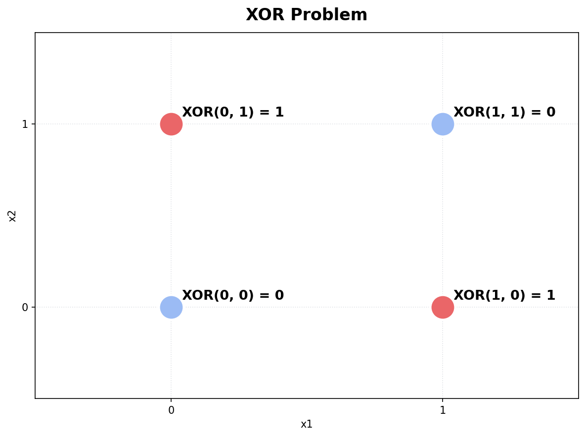
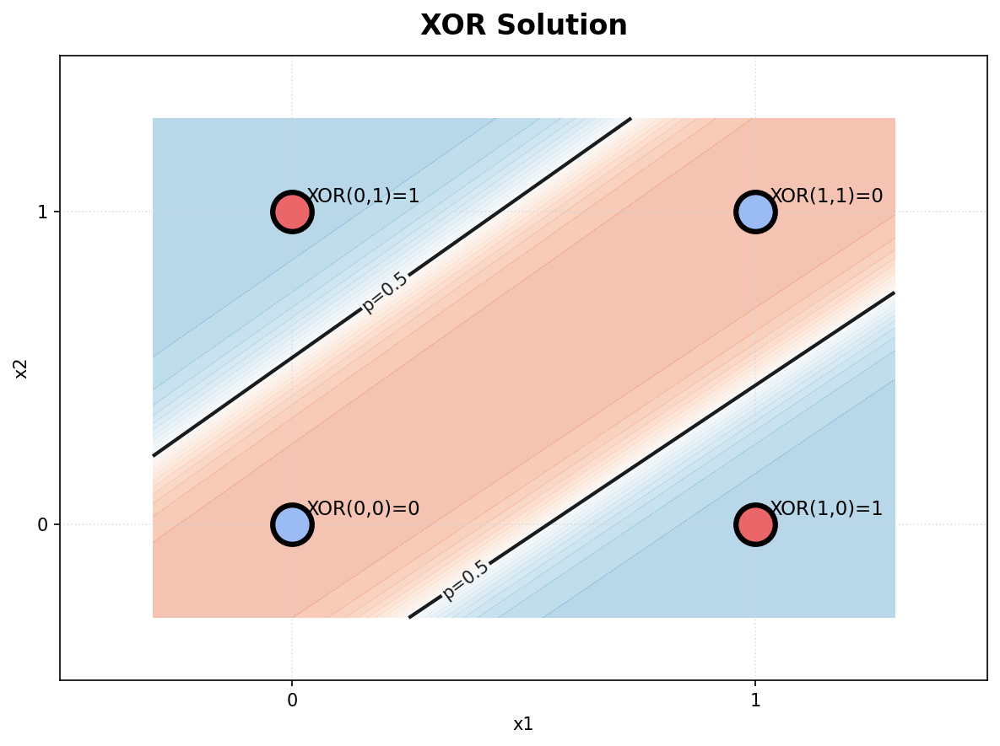
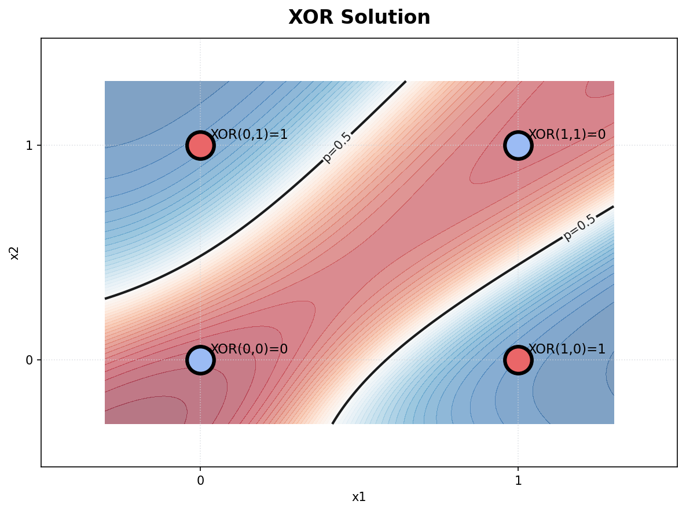

# 01 · 反向传播与自动微分

用纯 Python 手写一个标量自动微分引擎，再用它从零搭建 MLP 解决 XOR 问题；最后给出 PyTorch 对照实现，验证两者训练结果一致。

本模块回答三个问题：计算图怎么建、梯度怎么沿图反向流、非线性层为什么必需。

## 核心实现

`xor_python.py` 中只有一个 `Value` 类，所有运算和网络结构都建立在它之上。

| 组件 | 作用 |
|:---|:---|
| `Value` | 标量节点，持有 `data`、`grad`、`_backward` 和父节点集合 |
| 运算符重载（`+` `-` `*` `**`） | 前向计算时自动记录计算图，并挂载各自的局部梯度函数 |
| `relu` / `tanh` / `sigmoid` | 激活函数，同样以节点形式接入计算图 |
| `backward` | 先拓扑排序，把输出梯度置 1，再逆序遍历调用 `_backward` |

几个实现细节：

- 梯度用 `+=` 累加，因为一个节点可能被多条路径复用，必须求和而不是覆盖；对应地，训练循环里要手动清零 `p.grad`。
- `backward` 必须在 **拓扑序的逆序** 上执行，否则某个节点会在下游梯度还没到齐时先算梯度。
- `sum([...], self.b)` 用 `Value` 作起点，避免 `0 + Value` 丢失计算图。
- 反向公式直接写成代码：`tanh` 是 $`1 - y^{2}`$，`sigmoid` 是 $`\sigma(1-\sigma)`$，幂函数是 $`k x^{k-1}`$。

网络结构按 `Value → Neuron → Layer → MLP` 逐层组合：`Neuron` 做加权求和加偏置再过激活，`Layer` 并排多个神经元，`MLP` 串联多层，最后接 `sigmoid` 把输出压到 $(0,1)$。

## 为什么需要隐藏层

XOR 的四组样本 `(0,0)→0`、`(0,1)→1`、`(1,0)→1`、`(1,1)→0` 在二维平面上线性不可分——对角样本标签相同，任何一条直线都切不开。



所以这里的 MLP 采用 `2 → 3 → 1` 结构：3 个 `tanh` 隐藏神经元先把输入映射到可分空间，输出层再用 `sigmoid` 给出概率。隐藏层是这个例子的关键，也是后面所有深层模型的最小原型。

## 文件结构

```text
01-backpropagation-from-scratch/
├── README.md
├── xor_python.py          # 手写 Value + Neuron/Layer/MLP，训练 XOR
├── xor_pytorch.py         # PyTorch 对照实现（nn.Sequential + MSELoss + SGD）
├── assets/                # 文档配图
│   ├── xor_problem.png        # XOR 原始数据分布
│   ├── xor_solution_py.png    # 手写实现的分类结果
│   └── xor_solution_pth.png   # PyTorch 实现的分类结果
└── utils/
    ├── xor_problem_vis.py     # 原始数据分布可视化（生成 xor_problem.png）
    └── xor_solution_vis.py    # 决策区域可视化（生成 xor_solution_*.png）
```

## 运行

两个脚本都含本地导入，需要先进入目录再执行。

```bash
cd 01-backpropagation-from-scratch
python xor_python.py     # 手写实现，2000 轮，lr=0.05
python xor_pytorch.py    # PyTorch 实现，2000 轮，lr=0.1
```

依赖：`torch`、`numpy`、`matplotlib`。

图片统一输出到 `assets/`：背景色是模型对网格上每个点的预测概率，两条黑线是 $`p=0.5`$ 的决策边界，四个圆点标注真实标签。

## 结果

### 手写实现



### PyTorch 实现



两种实现的 MSE 损失都能降到很低的水平，决策边界都是把对角样本划为同一类的曲线，背景呈现清晰的蓝红分区。

差异只在超参（手写用 `lr=0.05`，PyTorch 用 `lr=0.1`）和随机初始化，收敛行为一致。这正好说明手写引擎的梯度是对的——PyTorch 的 `loss.backward()` 在这里做的事，就是 `Value.backward()` 的拓扑排序加逐节点反向。
