# 旋转位置编码（RoPE）

旋转位置编码（Rotary Position Embedding，RoPE）出自论文 https://arxiv.org/pdf/2104.09864；核心思想是：**用一组旋转矩阵把位置信息注入 query 和 key 向量，使注意力分数只依赖于 token 之间的相对位置，而不是绝对位置本身**。由于实现简单、外推性好，RoPE 已成为 LLaMA、Mistral、Gemma、Qwen 等主流大语言模型的标准位置编码方案。


```math
\begin{aligned} R_{\Theta,m}^d = \begin{pmatrix} \cos m\theta_0 & -\sin m\theta_0 & 0 & 0 & \cdots & 0 & 0 \\ \sin m\theta_0 & \cos m\theta_0 & 0 & 0 & \cdots & 0 & 0 \\ 0 & 0 & \cos m\theta_1 & -\sin m\theta_1 & \cdots & 0 & 0 \\ 0 & 0 & \sin m\theta_1 & \cos m\theta_1 & \cdots & 0 & 0 \\ \vdots & \vdots & \vdots & \vdots & \ddots & \vdots & \vdots \\ 0 & 0 & 0 & 0 & \cdots & \cos m\theta_{d/2-1} & -\sin m\theta_{d/2-1} \\ 0 & 0 & 0 & 0 & \cdots & \sin m\theta_{d/2-1} & \cos m\theta_{d/2-1} \end{pmatrix} \end{aligned}
```

其中 $`\Theta = \{\theta_i = 10000^{-2i/d},\ i=0,2,\dots,d/2-1\}`$

本文按"理论 → 代码"两部分组织：先讲清 RoPE 的完整原理，再逐行拆解一份真实实现。

# 第一部分：理论详解

## 为什么需要位置编码

Transformer 的自注意力机制本身是**置换不变**（permutation invariant）的：如果把输入 token 的顺序打乱，注意力输出的计算结果并不会改变。然而自然语言是严格顺序敏感的——"猫追老鼠"和"老鼠追猫"含义截然不同。因此必须额外向模型注入**"每个 token 在序列中的位置索引"**（即这个 token 是序列中的第几个）这类顺序信息，这就是**位置编码**（Position Encoding）的职责。

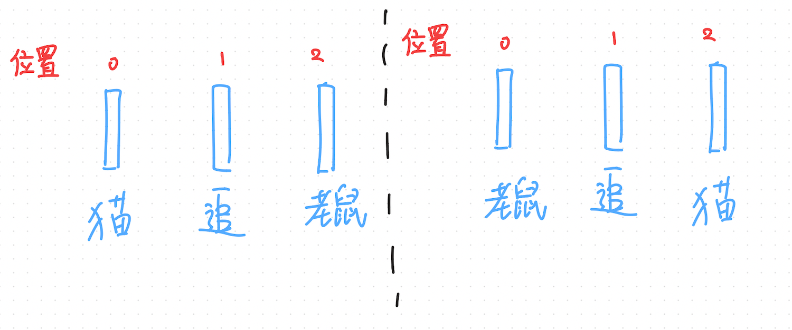

## RoPE 的核心机制

RoPE 的思路可以拆成三步：先用**旋转矩阵**把位置编码进二维向量，再把二维旋转推广到高维，最后让注意力天然只"看见"相对位置。

### 二维情形：位置就是角度

先把词向量（假设有二维）看作**二维平面**上的一个向量 $`x`$（列向量）。对于位置 $`m`$，用一个旋转矩阵 $`R(m\theta)`$ 对向量做旋转，得到携带位置信息的表示：

```math
f(x_m, m) = R(m\theta) \cdot x_m,\quad R(m\theta)=\begin{pmatrix} \cos m\theta & -\sin m\theta \\ \sin m\theta & \cos m\theta \end{pmatrix}
```

这里 $`\theta`$ 是基准旋转频率，位置 $`m`$ 越大，向量被旋转的角度 $`m\theta`$ 越大。直观上，不同位置的向量被"拨动"到圆上不同的相位——这就是绝对位置的几何含义。

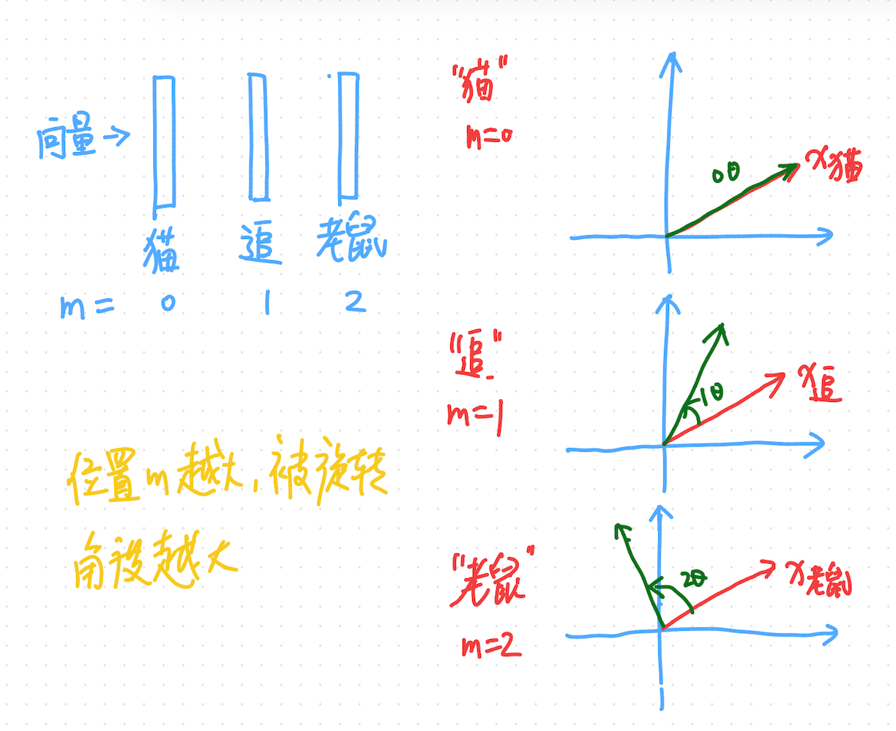

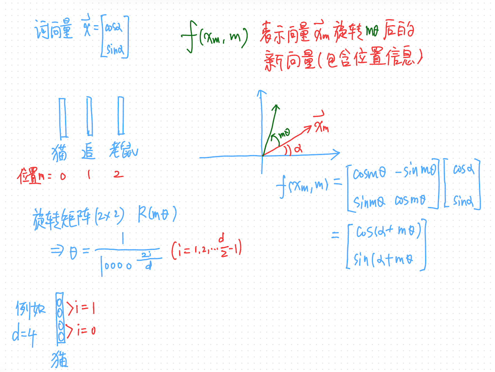

### 高维推广：分块旋转矩阵

实际模型中向量维度 $`d`$ 远大于 2。RoPE 把 $`d`$ 维空间划分成 $`d/2`$ 个二维子空间，每个子空间用**不同频率**独立旋转，频率沿维度递减（与 Sinusoidal 编码同一套公式）：

$`\theta_i = 10000^{-2i/d},\quad i=0,1,\dots,d/2-1`$

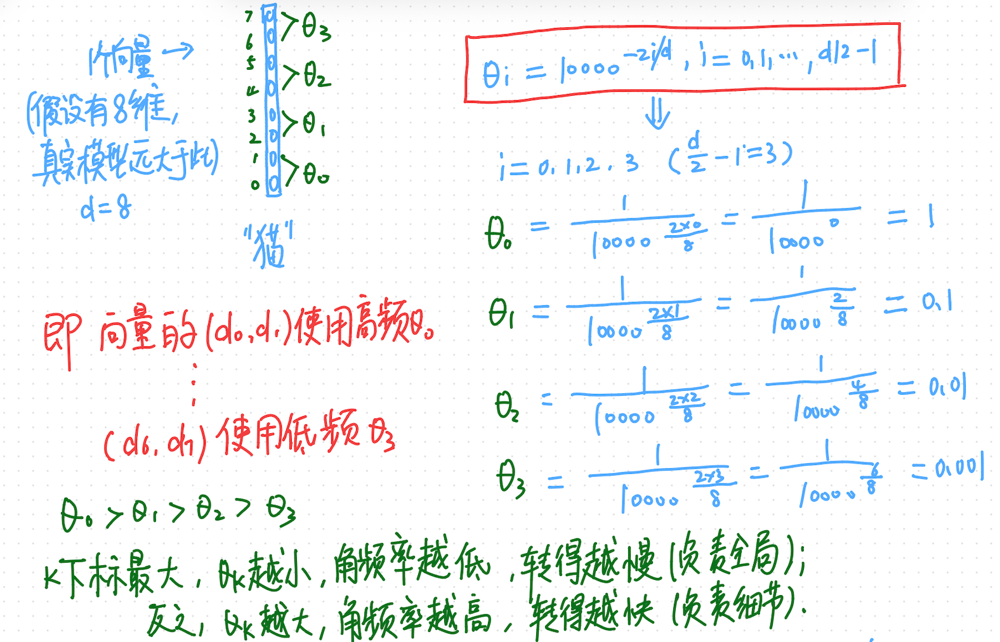


整体位置变换是一个对角分块的旋转矩阵 $`R_d(m)`$，由 $`d/2`$ 个 2×2 旋转块拼成。高频维度旋转快、分辨率高，负责精细的局部位置；低频维度旋转慢、周期长，负责大范围的全局位置——这赋予了模型不同粒度的距离感知。

完整的对角分块旋转矩阵写成如下形式：

```math
\begin{aligned} R_{\Theta,m}^d = \begin{pmatrix} \cos m\theta_0 & -\sin m\theta_0 & 0 & 0 & \cdots & 0 & 0 \\ \sin m\theta_0 & \cos m\theta_0 & 0 & 0 & \cdots & 0 & 0 \\ 0 & 0 & \cos m\theta_1 & -\sin m\theta_1 & \cdots & 0 & 0 \\ 0 & 0 & \sin m\theta_1 & \cos m\theta_1 & \cdots & 0 & 0 \\ \vdots & \vdots & \vdots & \vdots & \ddots & \vdots & \vdots \\ 0 & 0 & 0 & 0 & \cdots & \cos m\theta_{d/2-1} & -\sin m\theta_{d/2-1} \\ 0 & 0 & 0 & 0 & \cdots & \sin m\theta_{d/2-1} & \cos m\theta_{d/2-1} \end{pmatrix} \end{aligned}
```

其中 $`\Theta = \{\theta_i = 10000^{-2i/d},\ i=0,2,\dots,d/2-1\}`$

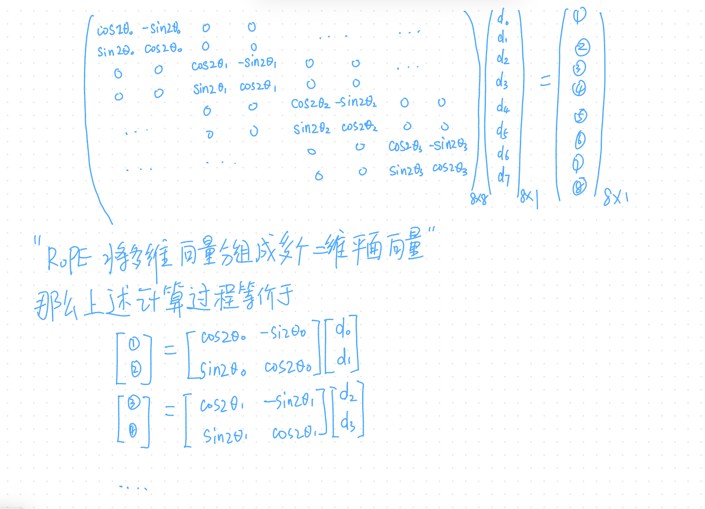

需要说明：多维向量的分组不一定是临近分组，在效果上没有区别；

⚠️ 后续的代码实现中，旋转矩阵的组织形式与上述有一些区别；

### 为什么是"相对"的

旋转的关键性质是：**两个向量同时旋转后，内积只取决于旋转角的差**。因此 query 与 key 都做位置旋转后，注意力分数只与位置差 $`n-m`$ 有关：

```math
\begin{aligned} \langle f_q(x_m,m),\ f_k(x_n,n)\rangle &= \langle R_d(m)q,\ R_d(n)k\rangle \\ &= g(q,k,n-m) \end{aligned}
```

换句话说：RoPE 用"乘法"（旋转）注入的是绝对位置，但模型实际学到的依赖关系是**纯相对**的——相隔 k 步的两个 token，无论在序列哪里，其注意力关系保持一致。这就是它同时具备两类位置编码优点的原因。

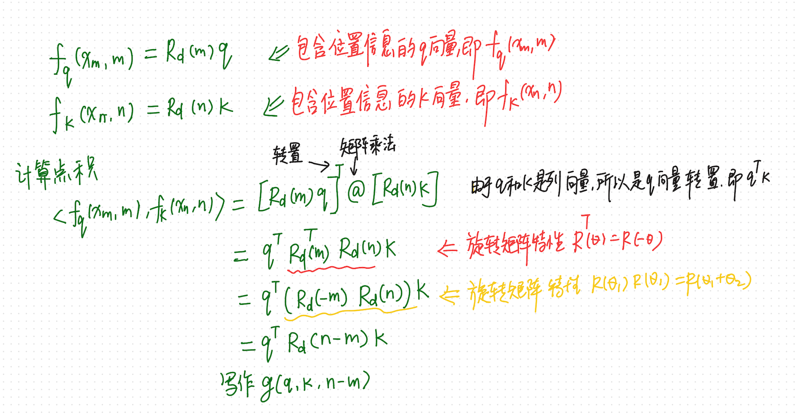

补充旋转矩阵特性

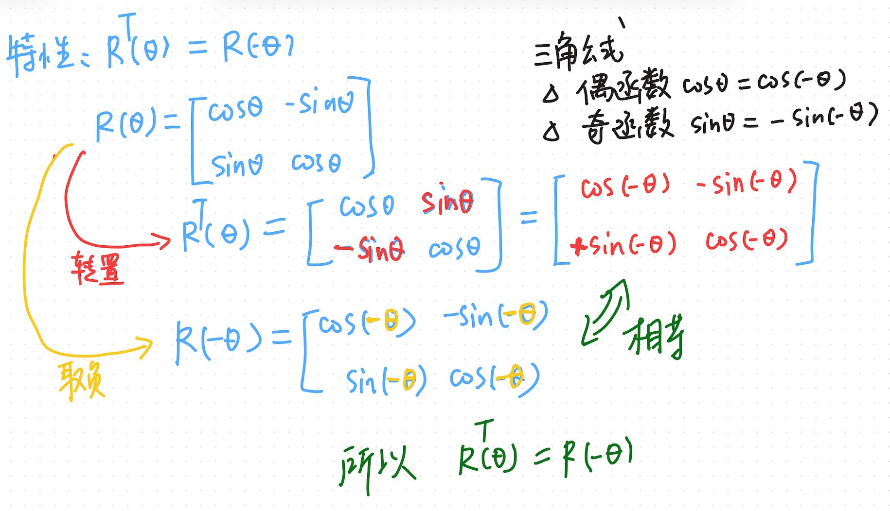

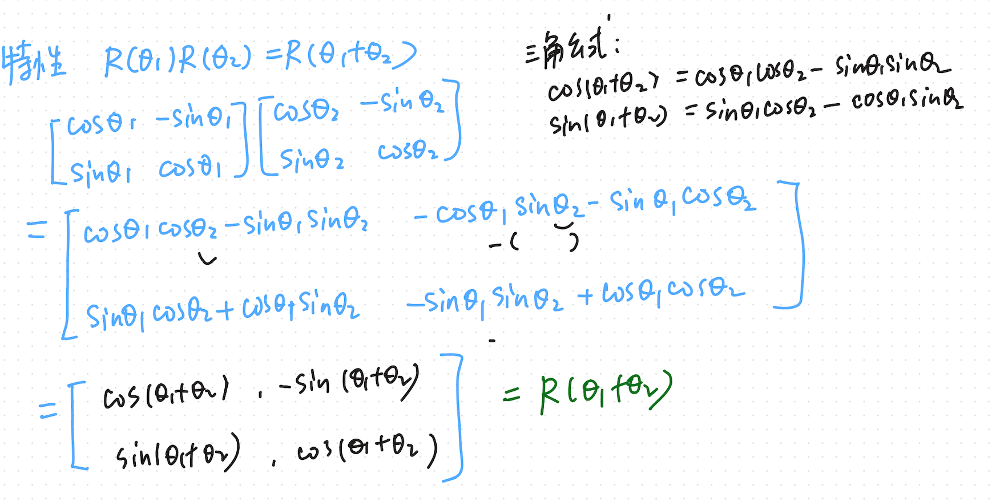

## RoPE 的三大关键性质

|性质|含义|实际收益|
|---|---|---|
|相对位置依赖|注意力分数只取决于 token 间距 n−m|同一距离的关系在序列任意位置一致，泛化到未见过的长度|
|远程衰减|内积随相对距离增大而衰减|符合语言直觉：相隔越远的词关联越弱，注意力更聚焦|
|长度外推|无需重训即可处理超过训练长度的序列|训练时用短序列，推理时可扩展到更长上下文|

## 长文本扩展：从 4K 到 2M

RoPE 的旋转角与位置 m 线性挂钩，一旦推理位置超过训练范围，旋转角会超出模型见过的区间，导致注意力退化。为此业界发展出一系列"缩放旋转角"的扩展技术：位置插值、YARN等；

这些方法都不改变 RoPE 的架构本身，只调整**旋转频率**与**缩放策略**，这也是 RoPE 生态强大之处——同一套位置编码可以不断"续命"。

# 第二部分：代码实现（逐行拆解）

## 预计算旋转表 cos / sin

```python
from __future__ import annotations  # Python 的特性，延迟求值所有类型注解

import torch
# torch.set_printoptions(precision=3, sci_mode=False) # 打印结果 将科学记数法改成小数

def precompute_freqs_cis(
        dim: int,
        max_seq_len: int,
        theta: float = 10000.0,
        device=None,
) -> tuple[torch.Tensor, torch.Tensor]:
    """预计算所有位置的 cos / sin 表。
    
    Parameters:
    ----------
    dim: 向量维度 (例如我们在理论部分提到的 d=8); 每个注意力头的维度 head_dim 
    max_seq_len: 支持的最大序列长度;
    theta: 旋转基数; 例如我们在理论部分提到的 10000

    Returns:
    ----------
    cos, sin: 预计算出的结果; 形状 [max_seq_len, dim]
    """
    inv_freq = 1.0 / (
        theta ** (torch.arange(0, dim, 2, dtype=torch.float32, device=device) / dim)
    ) # [dim/2] 
    t = torch.arange(max_seq_len) # [S]; 序列位置 0..S-1 
    freqs = torch.outer(t, inv_freq) # [S, dim/2]; 每个序列位置的各个频率, dim上两个特征共用一个频率, 所以频率数为 dim / 2
    
    # 复制一份频率, 凑满 dim 维
    emb = torch.cat([freqs, freqs], dim=-1) # [S, dim]

    return emb.cos(), emb.sin()
    
print(precompute_freqs_cis(8, 3))
# (tensor([[ 1.0000,  1.0000,  1.0000,  1.0000,  1.0000,  1.0000,  1.0000,  1.0000],
#         [ 0.5403,  0.9950,  0.9999,  1.0000,  0.5403,  0.9950,  0.9999,  1.0000],
#         [-0.4161,  0.9801,  0.9998,  1.0000, -0.4161,  0.9801,  0.9998,  1.0000]]), tensor([[0.0000, 0.0000, 0.0000, 0.0000, 0.0000, 0.0000, 0.0000, 0.0000],
#         [0.8415, 0.0998, 0.0100, 0.0010, 0.8415, 0.0998, 0.0100, 0.0010],
#         [0.9093, 0.1987, 0.0200, 0.0020, 0.9093, 0.1987, 0.0200, 0.0020]]))
```

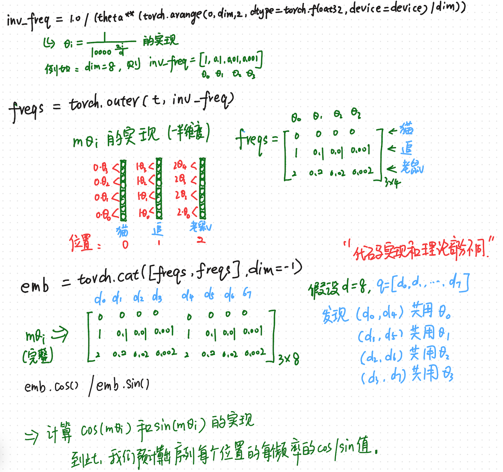

## 半旋取负操作（复数的i乘法）

```python
def rotate_half(x: torch.Tensor) -> torch.Tensor:
    """半旋转并取负数操作
    
    Example:
        >>> import torch 
        >>> x = torch.tensor([[1,2,3,4]])
        >>> rotate_half(x)
        torch.tensor([[-3.,-4.,1.,2.]])
    """
    x1 = x[..., : x.shape[-1] // 2]
    x2 = x[..., x.shape[-1] // 2 : ]
    return torch.cat((-x2, x1), dim=-1)
```

以往文档将这部分叫做“复数运算”，我们不纠结；这么变换为了后续代码好操作，叫什么名称不重要。

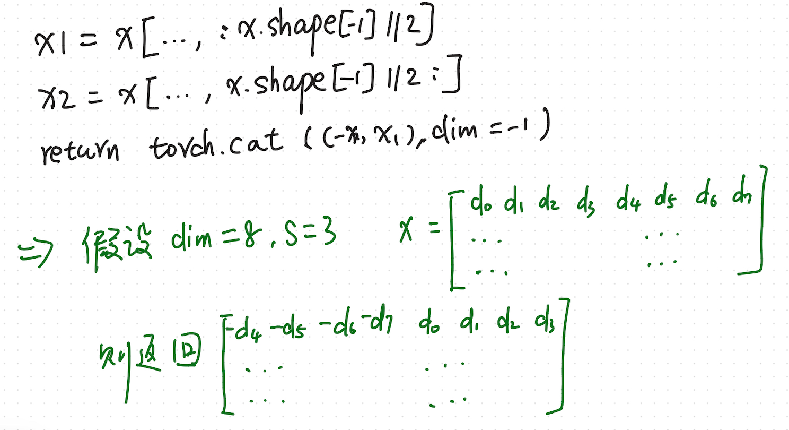

## 【核心】查表施加旋转

```python
def apply_rotary_pos_emb(
    q: torch.Tensor,
    k: torch.Tensor,
    cos: torch.Tensor,
    sin: torch.Tensor,
    position_ids: torch.Tensor,
) -> tuple[torch.Tensor, torch.Tensor]:
    """ 对 q/k 施加位置旋转, 变成带位置信息的 q_embed/k_embed. 

    Parameters:
    ----------
    q, k: [batch, heads, seq, head_dim]; 为了后续可将该函数植入真实模型, 所以直接支持多头+batch形式
    cos, sin: [max_seq_len, head_dim]
    position_ids: [batch, seq] 或 [seq]
    
    Returns:
    ----------
    q_embed/k_embed: 带位置信息的向量
    """
    # 按 position_ids 查表 -> [S, D] (1D 位置) 或 [B, S, D] (2D 位置)
    cos = cos[position_ids] # 根据位置m取 该位置下的各个频率cos
    if cos.dim() == 2:
        cos = cos.unsqueeze(0) # [1, seq, D]补 batch 维; 如果 position_ids 的 shape 为 [seq], 则 cos 的 shape 为 [seq, dim], cos.unsqueeze(0) 的 shape 为 [1, seq, dim
    cos = cos.unsqueeze(1) # 每一个样本需要1组位置编码即可
    
    sin = sin[position_ids] # 同上
    if sin.dim() == 2:
        sin = sin.unsqueeze(0)
    sin = sin.unsqueeze(1)
    
    # 旋转公式
    q_embed = q * cos + rotate_half(q) * sin 
    k_embed = k * cos + rotate_half(k) * sin
    return q_embed, k_embed 
```

示例展示查表过程：

**cos 值示例**（假设 cos 的 shape 为 `[max_seq_len=3, head_dim=4]`）：

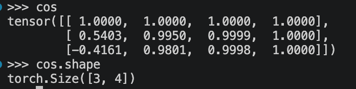

- **position_ids 为一维向量**（例如 shape=`[2]`）：

    - `cos[position_ids]` 相当于取 cos 的第 i（i=1,2）行的结果：

        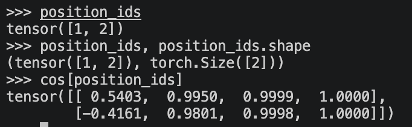

    - `cos[position_ids].unsqueeze(0)`：表示 1 个 batch 有 1 个样本序列；

    - `cos[position_ids].unsqueeze(1)`：表示 1 个 batch 有 1 个样本序列，每个样本序列需要 1 组位置编码。

        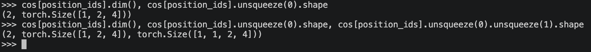

- **position_ids 为二维向量**（例如 shape=`[2,2]`，第一个 2 表示 batch，说明有两个样本序列；第二个 2 表示序列位置，说明取出一个序列中的两个位置）：

    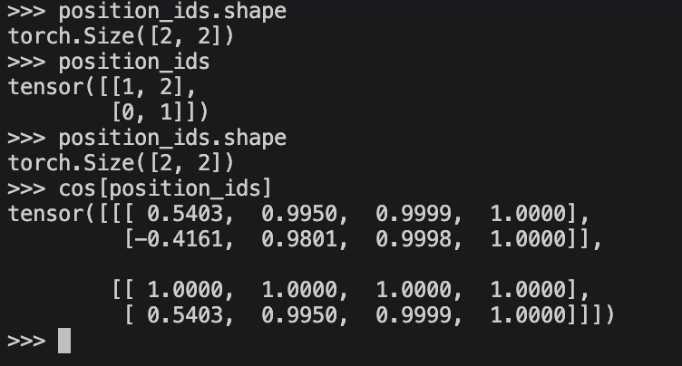

    - `cos[position_ids].unsqueeze(1)`：cos[position_ids] 已经包含了 batch，所以只要进行 `unsqueeze(1)` 即可，表示 batch 的每个样本序列中需要 1 组位置编码。

        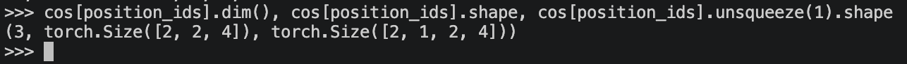

旋转公式理解（我认为这部分理解起来稍微复杂一些，需要换个角度）：

```python
# 旋转公式
q_embed = q * cos + rotate_half(q) * sin
k_embed = k * cos + rotate_half(k) * sin
return q_embed, k_embed
```

考虑到相关方均为多维向量，进行合理简化；

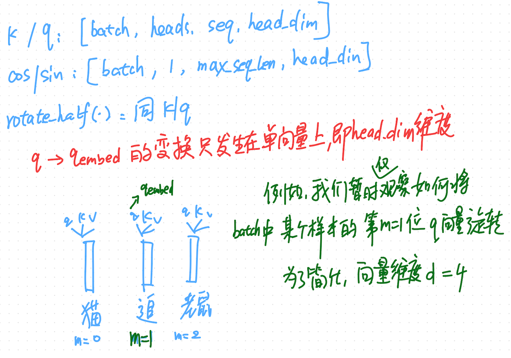

问题简化如下：

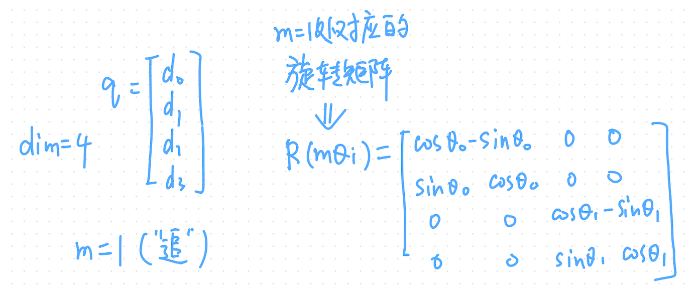

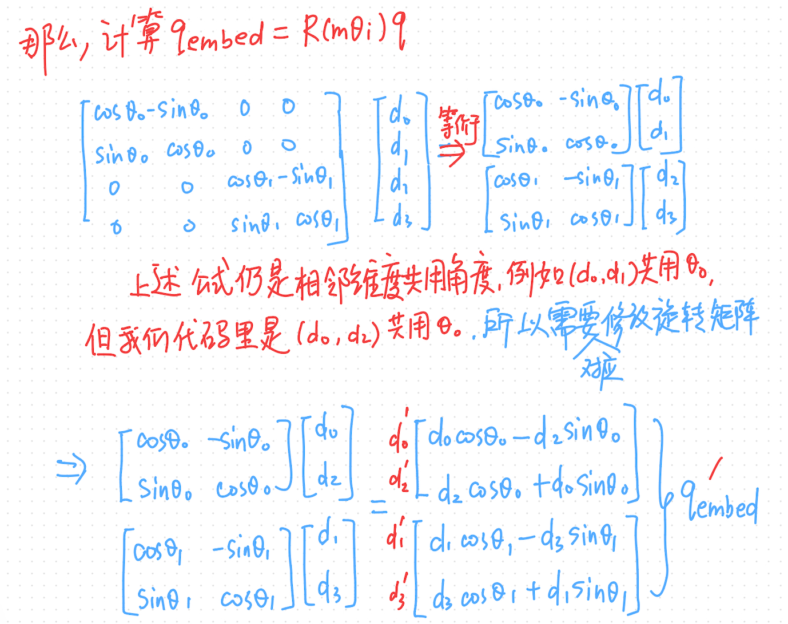

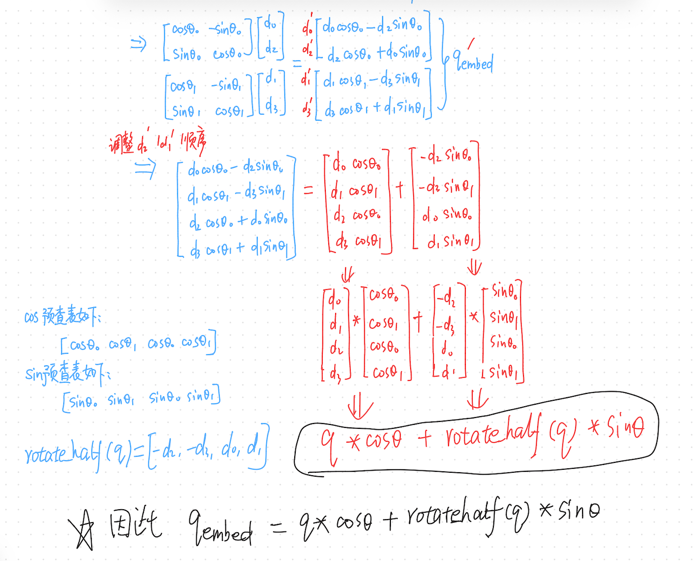

**关键点**：q 和 k 使用**同一张** cos/sin 表、按各自的 position_ids 分别旋转——旋转角差自然就是 (n−m)θ，注意力分数因此只依赖相对位置，这是整份代码对理论部分最核心的还原。

## RotaryEmbedding：零参数模块封装

```python
class RotaryEmbedding(nn.Module):
    """RoPE 模块：预计算表 + 应用旋转。无任何可学习参数。"""

    def __init__(self, dim, max_seq_len=2048, theta=10000.0):
        super().__init__()
        self.dim, self.max_seq_len, self.theta = dim, max_seq_len, theta
        cos, sin = precompute_freqs_cis(dim, max_seq_len, theta)
        # register_buffer：随模型保存/加载、随 .to(device) 迁移，但不参与梯度
        self.register_buffer("cos", cos)
        self.register_buffer("sin", sin)

    def forward(self, q, k, position_ids):
        return apply_rotary_pos_emb(q, k, self.cos, self.sin, position_ids)
```

最后用一个 nn.Module 把整条链路封装起来。两个要点：

- **register_buffer**：cos/sin 表不参与梯度计算，但会随模型 `.to(device)` 迁移、随 checkpoint 保存/加载——这正是"零参数但需要随模型走"的最佳实现方式

- **forward 只做转发**：直接调用 apply_rotary_pos_emb，不引入任何额外逻辑，保证训练与推理行为一致

## 自校验：代码自己证明正确性

该文件自带 `__main__` 自校验，验证了 RoPE 的三条核心性质，可在本地直接运行复现：

|校验项|断言|验证的理论|
|---|---|---|
|范数不变|旋转前后向量范数差 $`< 1e-5`$|旋转是等距变换，不改变注意力数值尺度|
|内积只依赖相对位置|同一对向量放 (1,3) 与 (5,7)，内积差 ≈ 0|位置差相同 → 注意力分数相同（相对编码）|
|位置差不同则内积不同|(1,2) 与 (1,7) 内积明显不同|旋转角差 (n−m)θ 确实携带距离信息|
|与 HF 对齐|与 transformers LLaMA 实现最大误差 $`< 1e-5`$|实现与工业界标准完全一致|

其中最值得品味的是第二条：用**同一个** q 向量和**同一个** k 向量，分别放在相距 2 步的不同位置，计算出的内积几乎相等——这正是"模型学到的是相对关系，而非绝对位置"的数值证明，也是理论部分"为什么是相对的"一次完整的实证闭环。

# 总结

旋转位置编码用一个优雅的几何操作——旋转——同时解决了绝对位置注入与相对距离建模两个问题：绝对位置通过旋转角 $`m\theta`$ 注入，注意力关系通过旋转差 $`(n-m)\theta`$ 呈现。它没有引入额外参数，却带来了相对位置编码的全部优点，并凭借频率缩放技术支撑起大模型从数千到数百万 token 的上下文扩展。回到代码，用一个简单实现基本展示了RoPE的核心内容。理解 RoPE，就理解了大模型如何处理"顺序"这一语言的基本维度。

