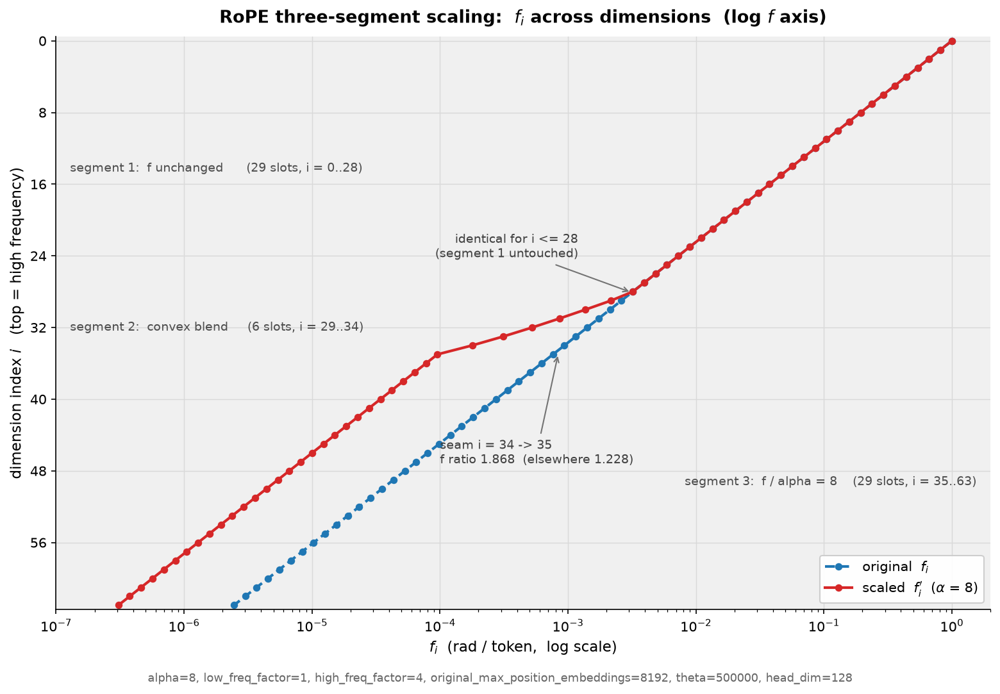
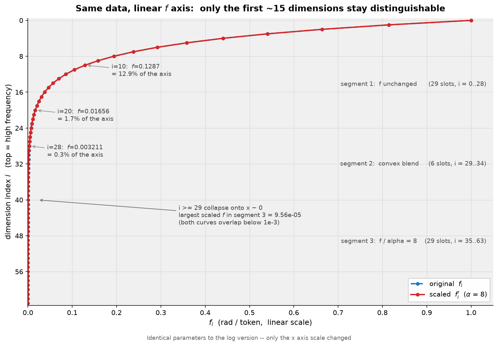

# Llama-3.1 三段式旋转位置编码（Three-Segment RoPE Scaling）

> 用一份**最小可运行的 PyTorch 实现**，把 Llama-3.1 用来从 **8192** 训练上下文扩展到 **131072** 上下文的
> `rope_type = "llama3"` 频率缩放规则看清：三段怎么分、插值权重怎么算、每个超参管什么、以及它到底改变了什么。

**一句话结论**：缩放**不增加频率槽位的数量**（恒为 $d_{\mathrm{head}}/2=64$），它把低频槽位的角频率除以 $\alpha$，把中频槽位在“除以 $\alpha$”与“保持不变”之间做凸组合，高频槽位完全不动——用**量程换精度**，让 128k 位置上的相位组合重新落回训练分布内。

| 关键事实 | 数值（Llama-3.1-8B） |
| --- | --- |
| 频率槽位数 | $64$（ $d_{\mathrm{head}}=128$ ，与缩放无关） |
| $\theta$ / $\alpha$ / $\ell$ / $h$ / $L$ | $500000$ / $8$ / $1$ / $4$ / $8192$ |
| 分界波长 | $\lambda_{\mathrm{low}}=8192$，$\lambda_{\mathrm{high}}=2048$ |
| 三段槽位分配 | 不动 $29$ 个（$i=0,\ldots,28$）、插值 $6$ 个（$i=29,\ldots,34$）、除以 $8$ 共 $29$ 个（$i=35,\ldots,63$） |
| 名义覆盖长度 | $8192\times 8=65536$ |
| 128k 映射回旧坐标 | $131072/8=16384$，仍大于 $8192$ |

---

## 目录

- [1. 为什么需要缩放：外推与插值](#1-为什么需要缩放外推与插值)
- [2. RoPE 基础：从频率到相对位置](#2-rope-基础从频率到相对位置)
- [3. 三段式规则的完整数学](#3-三段式规则的完整数学)
- [4. 手算一遍：第 32 个槽位的完整链条](#4-手算一遍第-32-个槽位的完整链条)
- [5. 逐维度数值表](#5-逐维度数值表)
- [6. PyTorch 实现与验证](#6-pytorch-实现与验证)
- [7. 图示：三种横轴刻度](#7-图示三种横轴刻度)
- [8. 超参的选择与影响](#8-超参的选择与影响)
- [9. 常见误解 FAQ](#9-常见误解-faq)
- [10. 仓库文件](#10-仓库文件)

---

## 1. 为什么需要缩放：外推与插值

RoPE 用**相位**表示位置。位置 $m$ 处、第 $i$ 个频率槽位的相位是

$$
\varphi_i(m)=m\cdot f_i
$$

模型在 $L=8192$ 的上下文上训练，意味着它只见过 $m\le 8192$ 时的相位组合。直接外推到 $m=131072$ 时，波长较短的槽位会转过几十圈甚至上千圈，落到训练时从未出现过的相位区域，注意力内积的分布随之漂移。

这里要区分两件事：

- **能否唯一编码位置**：由最慢的那个槽位决定。原始 $\theta=500000$ 时 $\lambda_{63}=2.56\times 10^{6}$，半周期约 $1.28\times 10^{6}$ token，**早就大于 128k**。所以“位置编码不下”从来不是瓶颈。
- **相位组合是否落在训练分布内**：这才是瓶颈。缩放的作用是把“外推”变成“插值”，让所有槽位在 128k 内转的圈数回到大约 $0\sim 2$ 圈。

形式上，缩放等价于**把位置轴压缩 $\alpha$ 倍**：

$$
m\cdot\frac{f_i}{\alpha}=\left(\frac{m}{\alpha}\right)\cdot f_i
$$

也就是说，物理位置 $131072$ 在新坐标里只相当于 $16384$。这正是 Position Interpolation 一族方法的核心思想。

---

## 2. RoPE 基础：从频率到相对位置

### 2.1 频率与波长

每个注意力头的维度为 $d=d_{\mathrm{head}}$，两两配对，共 $d/2$ 个频率槽位：

$$
f_i=\theta^{-2i/d},\qquad i=0,1,\ldots,\frac{d}{2}-1
$$

$$
\lambda_i=\frac{2\pi}{f_i}
$$

$f_i$ 的单位是 **rad / token**（每前进一个 token 转多少弧度），$\lambda_i$ 的单位是 **token / 圈**。

相邻槽位的频率比是常数：

$$
\frac{f_i}{f_{i+1}}=\theta^{2/d}=500000^{1/64}=1.2275704
$$

因此 64 个槽位在对数频率轴上是**等间距**的，构成一把“频率梳”。

### 2.2 旋转与相对位置

把第 $i$ 对维度 $(q_{2i},q_{2i+1})$ 看成复数，旋转就是乘 $e^{\mathrm{j}mf_i}$：

$$
\begin{pmatrix}
q'_{2i} \\
q'_{2i+1}
\end{pmatrix}
=
\begin{pmatrix}
\cos(mf_i) & -\sin(mf_i) \\
\sin(mf_i) & \cos(mf_i)
\end{pmatrix}
\begin{pmatrix}
q_{2i} \\
q_{2i+1}
\end{pmatrix}
$$

旋转矩阵正交，所以**模长不变**；两个位置 $m,n$ 上的向量做内积时，结果只依赖相对位移 $\Delta=n-m$：

$$
\langle R_m q,\;R_n k\rangle=\langle q,\;R_{n-m}k\rangle
$$

代码里的自检第 6 组直接数值验证了这两条性质。

---

## 3. 三段式规则的完整数学

### 3.1 规则本体

记 $\alpha$ 为 `factor`，$\ell$ 为 `low_freq_factor`，$h$ 为 `high_freq_factor`，$L$ 为 `original_max_position_embeddings`，则

$$
\lambda_{\mathrm{low}}=\frac{L}{\ell}=8192,\qquad
\lambda_{\mathrm{high}}=\frac{L}{h}=2048
$$

$$
f_i'=
\begin{cases}
\dfrac{f_i}{\alpha}, & \lambda_i>\lambda_{\mathrm{low}} \\[6pt]
f_i, & \lambda_i<\lambda_{\mathrm{high}} \\[6pt]
(1-s_i)\dfrac{f_i}{\alpha}+s_i f_i, & \text{otherwise}
\end{cases}
$$

| 段 | 判定 | 作用 | 直觉 |
| --- | --- | --- | --- |
| 高频段 | $\lambda_i<2048$ | $f_i$ 不动 | 保住局部次序与短距离分辨率 |
| 中频段 | $2048\le\lambda_i\le 8192$ | 在 $f_i/\alpha$ 与 $f_i$ 之间凸组合 | 平滑过渡，避免硬切换 |
| 低频段 | $\lambda_i>8192$ | $f_i/\alpha$ | 拉长量程，把长距离压回训练分布 |

### 3.2 插值权重 $s_i$ 从哪里来

$s_i$ 的定义是

$$
s_i=\frac{L/\lambda_i-\ell}{h-\ell}
$$

注意 $L/\lambda_i=Lf_i/(2\pi)$ 的物理含义是：**这个槽位在原始训练长度 $L$ 内能转多少圈**。

所以 $s_i$ 就是“圈数”从 $[\ell,h]$ 归一化到 $[0,1]$ 的坐标，它是**频率空间**的归一化，而不是波长空间的线性插值。

两个端点自动吻合：

- $\lambda_i=\lambda_{\mathrm{low}}=L/\ell$ 时，$L/\lambda_i=\ell\Rightarrow s_i=0\Rightarrow f_i'=f_i/\alpha$，与低频段一致；
- $\lambda_i=\lambda_{\mathrm{high}}=L/h$ 时，$L/\lambda_i=h\Rightarrow s_i=1\Rightarrow f_i'=f_i$，与高频段一致。

**为什么不能写成 $(\lambda_i-2048)/6144$？** 那是波长空间的线性插值，方向恰好相反：正确的 $s_i$ 随 $i$ 增大而**减小**（$0.804\to 0.075$），拉伸倍数 $k$ 随 $i$ 增大而**增大**（$1.21\to 5.26$）。用波长线性插值会得到相反趋势，并且让相邻槽位的 $\lambda'$ 不再单调。

### 3.3 为什么写成 $(1-s)A+sB$

对 $s$ 做一次仿射函数 $g(s)=a+bs$，再施加两个端点条件 $g(0)=A$、$g(1)=B$，可唯一解出 $a=A$、$b=B-A$，即

$$
g(s)=A+s(B-A)=(1-s)A+sB
$$

系数和恒为 $1$，所以它是**凸组合**，取值不会越出 $[A,B]$。本场景里 $A=f_i/\alpha$、$B=f_i$，于是 $B-A=f_i(1-1/\alpha)=0.875f_i$（$\alpha=8$）。

### 3.4 闭式拉伸倍数

定义 $k_i=f_i/f_i'=\lambda_i'/\lambda_i$，则三段统一写成

$$
k(s)=\frac{\alpha}{1-s+\alpha s},\qquad
\lambda_i'=\lambda_i\cdot k(s_i)
$$

端点检验：$s=0\Rightarrow k=\alpha$；$s=1\Rightarrow k=1$。中间示例：

| $\lambda$ | $s$ | $k$ |
| --- | --- | --- |
| $8192$ | $0$ | $8$ |
| $6000$ | $0.1218$ | $4.319$ |
| $4442.9$ | $0.2813$ | $2.695$ |
| $3000$ | $0.5769$ | $1.588$ |
| $2048$ | $1$ | $1$ |

---

## 4. 手算一遍：第 32 个槽位的完整链条

$d=128$、$\theta=500000$、$\alpha=8$、$\ell=1$、$h=4$、$L=8192$。

**第 1 步：频率**（$-2i/d=-2\times 32/128=-0.5$）

$$
f_{32}=500000^{-0.5}=\frac{1}{\sqrt{500000}}=\frac{1}{707.106781}=1.414214\times 10^{-3}
$$

**第 2 步：波长**

$$
\lambda_{32}=\frac{2\pi}{1.414214\times 10^{-3}}=4442.883
$$

**第 3 步：判定分段**：$2048\le 4442.883\le 8192$，落在**中频段**。

**第 4 步：插值权重**

$$
s_{32}=\frac{8192/4442.883-1}{4-1}=\frac{1.843848-1}{3}=0.281283
$$

**第 5 步：凸组合**（先算 $f_{32}/8=1.767767\times 10^{-4}$）

$$
\begin{aligned}
f_{32}'
&=(1-0.281283)\times 1.767767\times 10^{-4}+0.281283\times 1.414214\times 10^{-3} \\
&=1.270525\times 10^{-4}+3.977937\times 10^{-4} \\
&=5.248462\times 10^{-4}
\end{aligned}
$$

**第 6 步：拉伸倍数与新波长**

$$
k_{32}=\frac{8}{1-0.281283+8\times 0.281283}=\frac{8}{2.968981}=2.6945
$$

$$
\lambda_{32}'=4442.883\times 2.6945=11971.48
$$

**第 7 步：128k 内圈数**

$$
\frac{131072}{4442.883}=29.50
\;\longrightarrow\;
\frac{131072}{11971.48}=10.95
$$

---

## 5. 逐维度数值表

以下数字由 `python3 rope_llama3.py` 直接打印，非手填。$k$ 为波长拉伸倍数，最后一列是缩放后在 131072 token 内转的圈数。

| $i$ | 段 | $f_i$ | $\lambda_i$ | $s_i$ | $k_i$ | $f_i'$ | $\lambda_i'$ | 圈数@128k |
| --- | --- | --- | --- | --- | --- | --- | --- | --- |
| 0 | 不动 | $1.000000$ | $6.283$ | $1$ | $1.0000$ | $1.000000$ | $6.283$ | $20860.76$ |
| 10 | 不动 | $1.286874\times 10^{-1}$ | $48.825$ | $1$ | $1.0000$ | $1.286874\times 10^{-1}$ | $48.825$ | $2684.52$ |
| 28 | 不动 | $3.211446\times 10^{-3}$ | $1956.497$ | $1$ | $1.0000$ | $3.211446\times 10^{-3}$ | $1956.497$ | $66.99$ |
| 29 | 插值 | $2.616099\times 10^{-3}$ | $2401.738$ | $0.80362$ | $1.2075$ | $2.166571\times 10^{-3}$ | $2900.060$ | $45.20$ |
| 30 | 插值 | $2.131120\times 10^{-3}$ | $2948.303$ | $0.59285$ | $1.5534$ | $1.371894\times 10^{-3}$ | $4579.936$ | $28.62$ |
| 31 | 插值 | $1.736047\times 10^{-3}$ | $3619.249$ | $0.42115$ | $2.0263$ | $8.567514\times 10^{-4}$ | $7333.732$ | $17.87$ |
| 32 | 插值 | $1.414214\times 10^{-3}$ | $4442.883$ | $0.28128$ | $2.6945$ | $5.248462\times 10^{-4}$ | $11971.480$ | $10.95$ |
| 33 | 插值 | $1.152043\times 10^{-3}$ | $5453.952$ | $0.16734$ | $3.6843$ | $3.126938\times 10^{-4}$ | $20093.735$ | $6.52$ |
| 34 | 插值 | $9.384739\times 10^{-4}$ | $6695.109$ | $0.07453$ | $5.2573$ | $1.785078\times 10^{-4}$ | $35198.377$ | $3.72$ |
| 35 | $\div 8$ | $7.644970\times 10^{-4}$ | $8218.718$ | $0$ | $8.0000$ | $9.556212\times 10^{-5}$ | $65749.746$ | $1.99$ |
| 36 | $\div 8$ | $6.227724\times 10^{-4}$ | $10089.055$ | $0$ | $8.0000$ | $7.784655\times 10^{-5}$ | $80712.441$ | $1.62$ |
| 40 | $\div 8$ | $2.742482\times 10^{-4}$ | $22910.582$ | $0$ | $8.0000$ | $3.428102\times 10^{-5}$ | $183284.656$ | $0.72$ |
| 63 | $\div 8$ | $2.455141\times 10^{-6}$ | $2559195.517$ | $0$ | $8.0000$ | $3.068926\times 10^{-7}$ | $20473564.139$ | $0.0064$ |

**接缝处的一个细节**：$i=34$ 仍属混合带（只压 $5.2573$ 倍），$i=35$ 突然被压满 $8$ 倍，因此

$$
\frac{f_{34}'}{f_{35}'}=1.8679766\ne 1.2275704
$$

频率仍然单调下降，但频率梳在这里出现了一个“空档”。这是三段拼接留下的可见痕迹。

---

## 6. PyTorch 实现与验证

### 6.1 最小实现（推荐先读这份）

`rope_llama3_minimal.py` 在标准 RoPE 的 `precompute_freqs_cis / rotate_half / apply_rotary_pos_emb / RotaryEmbedding` 之上**只新增一个 `llama3_inv_freq`**，三段逻辑约 25 行；`rope_scaling=None` 时与原标准 RoPE 完全一致。

```python
inv_freq = 1.0 / (theta ** (torch.arange(0, dim, 2).float() / dim))  # 未缩放的 f_i
wavelen = 2 * math.pi / inv_freq  # 波长 lambda_i，单位 token/圈
wavelen_low = original_max_seq_len / low_freq_factor  # 8192；比它长 -> 低频段
wavelen_high = original_max_seq_len / high_freq_factor  # 2048；比它短 -> 高频段

is_low = wavelen > wavelen_low
is_high = wavelen < wavelen_high
is_mid = ~(is_low | is_high)

# s：L/lambda 是“原训练长度内转的圈数”，从 [ell, h] 归一化到 [0, 1]
s = (original_max_seq_len / wavelen - low_freq_factor) / (high_freq_factor - low_freq_factor)
s = s.clamp(0.0, 1.0)

inv_freq_scaled = torch.where(is_low, inv_freq / factor, inv_freq)  # 低频 ÷ alpha，高频不动
inv_freq_mid = (1.0 - s) * inv_freq / factor + s * inv_freq  # 中频凸组合
inv_freq = torch.where(is_mid, inv_freq_mid, inv_freq_scaled)
```

两个 `torch.where` 的分工：先按低频段/高频段得到两端分支，再只在中频段覆盖成凸组合。之后的 `torch.outer(t, inv_freq)` → `cat` → `cos/sin` 与标准 RoPE 完全一样，下游不用改。

调用方式只是多传一个 dict：

```python
scaling = {
    "rope_type": "llama3",
    "factor": 8.0,
    "low_freq_factor": 1.0,
    "high_freq_factor": 4.0,
    "original_max_seq_len": 8192,  # 对应 HF 的 original_max_position_embeddings
}

rope = RotaryEmbedding(
    dim=128,
    max_seq_len=16,
    theta=500000.0,
    rope_scaling=scaling,
)
q_embed, k_embed = rope(q, k, torch.arange(4))  # q, k: [batch, heads, seq, head_dim]
```

运行与实测输出：

```bash
python3 rope_llama3_minimal.py
```

```text
三段槽位数: 不动 29 / 插值 6 / 除以8 29
i=28  lambda=    1956.497  f=3.211446e-03  f'=3.211446e-03  k=1.0000
i=29  lambda=    2401.738  f=2.616099e-03  f'=2.166571e-03  k=1.2075
i=32  lambda=    4442.883  f=1.414213e-03  f'=5.248460e-04  k=2.6945
i=35  lambda=    8218.719  f=7.644970e-04  f'=9.556212e-05  k=8.0000
i=63  lambda= 2559195.750  f=2.455141e-06  f'=3.068926e-07  k=8.0000
q_embed: torch.Size([1, 2, 4, 128])  k_embed: torch.Size([1, 2, 4, 128])
旋转前后模长一致: True
```

### 6.2 完整版：自检与官方实现比对

`rope_llama3.py` 在同一份规则之外补充了配置合法性校验、逐维度 `slot_report`，以及 7 组自检：

```bash
python3 rope_llama3.py
```

| 自检 | 内容 |
| --- | --- |
| 1 | 代数形式、HuggingFace 风格形式、纯 Python 循环参考实现三者一致 |
| 2 | 三段槽位数为 $29/6/29$；高频段与原频率逐位相等；低频段严格等于 $f/8$ |
| 3 | 中频段严格落在 $(f/\alpha,f)$ 之间，排除“双重除法” |
| 4 | $f'$ 仍随 $i$ 严格单调下降 |
| 5 | 闭式 $k(s)$ 在两个端点分别等于 $\alpha$ 与 $1$ |
| 6 | 旋转保模长、内积只依赖相对位移 |
| 7 | $\lambda'/\lambda=k$，128k 内圈数恰好除以 $\alpha$ |

若环境装有 `transformers`，脚本还会与官方实现逐元素比对：

```text
[hf compare] shape match=True, max |ours - HF| = 0.000e+00, allclose(rtol=1e-6)=True
```

并且 `rope_llama3_minimal.py` 的 `llama3_inv_freq(128)` 与该结果 **`torch.equal` 逐位相等**——精简版只是去掉了工程化包装，没有引入任何数值偏差。

---

## 7. 图示：三种横轴刻度

三图共用同一份数据（$d=128$、$\theta=500000$、$\alpha=8$、$\ell=1$、$h=4$、$L=8192$），纵轴都是维度下标、顶部为高频。

**对数横轴**：三段结构最清晰——第一段两线重合、第二段分离、第三段平行左移 $\log_{10}8=0.903$ 个数量级。



**线性横轴**：只剩前约 15 个维度可辨，$i\ge 29$ 全部贴到 $x\approx 0$。它直观地告诉你动态范围被最高的少数维度占满。



复现：

```bash
python3 rope_three_segment_plot.py  # 生成 fig1 / fig2
```

---

## 8. 超参的选择与影响

只改一个参数、其余保持 Llama-3.1 默认，分段结果如下（由 `llama3_segments` 实算）：

| 改动 | $\lambda_{\mathrm{low}}$ | $\lambda_{\mathrm{high}}$ | 不动 | 插值 | $\div\alpha$ |
| --- | --- | --- | --- | --- | --- |
| 默认 $\ell=1,h=4$ | $8192$ | $2048$ | $29$（$0$–$28$） | $6$（$29$–$34$） | $29$（$35$–$63$） |
| $h=2$ | $8192$ | $4096$ | $32$（$0$–$31$） | $3$（$32$–$34$） | $29$（$35$–$63$） |
| $h=8$ | $8192$ | $1024$ | $25$（$0$–$24$） | $10$（$25$–$34$） | $29$（$35$–$63$） |
| $\ell=2$ | $4096$ | $2048$ | $29$（$0$–$28$） | $3$（$29$–$31$） | $32$（$32$–$63$） |
| $\ell=0.5$ | $16384$ | $2048$ | $29$（$0$–$28$） | $10$（$29$–$38$） | $25$（$39$–$63$） |
| $\theta=10000$ | $8192$ | $2048$ | $41$（$0$–$40$） | $9$（$41$–$49$） | $14$（$50$–$63$） |
| $\theta=10^{6}$ | $8192$ | $2048$ | $27$（$0$–$26$） | $7$（$27$–$33$） | $30$（$34$–$63$） |
| $L=4096$ | $4096$ | $1024$ | $25$（$0$–$24$） | $7$（$25$–$31$） | $32$（$32$–$63$） |
| $L=32768$ | $32768$ | $8192$ | $35$（$0$–$34$） | $7$（$35$–$41$） | $22$（$42$–$63$） |
| $\alpha=2$ 或 $16$ | $8192$ | $2048$ | $29$（$0$–$28$） | $6$（$29$–$34$） | $29$（$35$–$63$） |

旋钮语义：

- **$\alpha$ 管拉伸幅度**：只改第三段的下压量与第二段的斜率，**完全不改三段的分界位置**（最后两行可见槽位数不变）。名义覆盖长度约为 $L\times\alpha$。
- **$h$ 管“高频保住多少”**：$h$ 越大 $\Rightarrow\lambda_{\mathrm{high}}$ 越小 $\Rightarrow$ 不动的槽位越少、过渡带越宽。
- **$\ell$ 管“低频从哪开始压”**：$\ell$ 越大 $\Rightarrow\lambda_{\mathrm{low}}$ 越小 $\Rightarrow$ 更多槽位被压满 $\alpha$。
- **$\theta$ 管频率梳本身的形状**：$\theta$ 越大，低频槽位越多、越多槽位落入“除以 $\alpha$”区。注意 $\theta$ 与缩放会**叠加**：把 $\theta$ 从 $10^4$ 提到 $5\times 10^5$ 本身已经是一种频率压缩，再叠 $\alpha$ 要当心过度平滑。
- **$L$ 必须与真实训练长度一致**：填错 $L$ 会让三段整体错位，等于把缩放规则套在错误的锚点上。

---

## 9. 常见误解 FAQ

**Q1：缩放以后能支持的频率是不是变多了？**

不是。槽位数恒为 $d/2=64$，由 `head_dim` 决定，任何 $\alpha$ 都改不了。变化的是每个槽位的频率值：频率跨度从 $5.6099$ 个数量级扩到 $6.5130$（$+0.903=\log_{10}8$），低频段整体左移。要真正增加频率槽位，只能改 `head_dim`。

**Q2：相邻两个位置的相位差，是不是因为位置索引变大而改变了？**

不是。$\varphi_i(m+1)-\varphi_i(m)=f_i$，**与 $m$ 无关**。位置索引变大只让**累计相位**线性增长。让步进变化的是 $f_i$ 被除以 $\alpha$：步进 ÷8，所以位置索引才能乘到 8 倍大而仍不绕圈。等价写法是 $mf_i/\alpha=(m/\alpha)f_i$，即“压频率 ⇔ 压位置坐标”。

**Q3：代码里 `(1-s) * inv_freq_llama / factor + s * inv_freq_llama` 是不是除了两次？**

不是。HuggingFace 的写法先用 `torch.where` 得到 `inv_freq_llama`，在中频段它**恰好等于原频率 $f$**，所以中频段只除了一次。`rope_llama3.py` 里 `hf_style=True` 与代数形式逐位相等，自检第 1 组已验证。

**Q4：$s$ 需要 `clamp(0, 1)` 吗？**

不 clamp 也安全，因为 `torch.where` 只在中频段选用 `blended`，而中频段天然有 $s\in(0,1)$。加上 clamp 属于防御性写法，两者在本场景下结果一致。

**Q5：$\alpha=8$ 能把模型推到 128k 吗？**

名义覆盖是 $8192\times 8=65536$。128k 映射回旧坐标是 $16384$，仍是训练长度的 2 倍，所以 65k 以上属于继续外推，长程性能会逐步退化。要让 128k 完全“落回训练区间”，$\alpha$ 至少要 $16$（或者配合长上下文继续训练 / 微调）。

**Q6：$h=\ell$ 会怎样？**

$s_i$ 的分母为零。完整版的 `Llama3RoPEConfig.__post_init__` 会直接抛错；最小版未加这层校验，自行实验时需保证过渡带宽度非零。

**Q7：为什么 $\cos/\sin$ 要用 float32？**

旋转频率对精度敏感，bf16/fp16 下长位置的相位误差会被放大。实现中 `inv_freq` 与 `cos/sin` 均以 float32 计算，最后再转回 $q,k$ 的 dtype。

---

## 10. 仓库文件

| 文件 | 作用 |
| --- | --- |
| `rope_llama3.py` | 完整版：配置校验、`slot_report`、7 组自检、HF 官方实现比对 |
| `rope_three_segment_plot.py` | 生成对数 / 线性两种横轴的维度–频率图（fig1、fig2） |
| `fig1_rope_dim_vs_f_log.png` | 对数横轴图 |
| `fig2_rope_dim_vs_f_linear.png` | 线性横轴图 |
