# 自注意力机制（Self-Attention）

## 缩放点积注意力（Scaled Dot-Product Attention）

```math
\mathrm{Attention}(Q,K,V) = \mathrm{softmax}\!\left( \frac{QK^{\top}}{\sqrt{d_k}} \right) V
```

<p align="center">
  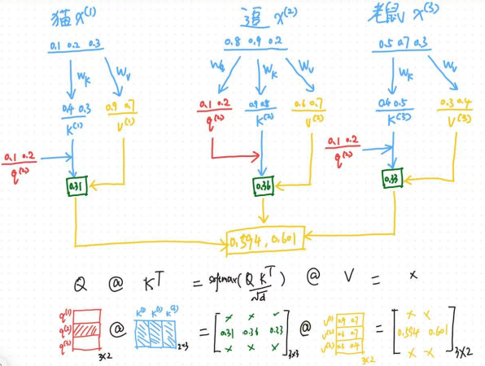
</p>

本篇要回答的四个问题：

1. **如何理解「自」和「注意力」的含义？**
2. **为什么必须是「有投影」的自注意力？** 为什么需要 q/k/v？q/k 为什么不能相同？v 为什么不能取原向量？
3. **MHA 和 GQA 的区别是什么？**
4. **参数量和时间复杂度是什么？**

## 【官方结构图】

<p align="center">
  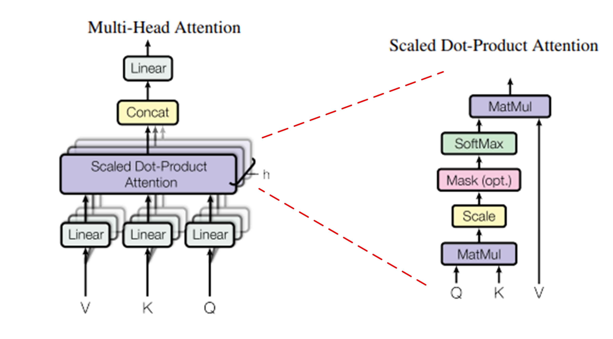
</p>

## 多头注意力（Multi-Head Attention）

```math
\begin{aligned}
\mathrm{head}_i &= \mathrm{softmax}\!\left(\frac{Q_i K_i^{\top}}{\sqrt{d_k}}\right)V_i, \\
Q_i &= Q W_Q^{(i)},\quad K_i = K W_K^{(i)},\quad V_i = V W_V^{(i)}, \\
\mathrm{MultiHead}(Q,K,V) &= \mathrm{Concat}\big(\mathrm{head}_1,\dots,\mathrm{head}_h\big) W_O .
\end{aligned}
```

<p align="center">
  
</p>

对同一个头的不同序列，`W_q` 相同；不同头的 `W_q` 不同。

## 第一部分：理论详解

### 1.1 如何理解「自」和「注意力」的含义

**【自】**：q、k、v 向量来自同一个序列。

**【注意力】**：等价于加权求和；隐向量的结果会关注来自序列不同 token 的信息（或者说，将注意力分给不同 token 向量，并有轻重取舍）。

<p align="center">
  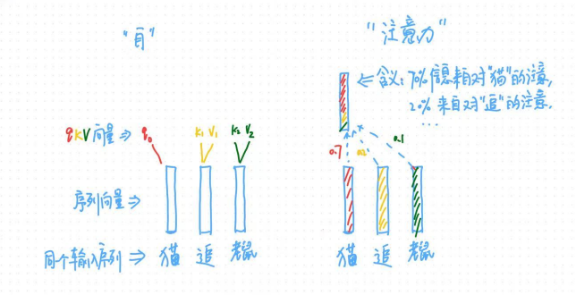
</p>

交叉注意力就是 **【不自】** 的注意力，因为 q 向量（来自解码器）和 k/v 向量（来自编码器）来自不同序列。

<p align="center">
  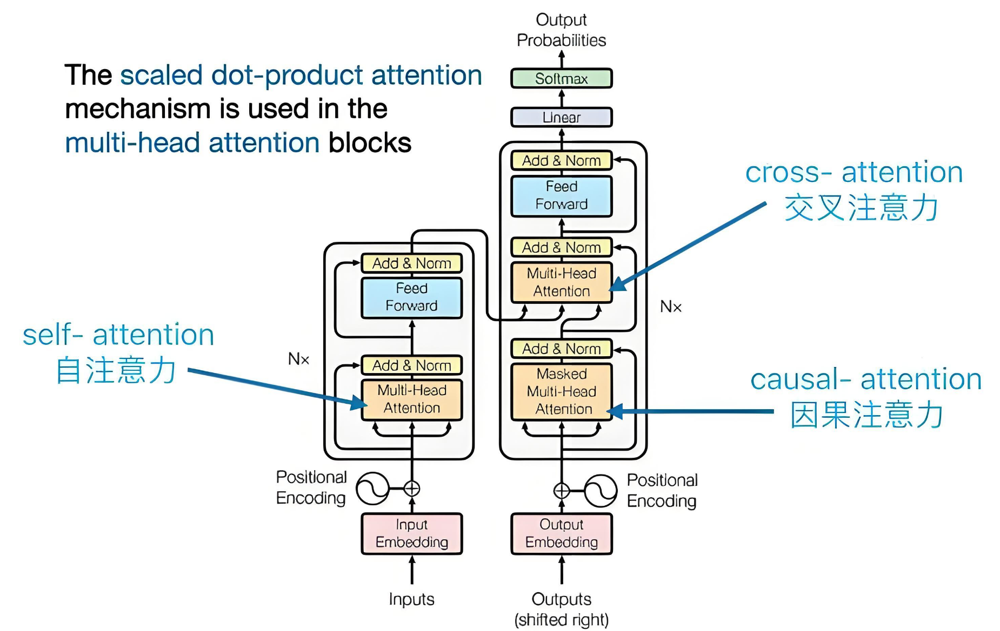
</p>

<p align="center">
  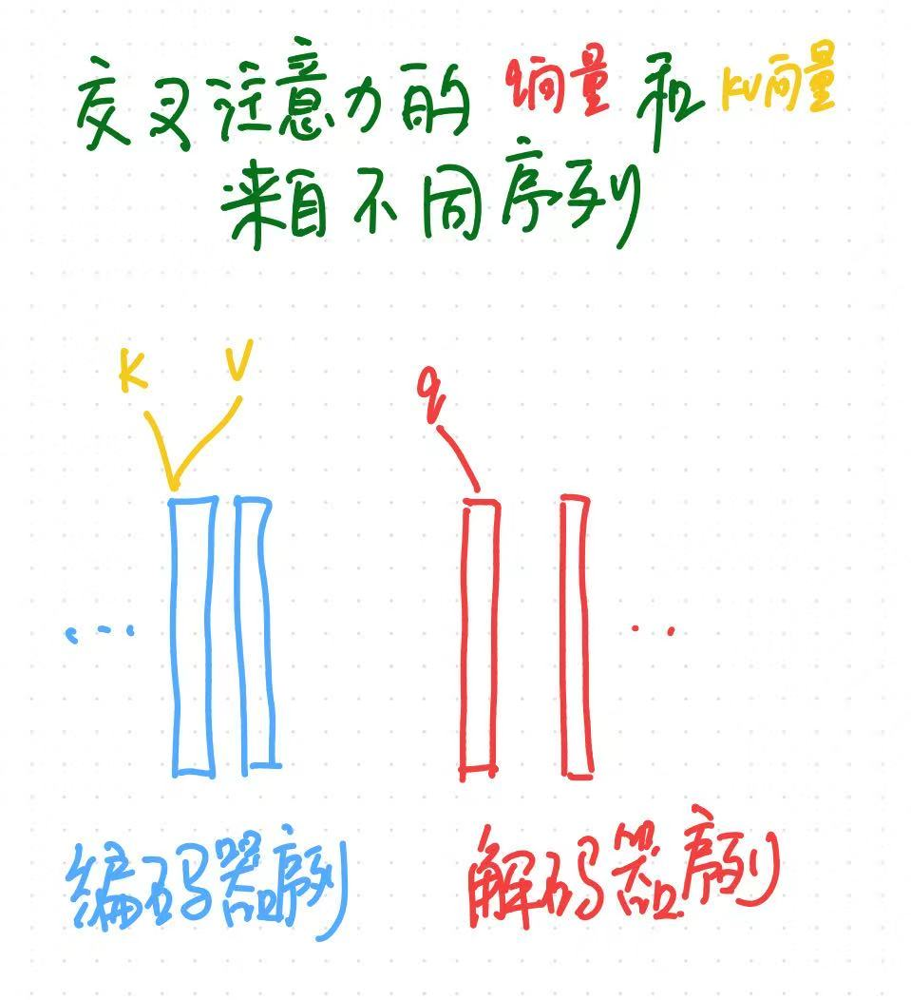
</p>

### 1.2 【无投影】的自注意力计算

<p align="center">
  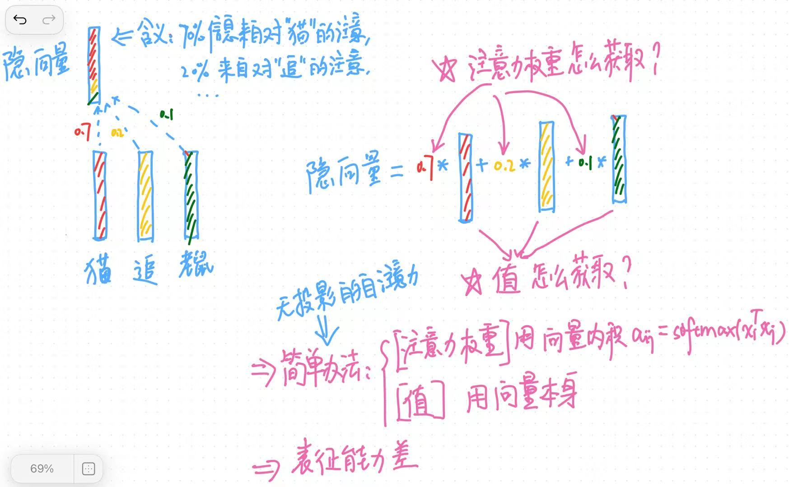
</p>

#### 表征能力弱的原因

> 极端案例：假设我希望相似度高的两个向量相关性低；例如「我玩着苹果手机，还吃着苹果」，两个「苹果」的语义相似度很高，但相关性很低。无投影的自注意力解决不了这种情况。

- **特征空间无法实现 Q/K/V 功能分工**。无投影直接令 $`Q=K=V=X`$，三者共用原始 token 嵌入空间。Q 用于表达检索需求、K 负责匹配检索、V 承载输出信息，复用同一向量会抹平检索差异性，无法分别学习检索特征和匹配特征。

- **缺少可学习投影矩阵，模型自由度不足**。带投影自注意力依靠 $`W_q,W_k,W_v`$，把原始向量映射到 3 个独立特征空间，专门优化相似度匹配；无投影没有该类参数，无法学习构造适配注意力计算的特征。

- **V 向量丧失选择性提取信息的能力**。V 直接采用原始 token 嵌入，输出仅能对原始向量加权平均，无法自主过滤冗余噪声，不能灵活挑选需要输出的语义信息，限制模型表达能力。

### 1.3 【有投影】的自注意力计算

#### 1.3.1 通俗理解 q、k、v 的合理性

以「求职过程」为例（不追求严谨性）：

<p align="center">
  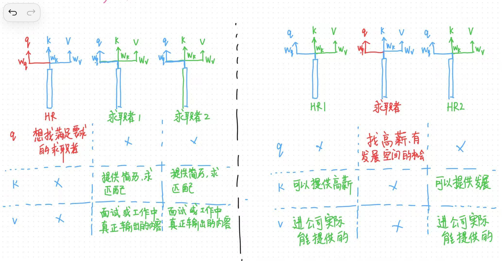
</p>

采用**求职场景**通俗类比自注意力里 Q/K/V 的含义：

- **Q（查询）**：需求方，代表自身想要检索、寻找的目标；

- **K（键）**：被检索方，相当于包装展示出来的简历闪光点，用于匹配；

- **V（值）**：被检索方真实能交付的内容，是最终要被提取输出的信息。

##### 从中得到核心结论

1. 不同 token 生成的 Q，关注、检索的信息侧重点不一样；

2. **Q 与 K 不能共用同一个向量**，否则会丢失检索差异，无法区分 token 之间不同的匹配特征；

3. **V 不能直接使用原始 token 向量**，需要独立投影，赋予模型选择性提取信息的能力；

4. **Q、K、V 三者各司其职，缺一不可**；三者源头都来自原始 token 向量是合理的（就像求职者自身同时产生需求、简历、可交付价值）；

5. 可训练矩阵 $`W_q,W_k,W_v`$ 的作用就是把同一个 token 向量分别映射到三个相互独立的特征空间，得到 Q、K、V；增加表征能力的同时增加自由度。

#### 1.3.2 缩放点积注意力公式

<p align="center">
  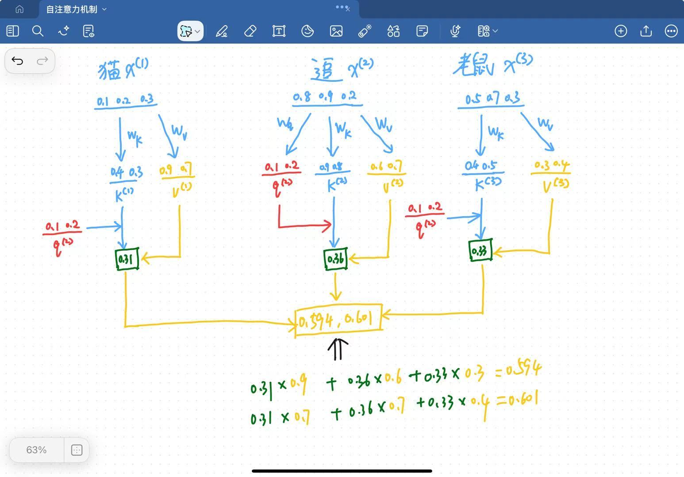
</p>

<p align="center">
  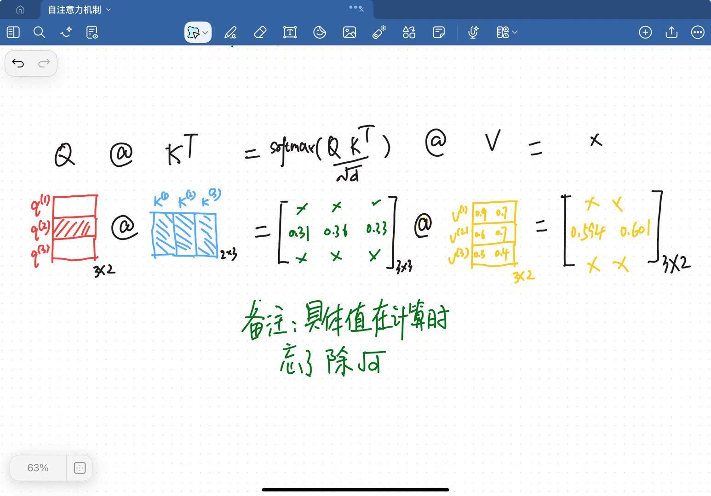
</p>

### 1.4 MHA & GQA 的区别

```math
\begin{aligned}
\mathrm{head}_i &= \mathrm{softmax}\!\left(\frac{Q_i K_i^{\top}}{\sqrt{d_k}}\right)V_i, \\
Q_i &= Q W_Q^{(i)},\quad K_i = K W_K^{(i)},\quad V_i = V W_V^{(i)}, \\
\mathrm{MultiHead}(Q,K,V) &= \mathrm{Concat}\big(\mathrm{head}_1,\dots,\mathrm{head}_h\big) W_O .
\end{aligned}
```

<p align="center">
  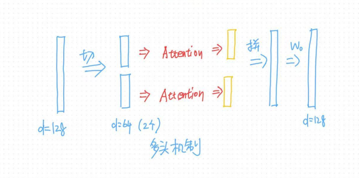
</p>

对同一个头的不同序列，`W_q` 相同；不同头的 `W_q` 不同。

区别：

- MHA 的每个头有自己的 Q/K/V；

- GQA 的每个头有自己的 Q，但多个头（例如 2 个）共用同一个 K/V。

参数量对比（记 $`d`$ 为模型维度、$`n_q`$ 为 Q 头数、$`n_{kv}`$ 为 K/V 头数、$`h_d=d/n_q`$）：

| 模型 | 权重矩阵 | 总参数量 | K/V 参数量 |
|---|---|---|---|
| MHA | $`W_q,W_k,W_v,W_o`$ 均为 $`d \times d`$ | $`4d^2`$ | $`2d^2`$ |
| GQA | $`W_q,W_o`$ 为 $`d \times d`$；$`W_k,W_v`$ 为 $`d \times (n_{kv} h_d)`$ | $`2d^2 + 2d^2 \cdot \frac{n_{kv}}{n_q}`$ | $`2d^2 \cdot \frac{n_{kv}}{n_q}`$ |

GQA 相对 MHA 的参数占比：

| $`\frac{n_{kv}}{n_q}`$ | 总参数占比 | K/V 参数占比 |
|---|---|---|
| $`1/8`$ | 56.25% | $`1/8`$ |
| $`2/8`$ | 62.5% | $`2/8`$ |
| $`4/8`$ | 75% | $`4/8`$ |

### 1.5 时间复杂度

<p align="center">
  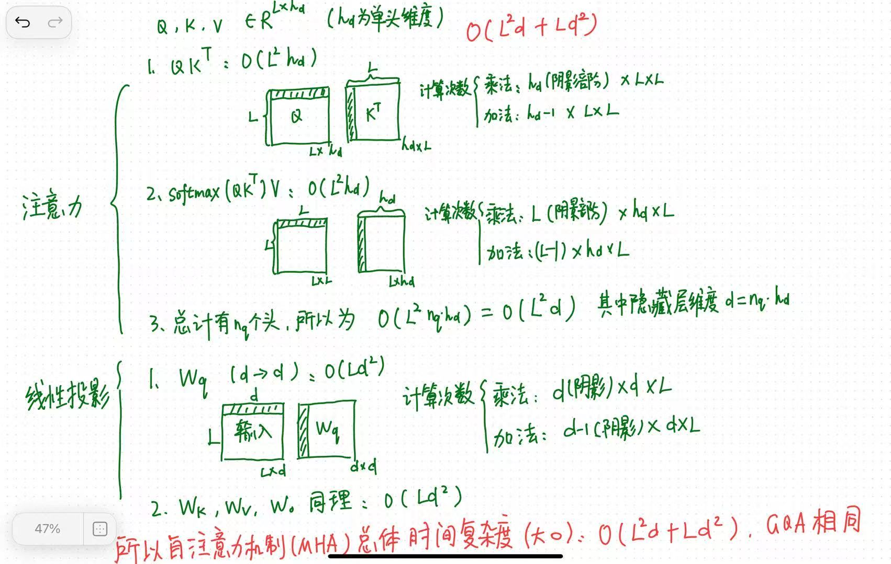
</p>

## 第二部分：核心代码实现

完整实现见 [`03-self-attention/attention.py`](https://github.com/donglinAI/ai-from-scratch/blob/main/03-self-attention/attention.py)；其中 RoPE 部分（`precompute_freqs_cis`、`rotate_half`、`apply_rotary_pos_emb`、`RotaryEmbedding`）见《旋转位置编码》一篇，这里只保留自注意力最核心的两块。

### 2.1 `repeat_kv`：GQA 的 K/V 头扩展

MHA 中 `n_rep` 为 1 直接返回；GQA 中用 `expand` 把 K/V 头补到与 Q 头数一致（视图操作，不复制显存）。

```python
def repeat_kv(x: torch.Tensor, n_rep: int) -> torch.Tensor:
    """GQA: 把 kv 头重复 n_rep 次，扩展到与 q 头数一致。
    
    x: [batch, kv_heads, seq, head_dim] -> [batch, kv_heads*n_rep, seq, head_dim]
    用 expand (不复制内存), 重复只是视图。
    """
    batch, kv_heads, seq, head_dim = x.shape 
    if n_rep == 1:
        return x 
    x = x[:, :, None, :, :].expand(batch, kv_heads, n_rep, seq, head_dim)
    return x.reshape(batch, kv_heads * n_rep, seq, head_dim)
```

### 2.2 `MultiHeadAttention`：一份代码同时支持 MHA / GQA

`num_kv_heads == num_heads` 时退化为 MHA；小于时为 GQA。`q_proj` 输出 $`n_q h_d`$ 维，`k_proj`/`v_proj` 只输出 $`n_{kv} h_d`$ 维，这是 GQA 省参数、省 KV Cache 的来源。

```python
class MultiHeadAttention(nn.Module):
    """支持 MHA (num_kv_heads=num_heads) 与 GQA (num_kv_heads < num_heads). """

    def __init__(
            self,
            hidden_size: int,
            num_heads: int,
            num_kv_heads: int | None = None, # num_kv_heads < num_heads 时为 GQA; 为 None 时为 MHA
            head_dim: int | None = None, # head_dim 为 None 时自动计算为 hidden_size // num_heads
            max_seq_len: int = 2048,
            rope_theta: float = 10000.0,
            bias = False,
    ):
        super().__init__()
        self.hidden_size = hidden_size 
        self.num_heads = num_heads
        self.num_kv_heads = num_kv_heads if num_kv_heads is not None else num_heads 
        self.head_dim = head_dim if head_dim is not None else hidden_size // num_heads 
        self.n_rep = num_heads // num_kv_heads  # 每个 kv 服务多少个 q
        assert self.num_heads % self.num_kv_heads == 0, "num_heads 必须能被 num_kv_heads 整除"

        # 投影：q 全头数，k/v 只有 kv_heads 组
        self.q_proj = nn.Linear(hidden_size, self.num_heads * self.head_dim, bias=bias)
        self.k_proj = nn.Linear(hidden_size, self.num_kv_heads * self.head_dim, bias=bias)
        self.v_proj = nn.Linear(hidden_size, self.num_kv_heads * self.head_dim, bias=bias)
        self.o_proj = nn.Linear(self.num_heads * self.head_dim, hidden_size, bias=bias)

        # RoPE 旋转位置编码（无参数）
        self.rope = RotaryEmbedding(dim=self.head_dim, max_seq_len=max_seq_len, theta=rope_theta)

    def forward(
            self,
            x: torch.Tensor, # [batch, seq, hidden_size]
            positions: torch.Tensor | None = None,
            attention_mask: torch.Tensor | None = None,
    ) -> torch.Tensor:
        """"""

        b, s, _ = x.shape 

        # 1) 投影 + 切头: [B, S, H*D] -> [B, S, H, D] -> [B, H, S, D]
        q = self.q_proj(x).view(b, s, self.num_heads, self.head_dim).transpose(1, 2) 
        k = self.k_proj(x).view(b, s, self.num_kv_heads, self.head_dim).transpose(1, 2)
        v = self.v_proj(x).view(b, s, self.num_kv_heads, self.head_dim).transpose(1, 2)

        # 2) RoPE: 对 q/k 施加位置编码
        if positions is None:
            positions = torch.arange(s, device=x.device)
        q, k = self.rope(q, k, positions)

        # 3) GQA 扩展：kv 头 重复到与q 头一致
        k = repeat_kv(k, self.n_rep) # [B, H, S, D]
        v = repeat_kv(v, self.n_rep)

        # 4) 缩放点积注意力分数 
        attn_weights = torch.matmul(q, k.transpose(-2, -1)) / math.sqrt(self.head_dim)

        # 5) causal 掩码 （decoder-only) : 上三角 -inf
        if attention_mask is None:
            causal = torch.triu(torch.ones(s, s, dtype=bool, device=x.device), diagonal=1)
            attn_weights = attn_weights.masked_fill(causal, float("-inf"))

        # 6) softmax + 加权求和
        attn_weights = F.softmax(attn_weights, dim=-1, dtype=torch.float32).to(q.dtype) # softmax计算敏感, 提升精度计算后再转回去(原weights可为fp16/bf16)
        out = torch.matmul(attn_weights, v) # [B, H, S, D]

        # 7) 合并头 + 输出投影 [B, H, S, D] -> [B, S, H, D] -> [B, S, H*D]
        out = out.transpose(1, 2).contiguous().view(b, s, self.num_heads * self.head_dim)
        return self.o_proj(out)
```
