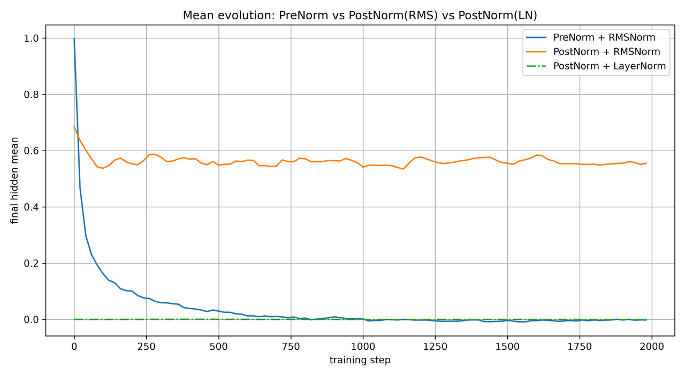
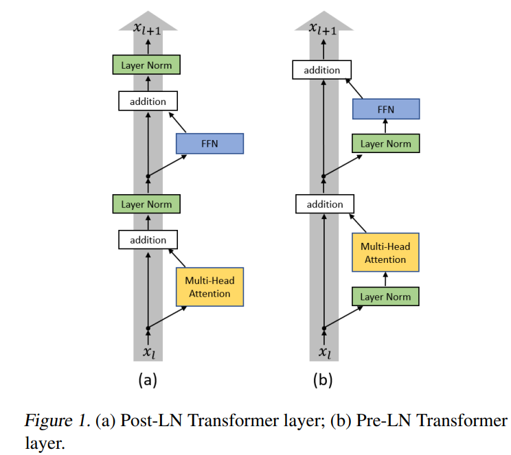
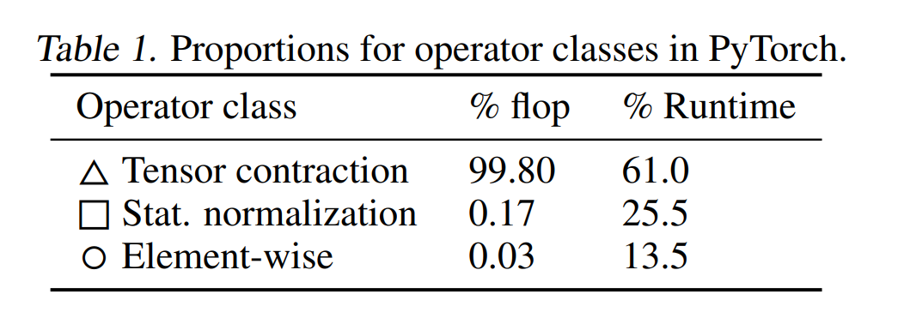
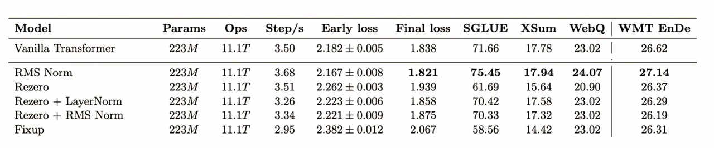

# RMSNorm（Root Mean Square Layer Normalization）

[](https://arxiv.org/abs/1910.07467)

**RMSNorm（Root Mean Square Layer Normalization）** 是 LayerNorm 的一种简化变体：**移除均值中心化（re-centering）**，仅保留基于 RMS 的**缩放归一化（re-scaling）**。在效果与 LayerNorm 相当的前提下（部分场景），只做**一次统计量规约、无逐元素减法路径**，计算开销更低；同时保留对输入与权重整体缩放的 **re-scaling 不变性**，归一化结果不受尺度影响。凭借低开销与稳定效果，RMSNorm 已被 **LLaMA、Mistral、Qwen 等主流大模型广泛采用**，成为大模型时代最常用的归一化层之一。

- 论文：[Root Mean Square Layer Normalization (arXiv:1910.07467)](https://arxiv.org/pdf/1910.07467)

---

## 目录

- [1. 引言与动机](#1-引言与动机)
- [2. 数学定义与前向计算](#2-数学定义与前向计算)
- [3. 不变性分析](#3-不变性分析)
- [4. 梯度推导](#4-梯度推导)
- [5. 计算复杂度与工程实现](#5-计算复杂度与工程实现)
- [6. 附录](#6-附录)

---

## 1. 引言与动机

深层网络训练不稳定的一个来源是**内部协变量偏移**：前置层的参数更新会改变后置层的输入分布，导致梯度尺度不稳、收敛缓慢。归一化层的思路是对每层输入施加一个「尺度标准形」，缓解分布漂移。

LayerNorm 对求和后的输入 $\mathbf{a}$ 同时做中心化与缩放：

$$
\mu = \frac{1}{n}\sum_{i=1}^{n}a_i,\qquad \sigma = \sqrt{\frac{1}{n}\sum_{i=1}^{n}(a_i - \mu)^2},\qquad \mathrm{LN}(\mathbf{a})_i = \frac{a_i - \mu}{\sigma}\,g_i
$$

其代价是两次统计量规约：均值 $\mu$ 与方差 $\sigma^2$ 各需一次全局归约。

> [!NOTE]
> **设计动机**：归一化带来的收益主要由 re-scaling 提供；去除 re-centering 不影响效果，但显著降低计算量。

## 2. 数学定义与前向计算

**定义（RMSNorm）**：对求和输入 $\mathbf{a} \in \mathbb{R}^n$ ，逐元素归一化：

$$
\bar{a}_i = \frac{a_i}{\mathrm{RMS}(\mathbf{a})},\qquad v_i = \bar{a}_i\,g_i,\qquad \mathrm{RMS}(\mathbf{a}) = \sqrt{\frac{1}{n}\sum_{i=1}^{n}a_i^2}
$$

$$
\mathbf{y} = f(\mathbf{v})
$$

其中 $\mathbf{x}$ 为线性层输入， $\mathbf{a} = W\mathbf{x}$ 为求和输入， $\mathbf{g}$ 为可学习 gain（初始化为 1，**经过学习后各维度值可能不同**）， $\bar{\mathbf{a}}$ 为归一化输入， $\mathbf{v}$ 为 RMSNorm 的输出。

**与 LayerNorm 的关系**：当 $\mu = 0$ 时， $\sigma = \mathrm{RMS}(\mathbf{a})$ ，两者归一化结果逐元素相等。因此 RMSNorm 可视为 LayerNorm 在「输入零均值」假设下的特例；**实际中注意力层 / 线性层输出常近似零均值（即使初始均值不为 0）**，故性能损失有限。

前向计算仅含三类可向量化操作：平方求均值、开方、逐元素乘除；不引入额外超参数。



*图 1 训练过程中隐层均值的演化（PreNorm vs PostNorm）*

## 3. 不变性分析

### 3.1 定理：缩放不变性

设输入 $\mathbf{x}$ 整体缩放 $\delta > 0$ ，则 $\mathbf{a}' = W(\delta \mathbf{x}) = \delta \mathbf{a}$ ，归一化输出不变：

$$
\mathbf{v}' = \frac{\delta \mathbf{a}}{\mathrm{RMS}(\delta \mathbf{a})}\odot \mathbf{g} = \frac{\delta \mathbf{a}}{\delta\,\mathrm{RMS}(\mathbf{a})}\odot \mathbf{g} = \mathbf{v}
$$

权重矩阵 $W$ 整体缩放 $\delta$ 同理，此时 $\mathbf{a}' = \delta W\mathbf{x} = \delta \mathbf{a}$ ；即 RMSNorm 对输入与权重矩阵的整体 re-scaling 不变。

**边界条件**：**不变性仅对「整体缩放」成立**——对单个权重向量或部分维度做不同倍率缩放不成立；对平移（re-centering）也不成立，这是与 LayerNorm 的实质差异。

### 3.2 与 LayerNorm 的不变性对照

| 方法 | 权重矩阵 re-centering | 权重矩阵 re-scaling | 数据集 re-scaling |
| :--- | :---: | :---: | :---: |
| LayerNorm | ✓ 不变 | ✓ 不变 | ✓ 不变 |
| RMSNorm | ✗ | ✓ 不变 | ✓ 不变 |

> [!WARNING]
> **易错点**：缩放不变性指整体 re-scaling；LayerNorm 额外具备 re-centering 不变性（对平移不敏感），RMSNorm 不具备——回答「两者差异」时须区分 re-centering 与 re-scaling 两个维度。

## 4. 梯度推导

设输入向量 $\mathbf{a}\in\mathbb{R}^{n}$ ，定义 RMS 归一化因子

$$
r = \mathrm{RMS}(\mathbf{a}) = \sqrt{\frac{1}{n}\sum_{k=1}^n a_k^2}
$$

归一化向量

$$
\bar{\mathbf{a}} = \mathbf{a} / r
$$

令激活输入为逐元素乘积

$$
\mathbf{v} = \bar{\mathbf{a}}\odot \mathbf{g}
$$

其中 $\mathbf{g}\in\mathbb{R}^{n}$ 为可学习逐元素增益参数， $\odot$ 表示哈达玛积。记上游梯度 $\partial L/\partial \mathbf{v}$ 。

### 4.1 损失对增益 g 的梯度

由 $v_i = \bar{a}_i g_i$ ，链式法则给出

$$
\frac{\partial L}{\partial g_j} = \sum_i \frac{\partial L}{\partial v_i}\frac{\partial v_i}{\partial g_j} = \frac{\partial L}{\partial v_j}\,\bar{a}_j
$$

写成向量形式

$$
\frac{\partial L}{\partial \mathbf{g}} = \frac{\partial L}{\partial \mathbf{v}} \odot \bar{\mathbf{a}} = \frac{\partial L}{\partial \mathbf{v}} \odot \frac{\mathbf{a}}{r}
$$

### 4.2 损失对输入 a 的梯度与 R 矩阵

先求归一化算子的雅可比分量。由 $\bar{a}_i = a_i/r$ 以及 $\partial r/\partial a_j = a_j/(nr)$ ，

$$
\frac{\partial \bar{a}_i}{\partial a_j} = \frac{\delta_{ij}}{r} - \frac{a_i a_j}{n r^3}
$$

结合 $v_i = g_i \bar{a}_i$ ，有 $\partial v_i/\partial a_j = g_i \cdot \partial\bar{a}_i/\partial a_j$ 。代入链式法则：

$$
\frac{\partial L}{\partial a_j} = \sum_i \frac{\partial L}{\partial v_i}\frac{\partial v_i}{\partial a_j} = \sum_i \left(g_i \frac{\partial L}{\partial v_i}\right) \left(\frac{\delta_{ij}}{r} - \frac{a_i a_j}{n r^3}\right)
$$

引入辅助梯度向量 $\mathbf{d} = \mathbf{g} \odot \partial L/\partial \mathbf{v}$ ，则

$$
\frac{\partial L}{\partial a_j} = \frac{d_j}{r} - \frac{a_j}{n r^3}\left(\mathbf{a}^\top \mathbf{d}\right)
$$

整理为向量形式并提取公因子：

$$
\frac{\partial L}{\partial \mathbf{a}} = \frac{1}{r}\left(\mathbf{I} - \frac{\mathbf{a} \mathbf{a}^\top}{n r^2}\right)\mathbf{d}
$$

记归一化雅可比矩阵

$$
R = \frac{1}{\mathrm{RMS}(\mathbf{a})}\left(\mathbf{I} - \frac{\mathbf{a} \mathbf{a}^\top}{n\,\mathrm{RMS}(\mathbf{a})^2}\right)
$$

最终梯度写成紧凑形式：

$$
\frac{\partial L}{\partial \mathbf{a}} = R\,\mathbf{d},\qquad \mathbf{d} = \mathbf{g} \odot \frac{\partial L}{\partial \mathbf{v}}
$$

### 4.3 损失对权重矩阵 W 的偏导

设线性变换 $\mathbf{a} = W\mathbf{x}$ ，其中 $W\in\mathbb{R}^{n\times m}$ ，输入向量 $\mathbf{x}\in\mathbb{R}^{m}$ ，输出 $\mathbf{a}\in\mathbb{R}^{n}$ 。我们已经求得 $\partial L/\partial \mathbf{a}\in\mathbb{R}^{n}$ ，利用矩阵–向量链式法则求 $\partial L/\partial W$ 。

对于标量损失 $L$ ，矩阵梯度的分量定义为

$$
\left(\frac{\partial L}{\partial W}\right)_{ij} = \frac{\partial L}{\partial W_{ij}}
$$

由 $\mathbf{a} = W\mathbf{x}$ ，分量形式 $a_i = \sum_{k=1}^m W_{ik} x_k$ ，于是

$$
\frac{\partial a_i}{\partial W_{ij}} = x_j
$$

链式法则：

$$
\frac{\partial L}{\partial W_{ij}} = \sum_{k=1}^n \frac{\partial L}{\partial a_k}\frac{\partial a_k}{\partial W_{ij}} = \frac{\partial L}{\partial a_i}\, x_j
$$

该分量关系恰好对应外积：

$$
\frac{\partial L}{\partial W} = \frac{\partial L}{\partial \mathbf{a}}\,\mathbf{x}^\top
$$

这是深度学习线性层反向传播的标准形式。

### 4.4 数值验证

设 $\mathbf{a} = [3, 4]^\top$ 、 $\mathbf{g} = [1, 1]^\top$ 、 $\partial L/\partial \mathbf{v} = [1, 1]^\top$ 、 $\mathbf{x} = [1, 2]^\top$ ，且 $\mathbf{a} = W\mathbf{x}$ 。

**步骤 1：归一化**

$$
\bar{\mathbf{a}} = \frac{\mathbf{a}}{\mathrm{RMS}(\mathbf{a})} = \frac{[3,4]^\top}{3.5355} = [0.8485,\ 1.1314]^\top
$$

**步骤 2：R 矩阵**

```math
R = \frac{1}{\mathrm{RMS}(\mathbf{a})}\left(\mathbf{I} - \frac{\mathbf{a}\mathbf{a}^\top}{n\,\mathrm{RMS}(\mathbf{a})^2}\right)
= \begin{bmatrix}
0.1810 & -0.1357 \\
-0.1357 & 0.1018
\end{bmatrix}
```

**步骤 3：增益 g 的梯度**

$$
\frac{\partial L}{\partial \mathbf{g}} = \frac{\partial L}{\partial \mathbf{v}}\odot\bar{\mathbf{a}} = [1,1]^\top \odot [0.8485,\ 1.1314]^\top = [0.8485,\ 1.1314]^\top
$$

**步骤 4：输入 a 的梯度**

$$
\mathbf{d} = [1,1]^\top
$$

$$
\frac{\partial L}{\partial \mathbf{a}} = R\,\mathbf{d} = [0.0453,\ -0.0339]^\top
$$

**步骤 5：权重 W 的梯度**

```math
\frac{\partial L}{\partial W} = \frac{\partial L}{\partial \mathbf{a}}\,\mathbf{x}^\top = \begin{bmatrix}0.0453 & 0.0906 \\ -0.0339 & -0.0678\end{bmatrix}
```

三个验证点：

- $R$ 对称（步骤 2 副对角线相等）；
- 梯度尺度被 $\frac{1}{r} \approx 0.2828$ 压缩（步骤 4 相对上游梯度 $[1,1]^\top$ 大幅缩小）；
- 步骤 5 按列拉直为 $[0.0453, -0.0339, 0.0906, -0.0678]^\top$ ，与克罗内克积求和形式的结果一致。

### 4.5 隐式学习率调节

输入或权重矩阵整体缩放 $\delta$ 时，梯度中的归一化矩阵同步缩小：

$$
R^{\prime} = \frac{R}{\delta}
$$

即**梯度尺度与输入 / 权重的 RMS 成反比**：权重矩阵范数偏大时，梯度被自动压小；范数偏小时梯度相对放大。其效果等价于隐式的学习率自适应（implicit learning rate adaptation），实验观测亦显示梯度尺度与 RMS 的负相关关系。

> [!IMPORTANT]
> **重点**： $R^{\prime} = R/\delta$ 中的 $\frac{1}{\delta}$ 是「隐式学习率」的数学来源——结构本身提供了梯度缩放，无需显式归一化梯度或调整学习率。

### 4.6 Pre-Norm 与 Post-Norm



*图 2 Post-LN 与 Pre-LN 的 Transformer 层结构对比。来源：[arXiv:2002.04745](https://arxiv.org/pdf/2002.04745)*

## 5. 计算复杂度与工程实现

### 5.1 计算开销对比

| 维度 | LayerNorm | RMSNorm |
| :--- | :--- | :--- |
| 统计量约简次数 | 2（均值 + 方差） | 1（对 $\mathbf{a}^2$ 求均值） |
| 逐元素减法 | 有，需 $\mathbf{a} - \mu$ | 无 |
| 可学习参数 | $\mathbf{g}, \mathbf{b}$ | $\mathbf{g}$ |

归一化层是逐元素操作，复杂度 $O(H)$ ，在 LLM 每层总计算量 $O(H^2)$ 中占比极小（约万分之一量级），因此 RMSNorm 少一次统计量归约、省去 $\mathbf{a} - \mu$ 减法路径，在**计算量**上的节省有限；真正的收益在工程层面。

并行训练中，统计量归约是跨设备集合通信点：LayerNorm 每层 2 次全局归约（均值、方差），RMSNorm 仅 1 次——少一次归约即少一次通信与同步，**通信过程也能节省成本**；再叠加省去减法路径带来的内存带宽节省，规模与并行度越大，收益越明显。



*表 1 各类算子的 FLOP 与运行时间占比。来源：[arXiv:2007.00072](https://arxiv.org/pdf/2007.00072)*



*表 2 不同归一化方案的模型效果对比。来源：[arXiv:2102.11972](https://arxiv.org/pdf/2102.11972)*

### 5.2 数值稳定性

工程实现通常在 RMS 分母加 $\varepsilon$ 防止除零： $r = \sqrt{\mathrm{mean}(\mathbf{a}^2) + \varepsilon}$ , $\varepsilon$ 属实现惯例。

### 5.3 代码实现（PyTorch）

```python
import torch

def rmsnorm_forward(a, g, eps=1e-6):
    """
    RMSNorm + per-element gain 前向
    Args:
        a: (..., n) 输入向量，最后一维做归一化
        g: (n,) 可学习逐元素增益
        eps: 数值稳定项
    Returns:
        v: 激活输入，(..., n)
        cache: 用于反向的缓存 (a, abar, rms, g)
    """
    rms = torch.sqrt(a.pow(2).mean(dim=-1, keepdim=True) + eps)
    abar = a / rms
    v = abar * g
    return v, (a, abar, rms, g)


def rmsnorm_backward(dv, cache):
    """
    RMSNorm + gain 反向，返回 grad_a, grad_g
    Args:
        dv: ∂L/∂v, (..., n) 上游梯度
        cache: 前向缓存
    Returns:
        grad_a: ∂L/∂a, (..., n)
        grad_g: ∂L/∂g, (n,) 沿所有批量维度规约求和
    """
    a, abar, rms, g = cache
    n = a.shape[-1]
    d = g * dv  # d = g ⊙ ∂L/∂v
    inner = (abar * d).sum(dim=-1, keepdim=True) / n
    grad_a = (d - abar * inner) / rms
    grad_g = (dv * abar).reshape(-1, n).sum(dim=0)
    return grad_a, grad_g


def linear_backward(grad_a, x):
    """
    线性层反向：a = W @ x（batch 版 a = x @ W.T），∂L/∂W = grad_a^T @ x
    这里约定：x: (..., m), a: (..., n)，W: (n, m)
    grad_a: ∂L/∂a, (..., n)
    x: (..., m)
    return ∂L/∂W: (n, m)
    """
    return torch.einsum("...n,...m->nm", grad_a, x)
```

运行结果：

```text
===== 前向结果 =====
a         = tensor([3., 4.])
rms       = 3.5355
abar      = tensor([0.8485, 1.1314])
v         = tensor([0.8485, 1.1314])

===== RMSNorm 反向梯度 =====
∂L/∂g     = tensor([0.8485, 1.1314])
∂L/∂a     = tensor([ 0.0453, -0.0339])

===== 线性层权重梯度 ∂L/∂W =====
tensor([[ 0.0453,  0.0905],
        [-0.0339, -0.0679]])

===== vec(∂L/∂W) (列主序) =====
tensor([ 0.0453,  0.0905, -0.0339, -0.0679])

===== Autograd 校验（验证解析梯度正确性） =====
autograd ∂L/∂a = tensor([ 0.0453, -0.0339])
autograd ∂L/∂g = tensor([0.8485, 1.1314])
```

## 6. 附录

本章节补充正文 4.3 节克罗内克积形式的相关细节，采用 $\mathrm{vec}$ 算子与克罗内克积进行统一的符号推导与数值核验。约定： $\mathrm{vec}(\cdot)$ 为**列主序向量化算子**，将矩阵按列依次堆叠为列向量；克罗内克积定义为，对矩阵 $A\in\mathbb{R}^{m\times n}$ 、 $B\in\mathbb{R}^{p\times q}$ ， $A\otimes B\in\mathbb{R}^{mp\times nq}$ 是分块矩阵，把 $A$ 的每个元素 $a_{ij}$ 替换为子块 $a_{ij}B$ ：

```math
A \otimes B = \begin{bmatrix} a_{11}B & \cdots & a_{1n}B \\ \vdots & \ddots & \vdots \\ a_{m1}B & \cdots & a_{mn}B \end{bmatrix}
```

两个核心恒等式贯穿推导：

$$
\mathrm{vec}\big(\mathbf{u}\mathbf{v}^\top\big) = \mathbf{v} \otimes \mathbf{u},\qquad \mathrm{vec}(W\mathbf{x}) = \big(\mathbf{x}^\top \otimes I_n\big)\,\mathrm{vec}(W)
$$

引入 $\mathrm{vec}$ 算子的目的： $\partial \mathbf{a}/\partial W$ 是向量对矩阵的三阶雅可比张量，无法直接套用向量–向量链式法则；将矩阵参数 $W$ 拉直为长向量 $\mathrm{vec}(W)$ ，即可把三阶张量转化为标准二维雅可比矩阵，在向量空间中完成链式求导。

沿用前文测试配置： $\mathbf{a} = [3,4]^\top$ 、 $n=2$ 、 $\mathbf{g}=[1,1]^\top$ 、 $\partial L/\partial \mathbf{v}=[1,1]^\top$ 、 $\mathbf{x}=[1,2]^\top$ 。此时归一化雅可比矩阵为

```math
R = \begin{bmatrix}0.1810 & -0.1357 \\ -0.1357 & 0.1018\end{bmatrix}
```

记辅助梯度 $\mathbf{d} = \mathbf{g}\odot \partial L/\partial \mathbf{v} = [1,1]^\top$ ，于是

```math
\frac{\partial L}{\partial \mathbf{a}} = R\mathbf{d} = \begin{bmatrix}0.0453 \\ -0.0339\end{bmatrix}
```

构造矩阵 $M = \mathrm{diag}(\mathbf{d})R$ ，本例中 $\mathrm{diag}(\mathbf{d}) = I_2$ ，故 $M = R$ 。计算 $\mathbf{x}^\top \otimes M$ ：

```math
\mathbf{x}^\top \otimes R = \begin{bmatrix} 1\cdot R & 2\cdot R \end{bmatrix} = \begin{bmatrix} 0.1810 & -0.1357 & 0.3620 & -0.2714 \\ -0.1357 & 0.1018 & -0.2714 & 0.2036 \end{bmatrix}
```

记号 $[\cdot]_i$ 表示取矩阵第 $i$ 行，对所有行求和：

$$
\sum_{i=1}^n \big[\mathbf{x}^\top \otimes M\big]_i = \begin{bmatrix}0.1810 & -0.1357 & 0.3620 & -0.2714\end{bmatrix} + \begin{bmatrix}-0.1357 & 0.1018 & -0.2714 & 0.2036\end{bmatrix} = \begin{bmatrix}0.0453 & -0.0339 & 0.0906 & -0.0678\end{bmatrix}
$$

将结果转置为列向量，即为 $\mathrm{vec}\left(\partial L/\partial W\right)$ ，即

$$
\sum_{i=1}^{n}\left[\mathbf{x}^\top\otimes\big(\mathrm{diag}(\mathbf{d})R\big)\right]_i = \mathrm{vec}\left(\frac{\partial L}{\partial W}\right)
$$

接下来基于 $\mathrm{vec}$ 算子执行链式推导。由 $\mathbf{a} = W\mathbf{x}$ ，使用向量化恒等式：

$$
\mathrm{vec}(\mathbf{a}) = \big(\mathbf{x}^\top \otimes I_n\big)\,\mathrm{vec}(W)
$$

记拉直后的参数向量 $\boldsymbol{\theta}_W = \mathrm{vec}(W)$ ，对应的雅可比矩阵为

$$
\frac{\partial \mathrm{vec}(\mathbf{a})}{\partial \boldsymbol{\theta}_W} = \mathbf{x}^\top \otimes I_n
$$

应用向量链式法则：

$$
\frac{\partial L}{\partial \boldsymbol{\theta}_W} = \left(\frac{\partial \mathrm{vec}(\mathbf{a})}{\partial \boldsymbol{\theta}_W}\right)^\top \frac{\partial L}{\partial \mathbf{a}}
$$

利用克罗内克积转置性质 $(A\otimes B)^\top = A^\top\otimes B^\top$ 以及 $I_n^\top = I_n$ ，得到

$$
\big(\mathbf{x}^\top \otimes I_n\big)^\top = \mathbf{x} \otimes I_n
$$

于是

$$
\frac{\partial L}{\partial \mathrm{vec}(W)} = \big(\mathbf{x} \otimes I_n\big)\frac{\partial L}{\partial \mathbf{a}}
$$

代入 $\partial L/\partial \mathbf{a} = R\mathbf{d}$ 、 $\mathbf{d} = \mathbf{g}\odot \partial L/\partial \mathbf{v}$ ，最终建立正文给出的克罗内克积求和形式：

$$
\frac{\partial L}{\partial \mathrm{vec}(W)} = \mathbf{x}\otimes\left(R\left(\mathbf{g}\odot\frac{\partial L}{\partial \mathbf{v}}\right)\right) = \sum_{i=1}^{n}\left[\mathbf{x}^\top\otimes\left(\mathrm{diag}\left(\mathbf{g}\odot\frac{\partial L}{\partial \mathbf{v}}\right)R\right)\right]_i
$$

代入数值核验： $\mathbf{x} = [1,2]^\top$ 、 $\partial L/\partial \mathbf{a} = [0.0453,-0.0339]^\top$ ，

```math
(\mathbf{x} \otimes I_2)\frac{\partial L}{\partial \mathbf{a}} = \begin{bmatrix} x_1\cdot \partial L/\partial a_1 \\ x_1\cdot \partial L/\partial a_2 \\ x_2\cdot \partial L/\partial a_1 \\ x_2\cdot \partial L/\partial a_2 \end{bmatrix} = \begin{bmatrix} 0.0453 \\ -0.0339 \\ 0.0906 \\ -0.0678 \end{bmatrix}
```

该结果与前述克罗内克积行求和结果完全一致，即为 $\mathrm{vec}(\partial L/\partial W)$ 。该 $\mathrm{vec}$ 形式适合高阶雅可比、Hessian 与扰动理论的代数推演；推导全程在拉直后的向量空间中使用标准向量链式法则，规避三阶张量的显式表达。
