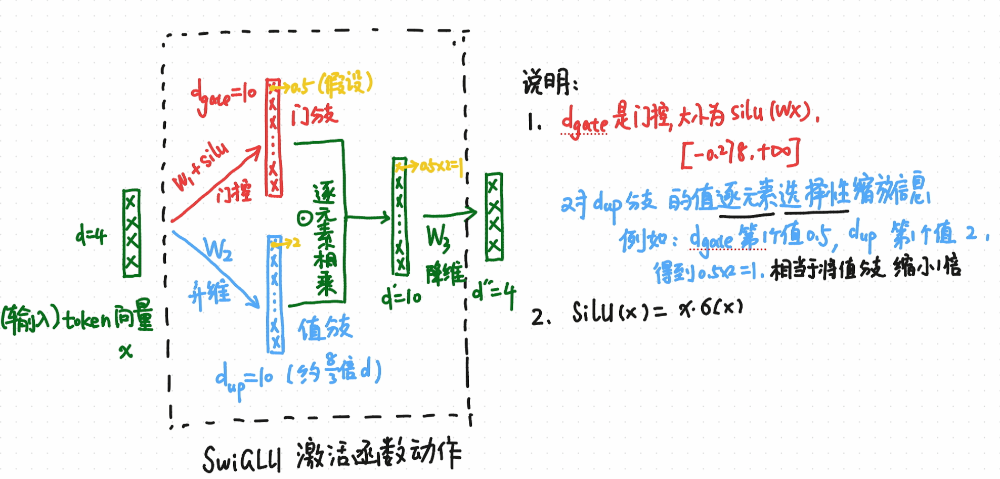
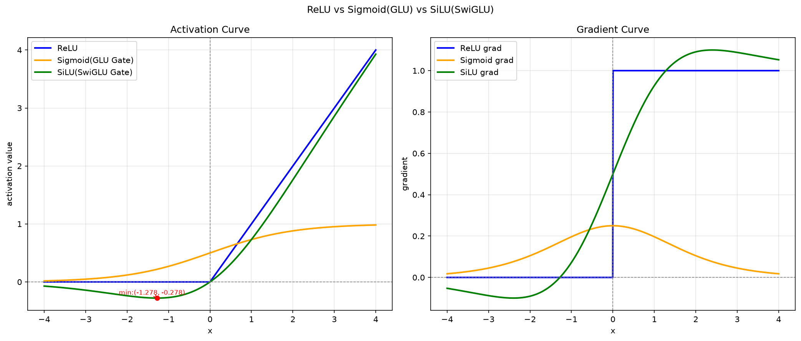

# SwiGLU（Swish 门控线性单元）

**SwiGLU（Swish-Gated Linear Unit，Swish 门控线性单元）**是目前大语言模型 Transformer FFN（前馈网络）中最主流的门控结构：**用一个经 SiLU 激活的「门分支」与一个线性直通的「值分支」逐元素相乘，替代单个逐元素激活函数**。相比 ReLU / GELU，SwiGLU 在同等参数预算下带来一致的收益，已被 **LLaMA、Qwen、Mistral、Gemma** 等主流模型广泛采用，是大模型时代 FFN 的事实标准之一。



**设计动机**：**门控的价值在于选择性**。门分支对每个维度给出一个**调制权重**，模型可按输入内容动态决定每维放行多少。**SwiGLU 把门函数换成 SiLU，让「门」本身具备非线性表达力，且负区间仍有非零梯度。**



[论文链接：GLU Variants Improve Transformer（Shazeer, 2020）](https://arxiv.org/abs/2002.05202)

## 数学定义与前向计算

### SiLU / Swish

**SiLU 是 Swish 的特殊情况**（即 $`\beta = 1`$ 的 Swish）：

```math
\mathrm{SiLU}(x) = x\,\sigma(x) = \frac{x}{1 + e^{-x}}
```

```math
\mathrm{Swish}_{\beta}(x) = x\,\sigma(\beta x)
```

负输入被 sigmoid 软压到接近 0（不是硬置 0）→ 梯度平滑、可微；正输入近似 $`x`$ → 不衰减有效信息。

### GLU 与 SwiGLU

GLU（Dauphin 2017）：

```math
\mathrm{GLU}(\mathbf{x}, W, V, \mathbf{b}, \mathbf{c}) = \sigma(\mathbf{x}W + \mathbf{b}) \odot (\mathbf{x}V + \mathbf{c})
```

SwiGLU（Shazeer 2020）把 GLU 的 sigmoid 门换成 SiLU：

```math
\mathrm{SwiGLU}(\mathbf{x}, W, V, \mathbf{b}, \mathbf{c}) = \mathrm{SiLU}(\mathbf{x}W + \mathbf{b}) \odot (\mathbf{x}V + \mathbf{c})
```

**SwiGLU 组成的 FFN 层（LLaMA 等，通常不加偏置）**：

```math
\mathrm{FFN}_{\mathrm{SwiGLU}}(\mathbf{x}) = \Big(\mathrm{SiLU}(\mathbf{x}W_{\mathrm{gate}}) \odot \mathbf{x}W_{\mathrm{up}}\Big) W_{\mathrm{down}}
```

### 代码实现

链接地址：https://github.com/donglinAI/ai-from-scratch/blob/main/06-swiglu/swiglu.py

```python
class SwiGLU(nn.Module):
    def __init__(self, hidden_size: int, intermediate_size: int, bias: bool = False):
        super().__init__()
        # 三个投影：gate（门控）/ up（信息）/ down（收缩回 hidden）
        self.gate_proj = nn.Linear(hidden_size, intermediate_size, bias=bias)
        self.up_proj = nn.Linear(hidden_size, intermediate_size, bias=bias)
        self.down_proj = nn.Linear(intermediate_size, hidden_size, bias=bias)

    def forward(self, x: torch.Tensor) -> torch.Tensor:
        # 门: SiLU 激活后作为逐元素“开关”
        gate = F.silu(self.gate_proj(x))
        # 信息通道：直接线性变换
        up = self.up_proj(x)
        # 门控相乘 -> 收缩回 hidden 维
        return self.down_proj(gate * up)
```

## 性质分析


链接地址：https://github.com/donglinAI/ai-from-scratch/blob/main/06-swiglu/swiglu_curve.py

### SiLU（上图绿色线）

- **平滑、处处可导**：无 ReLU 的拐点，导数连续。
- **非单调**：负区间先降后升，全局最小值 $`-W(e^{-1}) \approx -0.2785`$，取在 $`x^{*} = -1 - W(e^{-1}) \approx -1.2785`$（$`W`$ 为 Lambert W 函数；推导见附录 A）。
- **下界有限、无上界**：值域约 $`(-0.2785, +\infty)`$；$`x \to -\infty`$ 时 $`\mathrm{SiLU}(x) \to 0^{-}`$，$`x \to +\infty`$ 时 $`\mathrm{SiLU}(x) \to x`$。
- **自门控（self-gating）**：输出 = 输入 × 自身经 sigmoid 调制的因子，无需额外参数。
- **梯度不消失、上界约 1.10**：$`\mathrm{SiLU}'(x) = \sigma(x)\big(1 + x\,\sigma(-x)\big)`$ 恒为正，负区间非零（对比 ReLU 负区恒 0，缓解死亡神经元）；最大值约 1.0998（取在 $`x \approx 2.40`$ 附近）。
- **数值稳定**：$`x`$ 很大时 $`\sigma(x) \to 1`$、$`\mathrm{SiLU}(x) \to x`$，无指数溢出；直接 `x * sigmoid(x)` 即可。

### 激活函数对照

| 维度 | ReLU | SiLU（Swish, β=1） | SwiGLU |
| :--- | :--- | :--- | :--- |
| 定义 | $`\max(0, x)`$ | $`x\sigma(x)`$ | $`\mathrm{SiLU}(\mathbf{x}W_g) \odot \mathbf{x}W_u`$ |
| 单调性 | 单调（负区恒 0） | 非单调（最小值约 −0.28） | 双分支门控结构 |
| 平滑性 | 0 点不可导 | 平滑 | 平滑 |
| 负区间梯度 | 0 | 非零（峰值约 1.10） | 门分支非零 |
| 选择性 / 门控 | 无 | 自门控 | 显式门控（额外线性分支） |
| FFN 参数（$`d`$ 维输入） | $`8d^2`$ | $`8d^2`$ | $`8d^2`$（$`m = \frac{8}{3}d`$） |
| 典型使用 | 原始 Transformer | 轻量 / 视觉模型 | PaLM、LLaMA、Mistral、Qwen、Gemma |

### SwiGLU 的门控性质

- 门分支 $`\mathrm{SiLU}(\mathbf{x}W_{\mathrm{gate}})`$ 的**输出可正可负、可大于 1**——对比 GLU 的 sigmoid 门严格落在 $`(0,1)`$，SwiGLU 的门是**「带符号的软门」**：既放大、也允许反向抑制（负门 = 反相），调制能力更强。
- 双分支解耦：门分支学「放行策略」，值分支学「内容」，不同维度独立调制，表达能力高于单一逐元素激活。
- 梯度路径：**值分支对输出线性直通**（$`\partial h_i / \partial v_i = \mathrm{SiLU}(z_i)`$），门分支梯度含 $`\mathrm{SiLU}'`$（不消失），两条路径都没有 ReLU 式的梯度截断。
