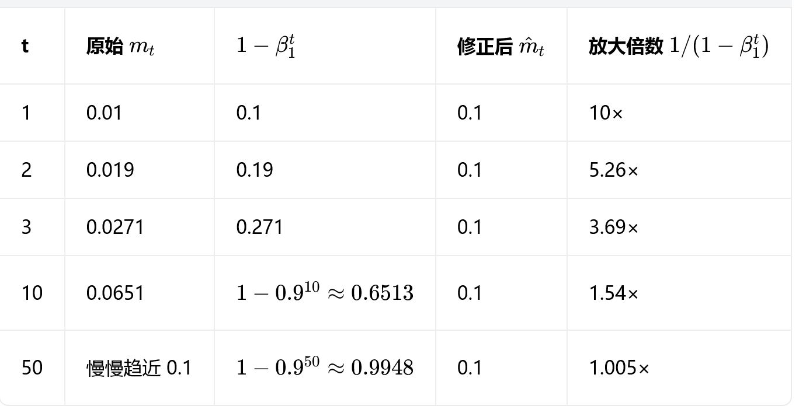
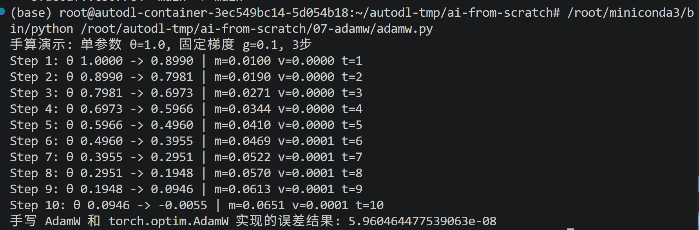

# AdamW 优化器

**AdamW（Decoupled Weight Decay，解耦权重衰减）**是对 Adam 优化器的一种改进，出自论文 [Decoupled Weight Decay Regularization](https://arxiv.org/abs/1711.05101)（Loshchilov & Hutter，ICLR 2019）。它的核心思想是：**把权重衰减从梯度的动量统计中解耦出来，直接作用在权重上**，避免衰减项被 Adam 的自适应步长「扭曲」。由于泛化更好、超参更稳，AdamW 已成为大模型预训练的事实默认优化器（GPT、LLaMA、Qwen 等均采用）。

| **项目** | **Adam（耦合 L2）** | **AdamW（解耦 L2）** | **备注（作用说明）** |
|---|---|---|---|
| 梯度 | $`\mathbf{g}_t' = \mathbf{g}_{\text{task},t} + \lambda\,\boldsymbol{\theta}_t`$ | $`\mathbf{g}_t = \mathbf{g}_{\text{task},t}`$（只用原始任务梯度） | 任务梯度：来自损失对权重的导数；L2 把惩罚项加到梯度里，污染梯度 |
| 一阶矩 | $`\mathbf{m}_t = \beta_1\,\mathbf{m}_{t-1} + (1-\beta_1)\,\mathbf{g}_t'`$ | $`\mathbf{m}_t = \beta_1\,\mathbf{m}_{t-1} + (1-\beta_1)\,\mathbf{g}_t`$ | 累积**梯度**方向的指数移动平均 EMA，起到动量平滑作用 |
| 二阶矩 | $`\mathbf{v}_t = \beta_2\,\mathbf{v}_{t-1} + (1-\beta_2)\,\mathbf{g}_t'^2`$ | $`\mathbf{v}_t = \beta_2\,\mathbf{v}_{t-1} + (1-\beta_2)\,\mathbf{g}_t^2`$ | 累积**梯度平方**的指数移动平均 EMA，用来估计梯度波动幅度，提供自适应缩放依据 |
| 偏差修正 | $`\hat{\mathbf{m}}_t = \frac{\mathbf{m}_t}{1-\beta_1^t},\quad \hat{\mathbf{v}}_t = \frac{\mathbf{v}_t}{1-\beta_2^t}`$ | $`\hat{\mathbf{m}}_t = \frac{\mathbf{m}_t}{1-\beta_1^t},\quad \hat{\mathbf{v}}_t = \frac{\mathbf{v}_t}{1-\beta_2^t}`$ | 修正 EMA 初始 0 值带来的低估，训练前期补偿步长；<br> |
| 参数更新 | $`\boldsymbol{\theta}_{t+1} = \boldsymbol{\theta}_t - \eta\,\frac{\hat{\mathbf{m}}_t}{\sqrt{\hat{\mathbf{v}}_t}+\varepsilon}`$ | $`\boldsymbol{\theta}_t \leftarrow \boldsymbol{\theta}_t\,(1-\eta\,\lambda)`$<br>$`\boldsymbol{\theta}_{t+1} = \boldsymbol{\theta}_t - \eta\,\frac{\hat{\mathbf{m}}_t}{\sqrt{\hat{\mathbf{v}}_t}+\varepsilon}`$ | **AdamW 先独立做权重收缩，再执行 Adam 自适应更新**；L2 正则把惩罚融合进 Adam 更新一步完成 |
| 惩罚项位置 | $`\lambda\,\boldsymbol{\theta}`$ 混入梯度，参与 $`\mathbf{m}`$、$`\mathbf{v}`$ 的更新 | 衰减直接乘权重，不进入梯度、不参与 $`\mathbf{m}`$、$`\mathbf{v}`$ 更新 | 核心差异点：L2 惩罚会进入动量统计；AdamW 的权重衰减和动量统计完全解耦 |
| 是否被自适应缩放 | ✅ 是，惩罚项跟着一起被 $`\hat{\mathbf{v}}_t`$ 缩放，力度随梯度方差变化 | ❌ 否，收缩系数 $`1-\eta\,\lambda`$ 为固定标量，不受 $`\hat{\mathbf{v}}_t`$ 影响 | L2 惩罚强度被自适应机制扭曲；AdamW 对权重的收缩比例稳定一致 |
| 惩罚强度 | 每个参数惩罚力度动态变化、不可控 | 收缩比例稳定可控 | 这也是 AdamW 提出的动机：获得稳定、可预期的正则效果 |

## AdamW 的动机

**动机一句话**：Adam 的 L2 正则会被自适应步长「扭曲」；AdamW 把衰减挪到自适应机制之外，让每个维度严格按 $`\eta\,\lambda`$ 均匀收缩。

Adam 把权重衰减（**提供向 0 收缩的趋势**）当作 L2 正则混入梯度：$`\mathbf{g} \leftarrow \mathbf{g} + \lambda\,\boldsymbol{\theta}`$。Loshchilov & Hutter 在论文中证明一个关键事实：**在 Adam 这类自适应优化器下，L2 正则化与权重衰减并不等价**。

混入梯度的衰减项会带来三个连锁问题：

- 衰减项进入一阶矩 $`\mathbf{m}`$、二阶矩 $`\mathbf{v}`$，参与指数滑动平均；

- 更新时再被 $`1/\sqrt{\hat{\mathbf{v}}}`$ 缩放——**历史梯度大的维度，衰减反而被削弱**；

- 结果：各维度被衰减的幅度不再均匀，正则强度随自适应机制变化，行为不可预期。

## 原理与公式

### Adam 的自适应学习率机制

SGD 对每个维度使用同一个学习率，遇到「山谷」地形时会在陡峭方向震荡、在平缓方向停滞。Adam 的思路是：**每个参数维护自己的有效步长（自适应缩放因子）**，由梯度历史自动决定：

$`\text{有效步长}_i = \frac{\eta}{\sqrt{\hat{v}_i} + \varepsilon}`$

梯度大的维度，二阶矩 $`\hat{\mathbf{v}}`$ 大，步长自动变小；梯度小的维度 $`\hat{\mathbf{v}}`$ 小，步长自动变大。所以 Adam 对不同维度「一视同仁地快速」，不需要手工为每个维度调学习率。

### 一阶矩与二阶矩：通俗理解

Adam 为每个参数维护两份指数滑动平均状态：

$`\mathbf{m}_t = \beta_1\,\mathbf{m}_{t-1} + (1-\beta_1)\,\mathbf{g}_t`$

$`\mathbf{v}_t = \beta_2\,\mathbf{v}_{t-1} + (1-\beta_2)\,\mathbf{g}_t^2`$

- **一阶矩负责「方向」**（$`\mathbf{m}`$）：对梯度本身做指数平均，像「惯性 / 动量」——平滑噪声、记住历史梯度方向。梯度持续同向时 $`\mathbf{m}`$ 变大、加速前进；来回震荡时相互抵消、趋近 0。它告诉优化器「往哪走」。

- **二阶矩负责「幅度」**（$`\mathbf{v}`$）：对梯度平方做指数平均，像「尺子」——度量每个维度历史梯度的大小，作为归一化分母。梯度大的维度 $`\mathbf{v}`$ 大、步长自动变小（防震荡）；梯度小的维度 $`\mathbf{v}`$ 小、步长自动变大（加速）。它告诉优化器「走多大」。

记忆长度由 $`\beta`$ 控制：$`\beta_1=0.9`$ 约记住最近 10 步的方向（求「快」），$`\beta_2=0.999`$ 约记住 1000 步的梯度尺度（求「稳」）。之所以用指数滑动平均，是因为只需保存 $`\mathbf{m}`$、$`\mathbf{v}`$ 两份状态，**内存 `O(1)`、随步数增长无额外开销**（后续代码也能看到这一点），不需要保留全部梯度历史。

### 偏置修正

$`\mathbf{m}`$、$`\mathbf{v}`$ 初始为 0，**早期被严重低估**，需要除以 $`1-\beta^t`$ 修正：

$`\hat{\mathbf{m}}_t = \frac{\mathbf{m}_t}{1-\beta_1^t}, \qquad \hat{\mathbf{v}}_t = \frac{\mathbf{v}_t}{1-\beta_2^t}`$

**为什么要偏置修正**：第 1 步时 $`\mathbf{m}_1 = (1-\beta_1)\,\mathbf{g}_1`$，比真实均值 $`\mathbf{g}_1`$ 缩小了 $`1-\beta_1`$ 倍；除以 $`1-\beta_1^t`$ 后恢复无偏估计，且随 $`t`$ 增大修正因子趋近 1。

### AdamW 的完整更新式

AdamW 把更新拆成两步：**先对权重做均匀衰减，再做自适应更新**。

1. 解耦衰减：

   $`\boldsymbol{\theta}_t \leftarrow \boldsymbol{\theta}_{t-1}\,(1 - \eta\,\lambda)`$

2. 自适应更新：

   $`\boldsymbol{\theta}_t \leftarrow \boldsymbol{\theta}_t - \eta\,\frac{\hat{\mathbf{m}}_t}{\sqrt{\hat{\mathbf{v}}_t} + \varepsilon}`$

衰减项不进 $`\mathbf{m}`$、$`\mathbf{v}`$，也不经过 $`1/\sqrt{\hat{\mathbf{v}}}`$ 缩放；每个维度严格按 $`\eta\,\lambda`$ 的比例收缩，行为可预期、可解释。合并写成完整更新式：

$`\boldsymbol{\theta}_t \leftarrow \boldsymbol{\theta}_{t-1}\,(1 - \eta\,\lambda) - \eta\,\frac{\hat{\mathbf{m}}_t}{\sqrt{\hat{\mathbf{v}}_t} + \varepsilon}`$

```python
def step(self) -> None:
        for i, p in enumerate(self.params):
            if p.grad is None:
                continue
            g = p.grad
            self.t[i] += 1
            t = self.t[i]
            # 1) 解耦的权重衰减: 直接缩放参数（不进 m/v，系数是 lr 不是 step_size）
            p.data.mul_(1 - self.lr * self.wd)
            # 2) 一阶矩 / 二阶矩 （指数滑动平均）
            self.m[i] = self.beta1 * self.m[i] + (1 - self.beta1) * g
            self.v[i] = self.beta2 * self.v[i] + (1 - self.beta2) * g * g
            # 3) Adam 更新:
            step_size = self.lr / (1 - self.beta1 ** t) # step_size 合并了一阶矩 偏差修正
            denom = (self.v[i] / (1 - self.beta2) ** t).sqrt() + self.eps
            p.data.addcdiv_(self.m[i], denom, value=-step_size)
```

## 权重衰减：定义与作用

### 什么是权重衰减

**权重衰减（weight decay）**是正则化的一种直接实现：**每次更新时把权重按固定比例缩小**。经典形式（SGD 下）为：

$`\boldsymbol{\theta}_t \leftarrow \boldsymbol{\theta}_{t-1}\,(1 - \eta\,\lambda)`$

即更新前先让所有权重乘上 $`1-\eta\,\lambda`$，把权重「拉向原点」。它是各向同性的收缩：**每个维度按同一相对比例缩小**，权重越大，被削减的绝对量越大。

### 权重衰减的作用

- **防止过拟合、提升泛化**：约束权重范数，限制模型复杂度，避免模型「记住」训练集噪声；

- **数值稳定**：权重被持续收缩，不会无限增长，训练过程更稳定；

- **鼓励简单解**：大权重往往对应尖锐、易过拟合的方向，压缩权重等价于鼓励更平滑、更可泛化的解。

### 与 L2 正则化的关系

对 SGD，权重衰减与 L2 正则（在损失中加入 $`\frac{\lambda}{2}\lVert\boldsymbol{\theta}\rVert^2`$）**数学等价**：L2 的梯度项 $`\lambda\,\boldsymbol{\theta}`$ 被学习率缩放后与直接衰减完全一致。但对 Adam 等自适应优化器，**二者不等价**：L2 项混入梯度后会进入 $`\mathbf{m}`$、$`\mathbf{v}`$ 并被 $`1/\sqrt{\hat{\mathbf{v}}}`$ 缩放，衰减行为被破坏——这正是 AdamW 要解决的问题。

## 代码实现

代码：<https://github.com/donglinAI/ai-from-scratch/blob/main/07-adamw/adamw.py>

我们实现的 AdamW 和 `torch.optim` 的结果 diff 极小，符合预期：


