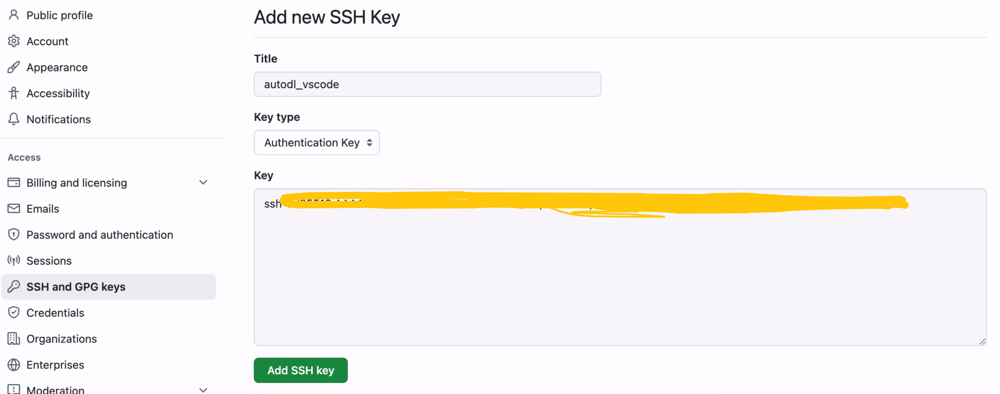
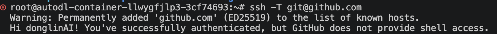

# Github 配置

> 目标：让 AutoDL 实例上的代码，以你自己的身份 push 到 GitHub 仓库。
> 一次配置包含三件事：认领身份、拿到权限、验证连通。

| 步骤 | 做什么 | 关键产出 |
| --- | --- | --- |
| 1 | 配置 git 身份 | `~/.gitconfig` 里的 name 和 email |
| 2 | 配置 GitHub 认证 | `~/.ssh/` 里的密钥对 + GitHub 上的公钥 |
| 3 | 测试是否联通 | `ssh -T` 返回 successfully authenticated |

---

## 1. 配置 git 身份

标明代码是你提的，涨绿格子；（明确了使用 autodl 上哪个实例的情况下，当实例释放后使用新实例时，还需要重新执行一遍）

```bash
git config --global user.name "donglinAI"
git config --global user.email "donglin_cui@163.com"
```

**验证是否写入成功：**

- 方式 1：在 `.gitconfig` 查看
- 方式 2：命令 `git config --global --list`

> ⚠️ 这两个配置只写进当前实例的 `~/.gitconfig`，实例释放后换新实例会丢失，需要重新执行一遍。

---

## 2. 配置 Github 认证

允许你往仓库 push 代码的权限。做法是本地生成一对 SSH 密钥，把公钥登记到 GitHub，之后 push 时 GitHub 认的是这把钥匙。

```bash
ssh-keygen -t ed25519 -C "donglin_cui@163.com"

# "-t ed25519" 是一种加密算法，可以不加，则使用默认算法；
# "-C donglin_cui@163.com" 起到备注作用，会追加到 pub 公钥的尾部作为一种标识，方便查哪个邮箱提交的公钥
```

**执行过程中**

- 一路回车至结束

**验证是否成功**

- 在 `.ssh/` 目录新生成 2 个文件：`id_ed25519`（私钥）和 `id_ed25519.pub`（公钥）

**后续**

- 将公钥内容复制到 github 上

查看公钥内容（一行，以 `ssh-ed25519` 开头、邮箱结尾）：

```bash
cat ~/.ssh/id_ed25519.pub
```

### 在 GitHub 添加公钥

路径：GitHub → 右上角头像 → **Settings** → 左侧 **SSH and GPG keys** → **New SSH key**



填写方式：

| 字段 | 填写内容 |
| --- | --- |
| Title | `autodl_vscode`（随你起名，认得出是哪台机器即可） |
| Key type | `Authentication Key` |
| Key | 粘贴 `id_ed25519.pub` 的完整内容 |

填完点 **Add SSH key**。

> ⚠️ 粘贴的是公钥（`.pub` 文件），不是私钥 `id_ed25519`。私钥只留在本机，永远不要外传。

---

## 3. 测试是否联通

```bash
ssh -T git@github.com
```

成功：返回以下 "Hi donglinAI! You've successfully authenticated, xx" 表明成功！



不用担心，`Warning: xxx` 信息，首次联通存在，之后没有；对应的动作是，在 `.ssh` 目录新增 `known_hosts` 文件，存放 github 主机指纹；

> 补充：结尾那句 `but GitHub does not provide shell access` 也是正常提示 —— GitHub 只开放 git 操作权限，不提供登录 shell，不影响 push。