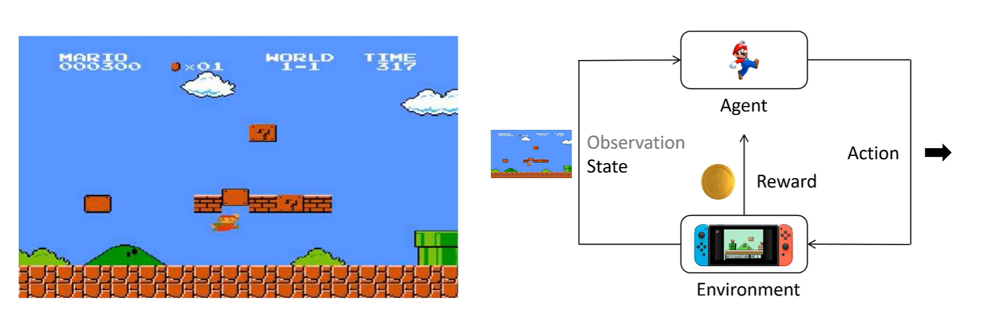

# PPO 算法原理

PPO（Proximal Policy Optimization，近端策略优化）是目前强化学习与 RLHF 里最常用的策略优化算法。它由三样东西拼成：**策略梯度** 决定往哪走，**重要性采样** 让旧数据可以反复用，**截断目标** 把每次更新的幅度锁在一个小区间里，不让策略一步走崩。

本文按这条主线展开：先阐述强化学习的概念与符号，再把策略梯度一路推到 PPO 的损失函数，每一处变形都给出完整的代数步骤与含义解释，最后用一段 Pytorch 代码实现 PPO 算法。

**一句话总结**：PPO = 策略梯度 + 重要性采样（让旧数据可以反复用）+ 一个"把新旧策略概率比锁在 $`[1-\varepsilon, 1+\varepsilon]`$ 区间内"的截断目标，从而同时拿到 on-policy 的稳定性和 off-policy 的样本效率。

---

## 目录

- [1. 强化学习基础概念](#1-强化学习基础概念)
- [2. 策略梯度：从目标函数到可计算的梯度](#2-策略梯度从目标函数到可计算的梯度)
- [3. 三个关键改进：折扣回报、基线、Actor-Critic](#3-三个关键改进折扣回报基线actor-critic)
- [4. Q / V / A 与 GAE](#4-q--v--a-与-gae)
- [5. 从 on-policy 到 off-policy：重要性采样](#5-从-on-policy-到-off-policy重要性采样)
- [6. PPO 的两类约束：KL 惩罚与 Clip 截断](#6-ppo-的两类约束kl-惩罚与-clip-截断)
- [7. 重点公式速查表](#7-重点公式速查表)
- [8. 代码结构与逐段说明](#8-代码结构与逐段说明)
- [9. 运行方式与实测结果](#9-运行方式与实测结果)
- [10. 常见坑与调参建议](#10-常见坑与调参建议)
- [11. 与 GRPO 的对照](#11-与-grpo-的对照)
- [12. 附录：期望、偏差与方差](#12-附录期望偏差与方差)
- [13. 附录：好的局势与坏的局势](#13-附录好的局势与坏的局势)

---

## 1. 强化学习基础概念

以超级玛丽游戏为例，用一张智能体-环境交互图展示各概念之间的关系。



> 左：环境渲染出的游戏画面。右：经典的 Agent–Environment 交互回路。环境给出 Observation / State，Agent 输出 Action，环境回填 Reward 并推进到下一帧，如此循环直到一局结束。

### 1.1 认识五个基础概念

- **环境（Environment）**：运行中的整个游戏系统，负责生成画面、切换状态、结算奖励、判定结束。智能体只能通过**既定动作** 与它交互，不能直接改内存。
- **智能体（Agent）**：观察状态，按策略输出动作，目标是最大化拿到手的奖励总和。
- **状态 / 观测（State / Observation）**：状态是环境的完整情况，观测是智能体可见的那一部分。超级玛丽里两者等价；很多真实场景智能体只能看到局部，那叫部分可观测。
- **动作（Action）**：智能体在当前状态下输出的行为。
- **奖励（Reward）**：执行动作后环境返回的标量反馈，可正可负，它的定义质量直接决定训练效果——奖励设计错了，模型就会精准地学会钻空子。

图里那条环绕的箭头就是 RL 的全部数据流：状态 → 策略 → 动作 → (奖励, 下一状态) → 状态…… **一局从 reset 开始，到 done 结束，称为一个 episode** 。

### 1.2 动作空间、策略、轨迹与回报


**动作空间（Action Space）**：可选择的动作集合，这里是 $`\{\text{left},\text{up},\text{right}\}`$。

**策略（Policy）**：输入状态，输出动作的概率分布，记作 $`\pi`$，参数化后为 $`\pi_\theta`$：

```math
\pi(\text{left}\mid s_t)=0.1,\qquad \pi(\text{up}\mid s_t)=0.2,\qquad \pi(\text{right}\mid s_t)=0.7
```

三个数加起来为 1。它是**分布**而不是单个动作：训练时按分布采样，0.7 的概率选 right，但也保留了 0.3 的概率去试别的——这正是探索的来源。

**轨迹（Trajectory）**：一连串状态与动作组成的序列，记作 $`\tau=\{s_0,a_0,s_1,a_1,\ldots\}`$，也叫 episode 或 rollout。状态转移有两类：

```math
s_{t+1}=f(s_t,a_t)\ \ (\text{确定型}),\qquad s_{t+1}\sim P(\cdot\mid s_t,a_t)\ \ (\text{随机型})
```

超级玛丽基本是确定转移；LLM 的 token 采样都属于随机型。

**回报（Return）**：从当前时刻到游戏结束的奖励累积。注意是"到结束"，不是"这一步"——一个动作的好坏由它带来的长期后果决定，这是 RL 与监督学习最根本的区别。

### 1.3 术语总表


| 概念 | 符号 | 含义 | 在 LLM 场景下的对应物 |
| --- | --- | --- | --- |
| 环境 | — | 生成画面、切换状态、给出奖励、判定结束 | 用户 prompt + 评分器 |
| 智能体 | — | 观察状态、输出动作、最大化总奖励 | 被训练的语言模型 |
| 状态 / 观测 | $`s`$ | 环境当前完整情况 / 智能体可见部分 | 已生成的 token 序列 |
| 动作 | $`a`$ | 策略输出的行为 | 下一个 token |
| 动作空间 | $`\mathcal{A}`$ | 所有可选动作的集合 | 词表 |
| 奖励 | $`r`$ | 执行动作后环境给的标量反馈 | 规则打分 / 奖励模型分 |
| 策略 | $`\pi_\theta(a\mid s)`$ | 状态到动作概率分布的映射，由 $`\theta`$ 参数化 | 语言模型本身 |
| 轨迹 | $`\tau`$ | 一整局的状态-动作-奖励序列，也叫 episode / rollout | 一条完整回答 |
| 回报 | $`G_t`$ | 从第 $`t`$ 步起的折扣累积奖励 | 整条回答的得分 |

### 1.4 两个容易忽略但很关键的细节

1. **策略输出的是概率分布，采样而不是取最大值。** 训练和推理都按分布采样，这样才有探索性，也才能让"提升某个动作概率"这件事有意义。取 argmax 就退化成贪心，策略梯度无从谈起。
2. **优化目标是长期回报，不是单步奖励。** 立刻吃到金币不一定最优，可能要牺牲眼前收益换取后面的通关。

训练目标写成期望（期望介绍[第 12 章](#12-附录期望偏差与方差)）形式：

```math
J(\theta)=\mathbb{E}_{\tau\sim\pi_\theta}\left[R(\tau)\right]=\sum_{\tau}P_\theta(\tau)\,R(\tau)
```

其中 $`R(\tau)`$ 是整条轨迹的总回报，$`P_\theta(\tau)`$ 是这条轨迹被策略生成出来的概率。目标是**最大化**它，所以用梯度上升。

---

## 2. 策略梯度：从目标函数到可计算的梯度

### 2.1 第一步：梯度推到期望里面

$`R(\tau)`$ 与 $`\theta`$ 无关，只有 $`P_\theta(\tau)`$ 与参数有关，于是梯度可以直接作用在概率上：

```math
\nabla_\theta J(\theta)=\nabla_\theta\sum_{\tau}P_\theta(\tau)R(\tau)=\sum_{\tau}\nabla_\theta P_\theta(\tau)\,R(\tau)
```

这里用到一个恒等式（log-derivative trick）：

```math
\nabla_\theta P_\theta(\tau)=P_\theta(\tau)\,\nabla_\theta\log P_\theta(\tau)
```

代入就得到**期望形式**，也就是可以用采样估计的形式：

```math
\nabla_\theta J(\theta)=\mathbb{E}_{\tau\sim\pi_\theta}\left[R(\tau)\,\nabla_\theta\log P_\theta(\tau)\right]
```

这一步是全篇最关键的一次变形：**"对概率求梯度" 变成了 "在采样上对 log 概率求梯度加权平均"**，于是梯度可以被蒙特卡洛估计。

### 2.2 第二步：把轨迹概率拆成每一步

轨迹的联合概率是"初始状态分布 × 每一步的策略概率 × 每一步的环境转移概率"：

```math
P_\theta(\tau)=\rho(s_0)\prod_{t=0}^{T}\pi_\theta(a_t\mid s_t)\,p(s_{t+1}\mid s_t,a_t)
```

取 log 后连乘变连加：

```math
\log P_\theta(\tau)=\log\rho(s_0)+\sum_{t=0}^{T}\log\pi_\theta(a_t\mid s_t)+\sum_{t=0}^{T}\log p(s_{t+1}\mid s_t,a_t)
```

再对 $`\theta`$ 求梯度。**初始分布 $`\rho(s_0)`$ 和环境转移 $`p(s'\mid s,a)`$ 都不含 $`\theta`$，梯度为 0**，所以整串只剩下策略项：

```math
\nabla_\theta\log P_\theta(\tau)=\sum_{t=0}^{T}\nabla_\theta\log\pi_\theta(a_t\mid s_t)
```

代回 2.1 的期望式：

```math
\nabla_\theta J(\theta)=\mathbb{E}_{\tau\sim\pi_\theta}\left[\sum_{t=0}^{T}R(\tau)\,\nabla_\theta\log\pi_\theta(a_t\mid s_t)\right]
```

### 2.3 第三步：REINFORCE 更新式与损失函数

用 $`N`$ 条轨迹的采样均值近似期望，得到 **REINFORCE**：

```math
\nabla_\theta J(\theta)\approx\frac{1}{N}\sum_{n=1}^{N}\sum_{t=1}^{T_n}R(\tau^n)\,\nabla_\theta\log\pi_\theta(a_n^t\mid s_n^t)
```

参数更新：

```math
\theta\leftarrow\theta+\alpha\,\frac{1}{N}\sum_{n=1}^{N}\sum_{t=1}^{T_n}R(\tau^n)\,\nabla_\theta\log\pi_\theta(a_n^t\mid s_n^t)
```

框架里写成"最小化损失"的形式（取负号）：

```math
\mathcal{L}_{\mathrm{REINFORCE}}(\theta)=-\frac{1}{N}\sum_{n=1}^{N}R(\tau^n)\sum_{t=1}^{T_n}\log\pi_\theta(a_n^t\mid s_n^t)
```

**直觉**：$`R(\tau)`$ 是标量权重，乘在**这条轨迹里每一个 token 的 log 概率**上。

- $`R>0`$：这条轨迹里所有动作的概率都被抬高；
- $`R<0`$：这条轨迹里所有动作的概率都被压低。

这就是"一荣俱荣、一损俱损"，也是方差巨大的根源——整局只有一个分数，分不清是哪一步立了功、哪一步闯了祸。

### 2.4 采样概率从哪来：神经网络一次前向

上面的式子把 $`\pi_\theta(a\mid s)`$ 写得理所当然，落到工程上它是**神经网络一次前向直接预估出来的**，不是查表也不是统计频次。

数据流是这样的：

1. **输入**：状态。超级玛丽里是一帧（或几帧堆叠的）画面；LLM 里是当前上下文。
2. **主干**：CNN / Transformer 把状态编码成特征向量。
3. **输出头**：一个"动作个数"维的全连接层，输出未归一化的 logits。
4. **softmax**：把 logits 变成和为 1 的概率分布，比如 left 0.2 / up 0.1 / right 0.7。
5. **采样**：按这个分布抽一个动作，同时记下它被选中的概率 $`\pi_\theta(a\mid s)`$。
6. **$`\theta`$**：以上所有层的参数。所谓"更新策略"，就是改这些参数，让好动作那一路的概率变大。

对应到代码只有三行：

```python
logits = self.policy_head(h)                  # [batch, n_actions]，未归一化打分
dist = torch.distributions.Categorical(logits=logits)
logp = dist.log_prob(action)                  # 即 log π_θ(a|s)
```

所以策略梯度里的 $`\nabla_\theta\log\pi_\theta(a\mid s)`$，就是"log_softmax 中该动作那一路对网络参数的梯度"。反向传播时，梯度从这一项流回整个网络；$`R(\tau)`$ 只是给这条梯度乘上的标量权重。

---

## 3. 三个关键改进：折扣回报、基线、Actor-Critic

### 3.1 改进一：用「从当前步开始」的折扣回报

整条轨迹的总回报里，$`t`$ 步之前的奖励跟当前动作毫无因果关系，纯属噪声。改成从当前步往后算，并加折扣因子 $`\gamma\in[0,1)`$：

```math
G_t=\sum_{t'=t}^{T}\gamma^{t'-t}r_{t'}
```

梯度变成：

```math
\nabla_\theta J(\theta)=\mathbb{E}\left[\sum_{t=1}^{T}G_t\,\nabla_\theta\log\pi_\theta(a_t\mid s_t)\right]
```

$`\gamma`$ 的作用：越远的奖励权重指数衰减，等效于"缩短有效视野"，方差随之下降。

### 3.2 改进二：减去基线

先别急着看公式，先回答一个问题：**为什么好端端的策略梯度，突然要减掉一个东西？**

因为不同局面天生就有不同的"底分"。

- **好的局势**：开局顺、离终点近、血条满。这时候随便走一步，后面也大概率吃到高分，$`G_t`$ 长期是正数；
- **坏的局势**：站在坑边、只剩一格血、时间快耗尽。再好的动作也救不回来，$`G_t`$ 长期是负数。

于是同一个动作会被局势的底色反复拉扯：

| 局面 | 同一个动作 | 该局面典型 $`G_t`$ | 直接拿 $`G_t`$ 更新 | 后果 |
| --- | --- | --- | --- | --- |
| 好局势 | 向右跳 | $`+40`$ | 概率被抬高 | 学会"向右永远好" |
| 坏局势 | 向右跳 | $`-10`$ | 概率被压低 | 同一个动作又被否定 |
| — | — | 真实增量可能都是 $`+5`$ | — | 相对信息被底色淹没 |

第三行是关键：这个动作在两个局面里的**真实增量可能一模一样**，但 $`G_t`$ 的绝对值差了 50。模型学到的不是"动作相对这个局面好不好"，而是"这一局整体顺不顺"，梯度信号被底色污染，方差极大。

**减掉基线，就是把这个局面的底分先扣掉**：好局势 $`b(s_t)\approx+35`$ → 增量 $`+5`$；坏局势 $`b(s_t)\approx-15`$ → 增量同样是 $`+5`$。同一个真正优秀的动作，在两种局势下都得到正向鼓励，信号这才可比、才稳定。

这就是 3.2 要做的事，写成公式：

```math
\nabla_\theta J(\theta)=\mathbb{E}\left[\sum_{t=1}^{T}\left(G_t-b(s_t)\right)\nabla_\theta\log\pi_\theta(a_t\mid s_t)\right]
```

**为什么减基线不改变梯度的期望？** 对任意只依赖状态 $`s`$ 的函数 $`b(s)`$：

```math
\mathbb{E}_{a\sim\pi_\theta}\left[b(s)\nabla_\theta\log\pi_\theta(a\mid s)\right]
=b(s)\sum_{a}\pi_\theta(a\mid s)\nabla_\theta\log\pi_\theta(a\mid s)
=b(s)\sum_{a}\nabla_\theta\pi_\theta(a\mid s)
=b(s)\,\nabla_\theta\!\!\sum_{a}\pi_\theta(a\mid s)
=b(s)\,\nabla_\theta 1=0
```

第三行用到了 $`\pi\nabla\log\pi=\nabla\pi`$。所以**减去基线是无偏的**，但由于把"这个局面本来就有的基础分"扣掉了，只留下动作的增量信号，方差显著下降。这是标准的控制变量（control variate）技巧。

### 3.3 改进三：Actor-Critic

基线用不着人工设计，直接用一个网络估状态价值 $`V_\phi(s)`$，于是分工成型：

- **Actor**（策略网络 $`\pi_\theta`$）：决定做什么；
- **Critic**（价值网络 $`V_\phi`$）：评估这个局面本身值多少分，提供基线。

代入基线后，策略梯度里的权重就是**优势函数**：动作比"这个局面的平均水平"好多少。

---

## 4. Q / V / A 与 GAE

### 4.1 三个函数

```math
Q^{\pi}(s,a)=\mathbb{E}_{\pi}\left[G_t\mid s_t=s,\,a_t=a\right]
```

```math
V^{\pi}(s)=\mathbb{E}_{a\sim\pi}\left[Q^{\pi}(s,a)\right]=\mathbb{E}_{\pi}\left[G_t\mid s_t=s\right]
```

```math
A^{\pi}(s,a)=Q^{\pi}(s,a)-V^{\pi}(s)
```

- $`Q`$：在 $`s`$ 做 $`a`$ 之后按策略走下去的**期望回报**；
- $`V`$：在 $`s`$ 按策略走下去的**平均回报**（对所有动作取期望）；
- $`A`$：这个动作比平均水平**好多少**。$`A>0`$ 鼓励，$`A<0`$ 抑制。

关键工程事实：**只需要训练 $`V`$ 一个网络**。因为贝尔曼关系

```math
Q^{\pi}(s_t,a_t)=r_t+\gamma\,\mathbb{E}\left[V^{\pi}(s_{t+1})\right]
```

给了 Q 的无偏替身，用采样代入就得到可计算的估计。

**把 $`Q`$ 代回优势函数，就能看清 A 到底依赖什么**：

```math
A_\theta(s,a)=Q_\theta(s,a)-V_\theta(s)
```

```math
Q_\theta(s_t,a)=r_t+\gamma\,V_\theta(s_{t+1})
```

```math
A_\theta(s_t,a)=r_t+\gamma\,V_\theta(s_{t+1})-V_\theta(s_t)
```

这就是"**优势函数只和状态价值有关**"的由来：右边三项全是已知量——当前这一步的即时奖励 $`r_t`$，加上下一状态价值 $`V_\theta(s_{t+1})`$ 的折扣值，再减去当前状态价值 $`V_\theta(s_t)`$，而这两个价值都来自**同一个 V 网络的标量输出**。

工程上带来三个好处：

1. **只训一个网络**。不用再维护 Q 网络，参数量、显存、调参负担一起降；
2. **连续动作空间也成立**。Q 网络要给每个动作输出一个值，连续动作根本没法枚举；V 只输出一个标量，和动作维度无关；
3. **一步 TD 误差就是这个式子的直接结果**，即 $`\delta_t=A^1_t`$，后面 4.3 的多步展开、4.4 的 GAE 都从它长出来。

代价是：优势的准确度完全押在 V 网络身上。V 估偏了，优势就偏了——这正是"偏差"的来源，也是 4.4 要用 $`\lambda`$ 在长步短步之间折中的原因。

### 4.2 一步 TD 误差

用单样本代入贝尔曼等式（期望变成实际观测，所以只能是近似）：

```math
\delta_t=r_t+\gamma V_\phi(s_{t+1})-V_\phi(s_t)
```

$`\delta_t`$ 就是**一步 TD 误差**，也是最粗的优势估计：方差最小，但完全依赖价值网络的准确度，偏差最大。

### 4.3 k 步优势的完整展开

一步：

```math
A_t^{1}=\delta_t=r_t+\gamma V(s_{t+1})-V(s_t)
```

两步，把 $`V(s_{t+1})`$ 用一步 TD 目标替换：

```math
A_t^{2}=r_t+\gamma r_{t+1}+\gamma^{2}V(s_{t+2})-V(s_t)
```

验证它可以拆成两个 TD 残差相加，中间项正好抵消：

```math
\begin{aligned}
\delta_t+\gamma\delta_{t+1}
&=\left(r_t+\gamma V_{t+1}-V_t\right)+\gamma\left(r_{t+1}+\gamma V_{t+2}-V_{t+1}\right)\\
&=r_t+\gamma r_{t+1}+\gamma^{2}V_{t+2}-V_t
\end{aligned}
```

三步同理：

```math
A_t^{3}=\delta_t+\gamma\delta_{t+1}+\gamma^{2}\delta_{t+2}
=r_t+\gamma r_{t+1}+\gamma^{2}r_{t+2}+\gamma^{3}V_{t+3}-V_t
```

归纳到 k 步：

```math
A_t^{k}=\sum_{l=0}^{k-1}\gamma^{l}\delta_{t+l}
```

一直展开到轨迹终点 $`T`$，末端没有后继状态（$`V(s_{T+1})=0`$），全部变成真实奖励，就是**蒙特卡洛优势**：

```math
A_t^{T}=G_t-V(s_t)
```

**偏差-方差权衡**：

| 步数 | 依赖价值网络的程度 | 采样随机性 | 偏差 | 方差 |
| --- | --- | --- | --- | --- |
| 1 步 TD | 高 | 低 | 高 | 低 |
| k 步 | 中 | 中 | 中 | 中 |
| 到终点（蒙特卡洛） | 0 | 全部叠加 | 无偏 | 高 |

### 4.4 GAE：把各阶优势加权平均

GAE 的出发点不是"选一个步数"，而是"**给所有步数加权，权重指数衰减**"：

```math
A_t^{\mathrm{GAE}(\lambda)}=(1-\lambda)\sum_{k=1}^{\infty}\lambda^{k-1}A_t^{k}
```

系数 $`(1-\lambda)\lambda^{k-1}`$ 之和为 1，所以这是一个**加权平均**（这就是为什么必须带 $`(1-\lambda)`$；去掉它就只是加权和，不是平均）。

**化简**：把每个 $`A_t^{k}`$ 展开成 TD 残差的和，按 $`\delta_{t+l}`$ 收集同类项。$`\delta_{t+l}`$ 出现在所有 $`k\ge l+1`$ 的项里，系数为

```math
(1-\lambda)\sum_{k=l+1}^{\infty}\lambda^{k-1}\gamma^{l}
=(1-\lambda)\gamma^{l}\lambda^{l}\left(1+\lambda+\lambda^{2}+\cdots\right)
=(1-\lambda)\gamma^{l}\lambda^{l}\frac{1}{1-\lambda}
=(\gamma\lambda)^{l}
```

于是 $`(1-\lambda)`$ 与等比级数的分母抵消，得到 PPO 里实际用的形式：

```math
A_t^{\mathrm{GAE}(\lambda)}=\sum_{l=0}^{\infty}(\gamma\lambda)^{l}\delta_{t+l}
```

两个端点：

- $`\lambda=0`$：只剩 $`\delta_t`$，退化为一步 TD（低方差、高偏差）；
- $`\lambda=1`$：权重变成 $`\gamma^{l}`$，退化为蒙特卡洛优势 $`G_t-V(s_t)`$（无偏、高方差）。

实践中取 $`\lambda=0.95`$、$`\gamma=0.99`$，落在两者之间。

### 4.5 价值网络怎么训练

价值网络的回归目标是"从 $`s_t`$ 开始的折扣回报"。工程上直接用 GAE 算出的返回值，避免再单独跑一遍蒙特卡洛：

```math
\hat{R}_t=A_t^{\mathrm{GAE}}+V_\phi(s_t),\qquad
\mathcal{L}_V=\frac{1}{2}\,\mathbb{E}\left[\left(V_\phi(s_t)-\hat{R}_t\right)^{2}\right]
```

---

## 5. 从 on-policy 到 off-policy：重要性采样

### 5.1 on-policy 的效率问题

策略梯度要求"用 $`\pi_\theta`$ 采的数据更新 $`\pi_\theta`$"。参数一更新，旧数据就过期，只能丢掉重采。一个直观的类比：学生（待训练策略）必须一直跟着老师（数据采集策略）上课，老师讲过的内容不能回放，学习速度被采样速度卡死。

### 5.2 重要性采样

想算分布 $`p`$ 下的期望，手上只有分布 $`q`$ 的样本，可以乘一个比值校正：

```math
\mathbb{E}_{x\sim p}\left[f(x)\right]=\int p(x)f(x)\,dx=\int q(x)\frac{p(x)}{q(x)}f(x)\,dx=\mathbb{E}_{x\sim q}\left[\frac{p(x)}{q(x)}f(x)\right]
```

放到策略梯度上：用参考策略 $`\theta'`$（旧策略，采集数据时用的那份）采样，目标策略是当前要更新的 $`\theta`$：

```math
\nabla_\theta J(\theta)=\mathbb{E}_{a\sim\pi_{\theta'}}\left[\frac{\pi_\theta(a\mid s)}{\pi_{\theta'}(a\mid s)}\,A^{\pi_{\theta'}}(s,a)\,\nabla_\theta\log\pi_\theta(a\mid s)\right]
```

因为 $`\nabla_\theta\log\pi_\theta=\nabla_\theta\pi_\theta/\pi_\theta`$，分子里的 $`\pi_\theta`$ 被约掉，得到可以直接优化的目标：

```math
\mathcal{L}(\theta)=-\mathbb{E}_{s,a\sim\pi_{\theta'}}\left[\frac{\pi_\theta(a\mid s)}{\pi_{\theta'}(a\mid s)}\,A^{\pi_{\theta'}}(s,a)\right]
```

记概率比：

```math
r_t(\theta)=\frac{\pi_\theta(a_t\mid s_t)}{\pi_{\theta'}(a_t\mid s_t)}
```

**这份数据可以更新很多次，效率上来了，但新风险也来了**：比值偏离 1 越远，估计方差越大；一旦两个分布差得太远，重要性采样估计直接失真，训练崩掉。

---

## 6. PPO 的两类约束：KL 惩罚与 Clip 截断

PPO 的全部工作就是"允许复用旧数据，但禁止新策略跑太远"。两种实现路线。

### 6.1 路线一：KL 惩罚

```math
\mathcal{L}_{\mathrm{KL}}(\theta)=-\mathbb{E}\left[r_t(\theta)A_t\right]+\beta\,\mathbb{D}_{\mathrm{KL}}\left(\pi_\theta\;\|\;\pi_{\theta'}\right)
```

第二项是软约束：策略偏离就罚，$`\beta`$ 控制罚款力度。缺点是 $`\beta`$ 难调——太小约束不住，太大模型学不动，而且 KL 是"事后"惩罚，更新完才知道超了多少。

### 6.2 路线二：Clip 截断（主流）

```math
\mathcal{L}_{\mathrm{CLIP}}(\theta)=-\mathbb{E}\left[\min\left(r_t(\theta)A_t,\;\mathrm{clip}\left(r_t(\theta),1-\varepsilon,1+\varepsilon\right)A_t\right)\right]
```

$`\varepsilon`$ 通常取 0.2。这个目标不是"惩罚偏离"，而是**直接把偏离带来的收益砍掉**，是硬约束。

**分两种情况看**（把 $`A`$ 的符号固定，看 $`r`$ 跑到边界外会发生什么）：

| 优势 | 我们希望的更新方向 | $`r`$ 在区间内 | $`r`$ 越界（$`A>0`$ 看上界，$`A<0`$ 看下界） | 结果 |
| --- | --- | --- | --- | --- |
| $`A>0`$（好动作） | 提高 $`\pi_\theta`$，$`r`$ 变大 | 目标随 $`r`$ 线性增长，正常鼓励 | $`\mathrm{clip}`$ 把 $`r`$ 压回 $`1+\varepsilon`$，两项相等/被 min 选中 | 梯度为 0，**再涨也不给奖励** |
| $`A<0`$（坏动作） | 降低 $`\pi_\theta`$，$`r`$ 变小 | 目标随 $`r`$ 下降，正常抑制 | $`\mathrm{clip}`$ 把 $`r`$ 抬回 $`1-\varepsilon`$ | 梯度为 0，**再降也不给奖励** |

**为什么用 min？** 取 min 得到的是原始目标的一个**悲观下界**：

- 对 $`A>0`$：$`\min(rA,\mathrm{clip}(r)A)`$ 保证策略改善带来的收益"最多只按 $`1+\varepsilon`$ 计入"，不允许靠一次极端更新刷分；
- 对 $`A<0`$：$`\min`$ 选中的是更悲观（更负）的那一项，保证不会因为过度降低坏动作概率而获得虚高收益。

数学上更严谨的说法：$`\min`$ 让**目标函数在下界处与未裁剪目标重合、在上界处被压平**，于是策略更新"走过头不加分、走不够照常加分"，单次更新的有效步长被锁死在一个小区间里。

### 6.3 完整的 PPO 损失（代码里真正算的）

```math
\mathcal{L}(\theta,\phi)=-\mathbb{E}\left[\min\left(r_tA_t,\;\mathrm{clip}(r_t,1-\varepsilon,1+\varepsilon)A_t\right)\right]
+c_1\,\mathbb{E}\left[\left(V_\phi(s_t)-\hat{R}_t\right)^{2}\right]
-c_2\,\mathbb{E}\left[\mathcal{H}\left(\pi_\theta(\cdot\mid s_t)\right)\right]
```

三项分别是策略损失、价值回归、熵奖励。$`c_1\approx0.5`$，$`c_2\approx0.01`$，熵项用来防止策略过早塌成确定性（探索没了，后面就学不动）。

---

## 7. 重点公式速查表

| 公式 | 名称 | 一句话含义 | 代码位置 |
| --- | --- | --- | --- |
| $`J(\theta)=\mathbb{E}_{\tau\sim\pi_\theta}[R(\tau)]`$ | 训练目标 | 让高回报轨迹出现的概率变大 | — |
| $`\nabla J=\mathbb{E}[R(\tau)\nabla\log P_\theta(\tau)]`$ | 策略梯度 | 把"对概率求导"换成"对 log 概率求导" | `policy_loss` 的祖先 |
| $`G_t=\sum_{t'=t}\gamma^{t'-t}r_{t'}`$ | 折扣回报 | 只算当前步往后的奖励，远期打折 | 替代 $`R(\tau)`$ |
| $`A=Q-V`$ | 优势函数 | 这个动作比该状态平均水平好多少 | `advantages` |
| $`\delta_t=r_t+\gamma V(s_{t+1})-V(s_t)`$ | TD 误差 | 一步之内"实际比预期好多少" | `compute_gae` 的 `delta` |
| $`A_t^{\mathrm{GAE}}=\sum_l(\gamma\lambda)^l\delta_{t+l}`$ | 广义优势估计 | TD 误差按 $`\gamma\lambda`$ 衰减累加，权衡偏差方差 | `compute_gae` |
| $`r_t(\theta)=\pi_\theta/\pi_{\theta'}`$ | 重要性采样比 | 新策略相对旧策略把该动作概率改了多少倍 | `ratio` |
| $`\min(rA,\mathrm{clip}(r)A)`$ | 截断目标 | 更新走过头就不给额外奖励 | `policy_loss` |
| $`\beta\,\mathbb{D}_{\mathrm{KL}}(\pi_\theta\Vert\pi_{\theta'})`$ | KL 约束 | 软约束，偏离就罚 | 可选（本实现用 clip + 近似 KL 早停） |
| $`(V_\phi-\hat R)^2`$ | 价值回归 | Critic 学会预测回报 | `value_loss` |
| $`\mathcal{H}(\pi)`$ | 策略熵 | 分布越均匀熵越大，维持探索 | `entropy` |

---

## 8. 代码结构与逐段说明

`ppo.py` 是单文件实现，约 300 行，无第三方强化学习框架，只依赖 `torch` 与 `gymnasium`。

```text
ppo.py
├── Config               超参数（dataclass，逐项注释）
├── ActorCritic          共享主干 + 策略头 + 价值头
├── RolloutBuffer        采样缓存（含 value_next 与 terminal）
├── compute_gae          GAE 倒序递推
├── ppo_update           截断目标 + 价值损失 + 熵奖励
├── train                采样 → 多 epoch 更新 → 丢弃 → 评估
└── plot_history         学习曲线与 KL 曲线
```

### 8.1 网络：一个主干两个头

```python
class ActorCritic(nn.Module):
    def forward(self, obs):
        h = self.trunk(obs)                       # 共享特征
        dist = torch.distributions.Categorical(logits=self.policy_head(h))
        value = self.value_head(h).squeeze(-1)    # 标量 V(s)
        return dist, value
```

两个细节是为了稳定：策略头用 `gain=0.01` 的正交初始化（初始策略接近均匀分布，不要一开始就过度自信）；价值头 `gain=1.0`。

### 8.2 采样：按分布采样，不取 argmax

```python
def act(self, obs):
    dist, value = self.forward(obs)
    action = dist.sample()          # 采样，保留探索
    logp = dist.log_prob(action)    # 记下旧策略的 log 概率，后面算 ratio 用
    return action, logp, value
```

**必须同时存 `logp` 和 `value`**：`logp` 是重要性采样比的分母，`value` 是 GAE 的起点。任何一项漏存，更新阶段就得重新前向一遍旧策略，非常容易埋 bug。

### 8.3 GAE：倒序递推一行搞定

```python
for t in reversed(range(n)):
    mask = 1.0 - terminals[t]
    delta = rewards[t] + gamma * values_next[t] * mask - values[t]
    last_adv = delta + gamma * lam * mask * last_adv
    advantages[t] = last_adv
```

对应公式

```math
\delta_t=r_t+\gamma V(s_{t+1})(1-d_t)-V(s_t),\qquad
A_t=\delta_t+\gamma\lambda(1-d_t)A_{t+1}
```

$`(1-d_t)`$ 掩码是必须的：episode 结束后，$`s_{t+1}`$ 属于新的一局，**跨 episode 自举会把上一局的价值污染到下一局**，这是最常见的隐形 bug。

### 8.4 PPO 更新：ratio、clip、min

```python
log_ratio = new_logprobs - old_logprobs[mb]
ratio = log_ratio.exp()

surr1 = ratio * adv
surr2 = torch.clamp(ratio, 1 - clip_eps, 1 + clip_eps) * adv
policy_loss = -torch.min(surr1, surr2).mean()

value_loss = F.mse_loss(new_values, returns[mb])
loss = policy_loss + value_coef * value_loss - entropy_coef * entropy
```

用 `log_prob` 之差再 `exp`，比直接 `new_probs / old_probs` 数值稳定得多（避免除零和极端比值）。

### 8.5 近似 KL 早停

```python
approx_kl = ((ratio - 1.0) - log_ratio).mean().item()
if approx_kl > target_kl:
    break
```

这个估计量恒非负、无偏，是 PPO 论文附录里的推荐做法。它让"同一批数据训练 10 个 epoch"变成自适应：偏离一大就提前收手，避免第 8、9 个 epoch 把策略带偏。

### 8.6 优势标准化

```python
advantages = (advantages - advantages.mean()) / (advantages.std() + 1e-8)
```

和 GRPO 的组内 Z-score 是同一个思想：让优势变成"零均值、单位标准差"的可比分差，避免不同批次奖励尺度变化导致步长忽大忽小。

---

## 9. 运行方式与实测结果

### 9.1 环境与依赖

```bash
pip install torch gymnasium matplotlib
```

### 9.2 训练

```bash
# 默认：CartPole-v1，150 轮更新，每轮 2048 步
python ppo.py

# 指定轮数并导出学习曲线
python ppo.py --updates 150 --plot assets/learning_curve.png
```

预期日志（本机 CPU 实测）：

```text
[upd    1] ep_ret=   22.2  pi_loss=-0.017  v_loss=52.374  ent=0.686  kl=0.0070  clip=10.0%
[upd   10] ep_ret=   90.7  pi_loss=+0.010  v_loss=95.567  ent=0.605  kl=0.0156  clip=8.1%
    -> eval greedy reward = 123.0  (elapsed 4.9s)
[upd   20] ep_ret=  131.0  pi_loss=-0.001  v_loss=119.218  ent=0.576  kl=0.0161  clip=13.4%
    -> eval greedy reward = 389.0  (elapsed 9.4s)
[upd   60] -> eval greedy reward = 500.0  (elapsed 26.7s)
Solved in 60 updates (threshold=475.0).
```

`ep_ret` 是这一轮里完成的对局平均回报，`clip` 是被截断的样本比例——它稳定在 5%~15% 说明 $`\varepsilon=0.2`$ 这个区间选得合适；如果长期接近 0，说明更新幅度太小、可以调大学习率；如果长期高于 40%，说明策略被推得太狠，该降学习率或缩小 epoch 数。


左图是每轮更新里完成对局的平均回报，右图是每轮更新的近似 KL。KL 全程被压在 `target_kl` 附近，正是 clip 与早停共同起作用的表现。

### 9.3 关键超参

| 参数 | 默认值 | 作用 | 调大 / 调小的后果 |
| --- | --- | --- | --- |
| `gamma` | 0.99 | 折扣因子 | 调小更短视，收敛快但可能学不到长期策略 |
| `lam` | 0.95 | GAE 的 $`\lambda`$ | 调小方差低、偏差高；调大反之 |
| `clip_eps` | 0.2 | 截断范围 | 调小更新保守、学得慢；调大易崩 |
| `epochs` | 10 | 每批数据重复训练轮数 | 调大样本效率高但易过拟合当前批次 |
| `lr` | 3e-4 | 学习率 | PPO 对学习率比较敏感，翻倍常直接崩 |
| `entropy_coef` | 0.01 | 熵奖励 | 调大探索多、收敛慢；调小易早熟塌缩 |
| `rollout_steps` | 2048 | 每批采样步数 | 太小时 GAE 估计方差大 |

### 9.4 评测

训练中每 `eval_interval` 轮用贪心策略跑 5 局，最优模型存为 `ppo_best.pt`：

```python
ckpt = torch.load("ppo_best.pt")
model = ActorCritic(ckpt["obs_dim"], ckpt["act_dim"])
model.load_state_dict(ckpt["model"])
```

---

## 10. 常见坑与调参建议

1. **采样用 argmax。** 分布退化成确定性策略，重要性采样比恒为 1，clip 完全失效，学不到东西。
2. **忘记 `(1-done)` 掩码。** 跨 episode 自举，价值估计被系统性污染，表现为 value loss 长期不降。
3. **把 truncated 当 terminated。** 时间上限截断并不代表状态终止，应当继续自举；本实现里 `terminal` 只存 `terminated`。
4. **优势不标准化。** 奖励尺度一批一变，等价于学习率在乱跳。
5. **ratio 用概率直接相除。** 旧概率可能极小，数值不稳，务必用 `exp(logp_new - logp_old)`。
6. **KL 惩罚与 clip 同时开很大。** 两者都在限制更新，叠加后学不动；主流做法是 clip 为主，KL 只用于监控或早停。
7. **模型不评估就宣布收敛。** 训练回报含探索噪声，必须用贪心策略单独评测。

---

## 11. 与 GRPO 的对照

PPO 是大模型 RLHF 的经典底座，GRPO 是它在"无 Critic"方向上的一次简化：

| 维度 | PPO | GRPO |
| --- | --- | --- |
| 网络 | Actor + Critic | 只有 Actor |
| 优势来源 | GAE（Critic 估 $`V`$） | 同一 prompt 下 G 条回答的组内 Z-score |
| 优势粒度 | 每步一个 $`A_t`$ | 每条轨迹一个 $`A_i`$，全轨迹共享 |
| 约束 | clip（$`\varepsilon`$）+ 可选 KL | clip + KL（对参考模型） |
| 样本要求 | 可逐步奖励 | 只需轨迹级最终奖励 |
| 典型场景 | 游戏控制、传统 RLHF | 数学 / 推理类可验证任务 |

两者策略项的骨架完全一致，都是

```math
-\min\left(r_tA_t,\;\mathrm{clip}(r_t,1-\varepsilon,1+\varepsilon)A_t\right)
```

差别只在"$`A`$ 从哪来"。理解了 PPO 的 clip，GRPO 只剩优势估计那一处替换。

---

## 12. 附录：期望、偏差与方差

### 12.1 先看一个期望的算例：小明考试

先看一个很接地气的例子：

> 老师告诉你小明的考试情况：20% 概率考 80 分，80% 概率考 90 分。那么你对小明这次考试的期望结果是多少？

```math
0.2\times 80+0.8\times 90=16+72=88
```

期望成绩 88 分。注意这个 88 不是"某一次考出来的分"，而是**把所有可能结果按概率加权后的中心值**。

"再考 n 次，统计平均成绩"说的是另一条路：反复采样、取平均，n 越大越接近 88。这两条路等价，就是期望的两种求法：

```math
\mathbb{E}_{x\sim p(x)}\left[x\right]=\sum_{x}x\,p(x)\;\approx\;\frac{1}{n}\sum_{i=1}^{n}x_i,\qquad x_i\sim p(x)
```

- 左边是**理论期望**：穷举所有可能结果，按概率加权；
- 右边是**采样估计**：只抽 $`n`$ 个样本求平均。

RL 里所有 $`\mathbb{E}`$ 走的都是右边这条：轨迹空间大到不可能穷举，只能采样。**这也解释了 2.3 里为什么 $`\frac{1}{N}\sum`$ 可以代替期望**。

一个算例看采样误差：真期望 88，抽 3 次恰好 90、80、90，均值 86.7，差 1.3 分。抽到 1000 次，误差才会压到很小——这就是"采样估计不等于期望"的直观体现，也是"样本量"在 RL 里值钱的原因。

### 12.2 偏差与方差：打靶比喻

| | 方差小 | 方差大 |
| --- | --- | --- |
| **偏差小** | 弹孔集中靶心：又准又稳（理想状态） | 围着靶心散开：平均对、单发飘（REINFORCE） |
| **偏差大** | 集中但整体偏左：稳定地错（一步 TD 全靠 V 的拟合） | 又偏又散：最差 |

- **偏差（Bias）**：估计值的期望与真值差多少。偏差大 = 系统性估高或估低，方向就错了。
- **方差（Variance）**：同样条件下多次估计的抖动程度。方差大 = 每次都不同，信号乱晃。

一句话记：**偏差看"平均准不准"，方差看"单次稳不稳"**。

### 12.3 案例解读：同一状态采样四条轨迹

假设在同一个状态 $`s`$ 下，用当前策略采 4 条轨迹，拿到回报：

```math
G^{(1)}=100,\quad G^{(2)}=20,\quad G^{(3)}=60,\quad G^{(4)}=0
```

- 均值 $`\bar G=45`$，标准差约 $`38.7`$；
- 若价值网络给出 $`V(s)=50`$，四条轨迹的优势分别是 $`+50,\;-30,\;+10,\;-50`$。

同一个状态、同一套动作，单次采样给出的信号能从 $`+50`$ 跳到 $`-50`$。**拿这四条去更新，方向几乎互相抵消**——这就是"方差大"在训练里的真实长相：loss 抖、回报抖、学得慢。

换成一步 TD：$`\delta_t=r_t+\gamma V(s_{t+1})-V(s_t)`$
- 每条样本只依赖紧邻的一步，抖动小得多（方差低）；
- 但完全押在 V 的准确度上，V 有系统误差就直接变成偏差（偏差高）。

| 估计方式 | 偏差 | 方差 | 依赖 |
| --- | --- | --- | --- |
| REINFORCE（整条 $`G_t`$） | 低（无偏） | 很高 | 只要采样 |
| 一步 TD（$`\delta_t`$） | 高（依赖 V） | 很低 | 一个准的 V |
| GAE（$`\lambda=0.95`$） | 中 | 中 | V + 采样 |

### 12.4 为什么 REINFORCE 的方差格外大

1. **后续所有随机性都叠加进 $`G_t`$**。第 $`t`$ 步动作再好，后面任一步抽到烂 token，整条回报直接崩。
2. **单条轨迹、没有平滑**。蒙特卡洛就是"拿一次采样当真值"；GAE 则会借 V 做多步平均。
3. **奖励稀疏**。LLM 里常常整条回答只有一个 0/1 分，中间全是 0，$`G_t`$ 几乎完全由结尾那一下随机决定。

### 12.5 压方差的两条路线

- **学一个基线**：$`A=G_t-V(s_t)`$，PPO 走这条，需要 Critic；
- **用同组样本做基线**：$`A_i=\dfrac{R_i-\bar R}{\sigma_R}`$，GRPO 走这条，不要 Critic，但要求同一 prompt 能采多条。

两条路本质相同：**把"局面或题目本身自带的分数"扣掉，只留相对增量**。

---

## 13. 附录：好的局势与坏的局势

### 13.1 把 3.2 的说法形式化

- **好的局势**：$`V(s)`$ 高。做对做错都容易拿高分，比如已经快到终点。
- **坏的局势**：$`V(s)`$ 低。再努力也难翻盘，比如只剩一格血。

同一个动作 $`a`$ 的真实增量 $`A(s,a)`$ 可能完全一样，但它在两种局势下的 $`G_t`$ 绝对水平差出一大截：

```math
G_t^{\text{good}}=V(s_{\text{good}})+A,\qquad G_t^{\text{bad}}=V(s_{\text{bad}})+A
```

直接用 $`G_t`$ 更新，等于让 $`V(s)`$ 这个"底色"主导梯度；减去 $`V(s_t)`$ 之后：

```math
A=G_t-V(s_t)
```

两种局势被归一到"相对平均水平"的同一把尺子上，这才是可比较的学习信号。

### 13.2 三种落地方式

| 做法 | 怎么处理"底色" | 代价 |
| --- | --- | --- |
| REINFORCE + baseline $`V(s)`$ | 减掉状态价值 | 要训 Critic |
| GAE | 用 $`\lambda`$ 缩短视野，顺带削弱远方随机性 | 仍有偏差，需调 $`\lambda`$ |
| GRPO | 用同 prompt 组内均值代替 $`V(s)`$ | 要求一题多采样，且无法逐 token 区分 |

在 LLM 场景里，"好的局势 / 坏的局势"可以直译成：**同一道题里，有的回答天生容易得分（简单解法、常见题型），有的写法怎么都吃亏**。GRPO 的组内归一化，就是不给每道题算绝对分，只问"在同样这道题的这批回答里，你比平均好多少"。

### 13.3 一句话收尾

**好的局势与坏的局势 = 状态价值的高低。** 优势函数做的事，就是把"这个局面本来值多少"减掉，只留"这个动作额外挣到多少"。从 3.2 的动机、4.1 的推导，到 GAE 和 GRPO 的设计，都是这一句话的不同实现。

---

## 参考文献

- 论文：Schulman et al., *Proximal Policy Optimization Algorithms*, arXiv:1707.06347
- 论文：Schulman et al., *High-Dimensional Continuous Control Using Generalized Advantage Estimation*, arXiv:1506.02438
- 论文：Sutton & Barto, *Reinforcement Learning: An Introduction*（第 13 章策略梯度）
