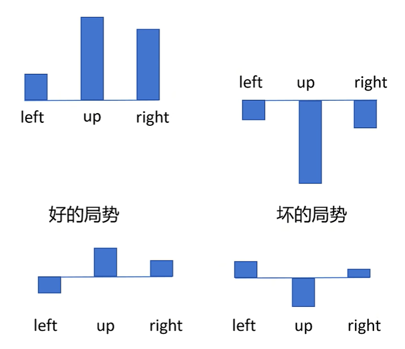
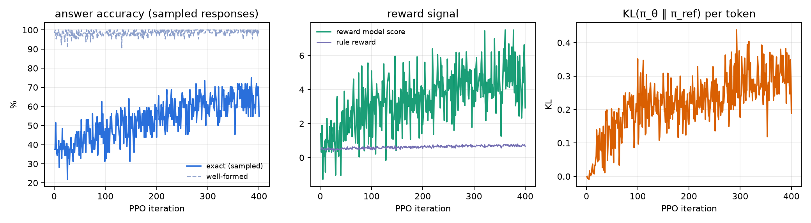

# PPO 算法原理

**PPO 是目前强化学习里使用最广的策略优化算法，RLHF 的对齐阶段基本都以它为基础。** 它的出发点仍然是 **策略梯度** ：朝着让高回报动作概率变大的方向更新参数。真正的难点在于估计这个方向：用整条轨迹的回报作权重，噪声太大；只依赖价值网络的估值，又会把偏差带进来。PPO 的大部分设计都在处理这两端 —— 一方面用优势函数和 GAE 把 “这个动作比平均水平好多少” 估得尽量准、尽量稳，另一方面允许同一批数据被反复使用，同时用重要性采样的比值和截断把单次更新的幅度限制住。相比 TRPO 那类二阶方法，PPO 只用一阶梯度加一个截断，工程上更容易实现，也更好调。

本文从强化学习的基本概念和符号讲起，先把策略梯度从目标函数推到可计算的形式，说明折扣回报、基线、优势函数这几步改动各自解决什么问题；再展开优势估计，从一步 TD 推到 GAE，讲清偏差与方差如何权衡；然后把梯度还原成损失函数，引入重要性采样，让旧数据可以复用，并用 clip 约束新旧策略的偏离，得到 PPO 最终的优化目标。推导给出完整的代数步骤，关键公式会标明哪一步是期望层面的等式、哪一步是单次采样的估计。

最后是一份不依赖第三方 RL 库的单文件 PyTorch 实现，在 CartPole 上从零训练到满分，附带实测日志、学习曲线，以及调试过程中容易踩的坑和超参数建议。

---

## 目录

- [1. 强化学习基础概念](#1-强化学习基础概念)
- [2. 策略梯度：从目标函数到可计算的梯度](#2-策略梯度从目标函数到可计算的梯度)
- [3. 三个关键改进：折扣回报、基线、Actor-Critic](#3-三个关键改进折扣回报基线actor-critic)
- [4. 从 REINFORCE 到 GAE：优势的估计](#4-从-reinforce-到-gae优势的估计)
- [5. 复用旧数据：重要性采样](#5-复用旧数据重要性采样)
- [6. 别让新策略跑太远：KL 惩罚与 Clip 截断](#6-别让新策略跑太远kl-惩罚与-clip-截断)
- [7. 重点公式速查表](#7-重点公式速查表)
- [8. 代码结构与逐段说明](#8-代码结构与逐段说明)
- [9. 运行方式与实测结果](#9-运行方式与实测结果)
- [10. 常见坑与调参建议](#10-常见坑与调参建议)
- [11. 与 GRPO 的对照](#11-与-grpo-的对照)
- [12. 附录：概念速查](#12-附录概念速查)

---

## 1. 强化学习基础概念

以超级玛丽游戏为例，用一张智能体-环境交互图展示各概念之间的关系。


> 左：环境渲染出的游戏画面。右：经典的 Agent–Environment 交互回路。环境给出 Observation / State，Agent 输出 Action，环境回填 Reward 并推进到下一帧，如此循环直到一局结束。

### 1.1 认识五个基础概念

- **环境（Environment）**：运行中的整个游戏系统，负责生成画面、切换状态、结算奖励、判定结束。智能体只能通过**既定动作** 与它交互，不能直接改内存。
- **智能体（Agent）**：观察状态，按策略输出动作，目标是最大化拿到手的奖励总和。
- **状态 / 观测（State / Observation）**：状态是环境的完整情况，观测是智能体可见的那一部分。超级玛丽里两者等价；很多真实场景智能体只能看到局部，那叫部分可观测。
- **动作（Action）**：智能体在当前状态下输出的行为。
- **奖励（Reward）**：执行动作后环境返回的标量反馈，可正可负，它的定义质量直接决定训练效果——奖励设计错了，模型就会精准地学会钻空子。

图里那条环绕的箭头就是 RL 的全部数据流：状态 → 策略 → 动作 → (奖励, 下一状态) → 状态…… **一局从 reset 开始，到 done 结束，称为一个 episode** 。

### 1.2 动作空间、策略、轨迹与回报


**动作空间（Action Space）**：可选择的动作集合，这里是 $`\{\text{left},\text{up},\text{right}\}`$。

**策略（Policy）**：输入状态，输出动作的概率分布，记作 $`\pi`$，参数化后为 $`\pi_\theta`$：

```math
\pi(\text{left}\mid s_t)=0.1,\qquad \pi(\text{up}\mid s_t)=0.2,\qquad \pi(\text{right}\mid s_t)=0.7
```

三个数加起来为 1。它是**分布**而不是单个动作：训练时按分布采样，0.7 的概率选 right，但也保留了 0.3 的概率去试别的——这正是探索的来源。

**轨迹（Trajectory）**：一连串状态与动作组成的序列，记作 $`\tau=\{s_0,a_0,s_1,a_1,\ldots\}`$，也叫 episode 或 rollout。状态转移有两类：

```math
s_{t+1}=f(s_t,a_t)\ \ (\text{确定型}),\qquad s_{t+1}\sim P(\cdot\mid s_t,a_t)\ \ (\text{随机型})
```

超级玛丽基本是确定转移；LLM 的 token 采样都属于随机型。

**回报（Return）**：从当前时刻到游戏结束的奖励累积。注意是"到结束"，不是"这一步"——一个动作的好坏由它带来的长期后果决定，这是 RL 与监督学习最根本的区别。

### 1.3 术语总表


| 概念 | 符号 | 含义 | 在 LLM 场景下的对应物 |
| --- | --- | --- | --- |
| 环境 | — | 生成画面、切换状态、给出奖励、判定结束 | 用户 prompt + 评分器 |
| 智能体 | — | 观察状态、输出动作、最大化总奖励 | 被训练的语言模型 |
| 状态 / 观测 | $`s`$ | 环境当前完整情况 / 智能体可见部分 | 已生成的 token 序列 |
| 动作 | $`a`$ | 策略输出的行为 | 下一个 token |
| 动作空间 | $`\mathcal{A}`$ | 所有可选动作的集合 | 词表 |
| 奖励 | $`r`$ | 执行动作后环境给的标量反馈 | 规则打分 / 奖励模型分 |
| 策略 | $`\pi_\theta(a\mid s)`$ | 状态到动作概率分布的映射，由 $`\theta`$ 参数化 | 语言模型本身 |
| 轨迹 | $`\tau`$ | 一整局的状态-动作-奖励序列，也叫 episode / rollout | 一条完整回答 |
| 回报 | $`G_t`$ | 从第 $`t`$ 步起的折扣累积奖励 | 整条回答的得分 |

### 1.4 两个容易忽略但很关键的细节

1. **策略输出的是概率分布，采样而不是取最大值。** 训练和推理都按分布采样，这样才有探索性，也才能让"提升某个动作概率"这件事有意义。取 argmax 就退化成贪心，策略梯度无从谈起。
2. **优化目标是长期回报，不是单步奖励。** 立刻吃到金币不一定最优，可能要牺牲眼前收益换取后面的通关。

**符号约定**：本文只用 $`\pi_\theta`$ 一个符号表示策略，避免 $`P`$ 与 $`\pi`$ 混用。它有两种粒度：

- $`\pi_\theta(a\mid s)`$：给定状态 $`s`$ 时选动作 $`a`$ 的**条件概率**，也就是单步策略；
- $`\pi_\theta(\tau)`$：整条轨迹 $`\tau`$ 被采样出来的**概率**，由单步策略与环境转移连乘得到（2.2 会展开）。

两者不是两个不同的东西，而是同一个策略在不同粒度上的概率。本文所有 $`\pi_\theta(\tau)`$ 都指后者。

训练目标写成期望（期望是什么、怎么用采样估计，见 [12.1](#121-期望定义与算例)）形式：

```math
J(\theta)=\mathbb{E}_{\tau\sim\pi_\theta}\left[R(\tau)\right]=\sum_{\tau}\pi_\theta(\tau)\,R(\tau)
```

其中 $`R(\tau)`$ 是整条轨迹的总回报，$`\pi_\theta(\tau)`$ 是这条轨迹被策略生成出来的概率。目标是**最大化**它，所以用梯度上升。

---

## 2. 策略梯度：从目标函数到可计算的梯度

### 2.1 第一步：梯度推到期望里面

$`R(\tau)`$ 与 $`\theta`$ 无关，只有轨迹概率 $`\pi_\theta(\tau)`$ 与参数有关。把它代回 1.4 的目标函数，对 $`\theta`$ 求梯度，下面一行都不省：

```math
\begin{aligned}
\nabla_\theta J(\theta)
&=\nabla_\theta\sum_{\tau}\pi_\theta(\tau)\,R(\tau) &&\text{① 期望按定义展开}\\
&=\sum_{\tau}R(\tau)\,\nabla_\theta\pi_\theta(\tau) &&\text{② 梯度进求和，}R\text{ 视为常数}\\
&=\sum_{\tau}R(\tau)\,\nabla_\theta\pi_\theta(\tau)\,\frac{\pi_\theta(\tau)}{\pi_\theta(\tau)} &&\text{③ 乘一除一，值不变}\\
&=\sum_{\tau}\pi_\theta(\tau)\,R(\tau)\,\frac{\nabla_\theta\pi_\theta(\tau)}{\pi_\theta(\tau)} &&\text{④ 交换乘法顺序}\\
&=\sum_{\tau}\pi_\theta(\tau)\,R(\tau)\,\nabla_\theta\log\pi_\theta(\tau) &&\text{⑤ 对数求导法则}\\
&=\mathbb{E}_{\tau\sim\pi_\theta}\left[R(\tau)\,\nabla_\theta\log\pi_\theta(\tau)\right] &&\text{⑥ 回到期望定义}
\end{aligned}
```

**每一步在做什么**

**① 期望按定义展开**：期望就是"每个结果的取值 × 这个结果的概率"求和，所以 $`\mathbb{E}_{\tau\sim\pi_\theta}[R(\tau)]=\sum_{\tau}\pi_\theta(\tau)R(\tau)`$。这一步只是改写形式，没有近似。

**② 梯度进求和**：$`\nabla_\theta`$ 是线性算子，有限项求和可以逐项求导；$`R(\tau)`$ 是采样得到的实际回报，与 $`\theta`$ 无关，当作常数系数提到前面。

**③ 凭空乘一个 $`\pi_\theta(\tau)/\pi_\theta(\tau)`$**：同除同一个非零量，值完全不变，目的是把 $`\nabla_\theta\pi_\theta(\tau)`$ 凑成 $`\nabla_\theta\pi_\theta(\tau)/\pi_\theta(\tau)`$ 的形状，好让下一步换成对数。前提是 $`\pi_\theta(\tau)>0`$，也就是这条轨迹确实能被采到。

**④ 换个乘法顺序**：把 $`\pi_\theta(\tau)`$ 提到最前面，只是交换律，好处是它正好对上 ⑥ 里期望的权重。

**⑤ 对数求导法则（这一步是全篇的关键）**：对任意 $`f(\theta)>0`$，

```math
\frac{d}{d\theta}\ln f(\theta)=\frac{1}{f(\theta)}\cdot\frac{df(\theta)}{d\theta}
\quad\Longrightarrow\quad
\nabla_\theta\log f(\theta)=\frac{\nabla_\theta f(\theta)}{f(\theta)}
```

它来自复合函数求导：$`\ln f`$ 的导数是 $`1/f`$，再乘内层 $`f`$ 对 $`\theta`$ 的导数。取 $`f(\theta)=\pi_\theta(\tau)`$，即

```math
\nabla_\theta\log\pi_\theta(\tau)=\frac{\nabla_\theta\pi_\theta(\tau)}{\pi_\theta(\tau)}
```

所以 ④ 末尾那个分式可以直接改写为 $`\nabla_\theta\log\pi_\theta(\tau)`$。这就是 log-derivative trick 的全部内容——**它不是一个额外假设，只是对数求导法则的移项**。

**⑥ 求和回到期望**：$`\sum_{\tau}\pi_\theta(\tau)\,g(\tau)`$ 正是 $`g(\tau)`$ 在分布 $`\pi_\theta`$ 下的期望，这里 $`g(\tau)=R(\tau)\nabla_\theta\log\pi_\theta(\tau)`$。

实际训练时这个期望算不出来（轨迹无穷多），用 $`N`$ 条采样取平均近似：

```math
\nabla_\theta J(\theta)\approx\frac{1}{N}\sum_{n=1}^{N}R(\tau^n)\,\nabla_\theta\log\pi_\theta(\tau^n),\qquad \tau^n\sim\pi_\theta(\tau)
```

采样均值是期望的无偏估计，依据是"采样次数越多，均值越接近期望"（[12.1](#121-期望定义与算例) 的算例给出了具体数字）。

至此完成全篇最关键的一次变形：**"对概率求梯度" 变成了 "在采样上对 log 概率求梯度加权平均"**，于是梯度可以被蒙特卡洛估计。顺带还有一个工程好处：轨迹概率是几十个概率连乘，早就下溢成 0，取 log 后变成连加，数值稳定得多。

### 2.2 第二步：把轨迹概率拆成每一步

轨迹的联合概率是"初始状态分布 × 每一步的策略概率 × 每一步的环境转移概率"：

```math
\pi_\theta(\tau)=\rho(s_0)\prod_{t=0}^{T}\pi_\theta(a_t\mid s_t)\,p(s_{t+1}\mid s_t,a_t)
```

取 log 后连乘变连加：

```math
\log \pi_\theta(\tau)=\log\rho(s_0)+\sum_{t=0}^{T}\log\pi_\theta(a_t\mid s_t)+\sum_{t=0}^{T}\log p(s_{t+1}\mid s_t,a_t)
```

再对 $`\theta`$ 求梯度。**初始分布 $`\rho(s_0)`$ 和环境转移 $`p(s'\mid s,a)`$ 都不含 $`\theta`$，梯度为 0**，所以整串只剩下策略项：

```math
\nabla_\theta\log \pi_\theta(\tau)=\sum_{t=0}^{T}\nabla_\theta\log\pi_\theta(a_t\mid s_t)
```

代回 2.1 的期望式：

```math
\nabla_\theta J(\theta)=\mathbb{E}_{\tau\sim\pi_\theta}\left[\sum_{t=0}^{T}R(\tau)\,\nabla_\theta\log\pi_\theta(a_t\mid s_t)\right]
```

### 2.3 第三步：REINFORCE 更新式与损失函数

用 $`N`$ 条轨迹的采样均值近似期望，得到 **REINFORCE**：

```math
\nabla_\theta J(\theta)\approx\frac{1}{N}\sum_{n=1}^{N}\sum_{t=1}^{T_n}R(\tau^n)\,\nabla_\theta\log\pi_\theta(a_n^t\mid s_n^t)
```

参数更新：

```math
\theta\leftarrow\theta+\alpha\,\frac{1}{N}\sum_{n=1}^{N}\sum_{t=1}^{T_n}R(\tau^n)\,\nabla_\theta\log\pi_\theta(a_n^t\mid s_n^t)
```

框架里写成"最小化损失"的形式（取负号）：

```math
\mathcal{L}_{\mathrm{REINFORCE}}(\theta)=-\frac{1}{N}\sum_{n=1}^{N}R(\tau^n)\sum_{t=1}^{T_n}\log\pi_\theta(a_n^t\mid s_n^t)
```

**直觉**：$`R(\tau)`$ 是标量权重，乘在**这条轨迹里每一个 token 的 log 概率**上。

- $`R>0`$：这条轨迹里所有动作的概率都被抬高；
- $`R<0`$：这条轨迹里所有动作的概率都被压低。

这就是"一荣俱荣、一损俱损"，也是方差巨大的根源——整局只有一个分数，分不清是哪一步立了功、哪一步闯了祸。

### 2.4 采样概率从哪来：神经网络一次前向

上面的式子把 $`\pi_\theta(a\mid s)`$ 写得理所当然，落到工程上它是**神经网络一次前向直接预估出来的**，不是查表也不是统计频次。

数据流是这样的：

1. **输入**：状态。超级玛丽里是一帧（或几帧堆叠的）画面；LLM 里是当前上下文。
2. **主干**：CNN / Transformer 把状态编码成特征向量。
3. **输出头**：一个"动作个数"维的全连接层，输出未归一化的 logits。
4. **softmax**：把 logits 变成和为 1 的概率分布，比如 left 0.2 / up 0.1 / right 0.7。
5. **采样**：按这个分布抽一个动作，同时记下它被选中的概率 $`\pi_\theta(a\mid s)`$。
6. **$`\theta`$**：以上所有层的参数。所谓"更新策略"，就是改这些参数，让好动作那一路的概率变大。

对应到代码只有三行：

```python
logits = self.policy_head(h)                  # [batch, n_actions]，未归一化打分
dist = torch.distributions.Categorical(logits=logits)
logp = dist.log_prob(action)                  # 即 log π_θ(a|s)
```

所以策略梯度里的 $`\nabla_\theta\log\pi_\theta(a\mid s)`$，就是"log_softmax 中该动作那一路对网络参数的梯度"。反向传播时，梯度从这一项流回整个网络；$`R(\tau)`$ 只是给这条梯度乘上的标量权重。

---

## 3. 三个关键改进：折扣回报、基线、Actor-Critic

### 3.1 改进一：用「从当前步开始」的折扣回报

整条轨迹的总回报里，$`t`$ 步之前的奖励跟当前动作毫无因果关系，纯属噪声（这种"把整条轨迹奖励加起来"的算法叫蒙特卡洛，见 [12.6](#126-蒙特卡洛)）。改成从当前步往后算，并加折扣因子 $`\gamma\in[0,1)`$：

```math
G_t=\sum_{t'=t}^{T}\gamma^{t'-t}r_{t'}
```

梯度变成：

```math
\nabla_\theta J(\theta)=\mathbb{E}\left[\sum_{t=1}^{T}G_t\,\nabla_\theta\log\pi_\theta(a_t\mid s_t)\right]
```

$`\gamma`$ 的作用：越远的奖励权重指数衰减，等效于"缩短有效视野"，方差随之下降。

### 3.2 改进二：减去基线




**先看清问题：不是分数不够大，而是区分度不够。**

策略梯度的权重是回报，可回报的绝对值里混着"这个局面本身值多少分"这一层底色，动作之间的差异被它压扁了。

- **好的局势**（离终点近、血条满；定义见 [12.3](#123-好的局势与坏的局势)）：左、上、右三种走法都能吃到奖励，假设分别是 $`+40`$、$`+45`$、$`+38`$。三个都是正数，梯度全为正，三个动作的概率一起被抬高。模型确实在变好，但 up 只比 left 高 5 分，**排序信息被几十点的公共底分淹没**，要把 up 的概率明显拉开，得磨很多轮。
- **坏的局势**（站在坑边、只剩一格血）：三种走法都是负分，假设 $`-10`$、$`-5`$、$`-12`$。梯度全为负，三个动作的概率一起被压低，**连这里最好的 up（-5）也在挨罚**。模型学到的是"这个局面做什么都没用"，而不是"尽量选 up"。

画成柱子看得更清楚：好的局势三根柱子都在零线上方，坏的局势三根都在零线下方，**高度差都很小，"哪根最高"要眯着眼才看得出来**。两种情况都缺少区分度，策略要么更新得极慢，要么学偏。

这里的区别可以概括为：**回报的绝对水平由局面决定，动作之间的相对差异才是要学的信号。直接把绝对值喂给梯度，等于用大嗓门盖住了小差别。**

**解决办法：把这个局面的"底分"减掉。**

给每个状态减一个只与状态有关的基线 $`b(s_t)`$（通常取状态价值 $`V(s_t)`$），把回报整体平移到以 0 为中心：

| 局面 | 三个动作的原始回报 | 该局面的基线 $`b(s_t)`$ | 减基线后的优势 | 学到的偏好 |
| --- | --- | --- | --- | --- |
| 好的局势 | $`+40`$ / $`+45`$ / $`+38`$ | $`+41`$ | $`-1`$ / $`+4`$ / $`-3`$ | up |
| 坏的局势 | $`-10`$ / $`-5`$ / $`-12`$ | $`-9`$ | $`-1`$ / $`+4`$ / $`-3`$ | up |

关键在于：**动作之间的相对大小一点没变，但符号有了区分度**。最好的动作拿正梯度被鼓励，相对不太好的动作拿负梯度被抑制，策略被明确地推向 up；而且好、坏两种局势下算出的优势完全一致，说明学到的偏好不再被局势底色带偏。

写成公式：

```math
\nabla_\theta J(\theta)=\mathbb{E}\left[\sum_{t=1}^{T}\left(G_t-b(s_t)\right)\nabla_\theta\log\pi_\theta(a_t\mid s_t)\right]
```

注意括号里这一项是优势的**一次采样估计**，它的期望才是真正的优势 $`A=Q-V`$（这层区别在 [4.1](#41-动作价值状态价值与优势) 讲清），所以它估的是方向，不是精确值。

**问题来了：随便减一个东西，不会把梯度带偏吗？**

不会。因为 $`b(s)`$ 只依赖状态、不依赖动作，在同一个状态上它给所有动作平移了同一个常数，**只改分数的绝对水平，不改动作之间的排序**；而策略梯度的期望，恰好对"整行平移"免疫。下面把证明拆开，一行一行看。

要证的命题是：这个基线项贡献的梯度期望为零。

```math
\mathbb{E}_{a\sim\pi_\theta}\left[b(s)\nabla_\theta\log\pi_\theta(a\mid s)\right]=0
```

推导（离散动作写成求和）：

```math
\begin{aligned}
\mathbb{E}_{a\sim\pi_\theta}\left[b(s)\nabla_\theta\log\pi_\theta(a\mid s)\right]
&=b(s)\sum_{a}\pi_\theta(a\mid s)\nabla_\theta\log\pi_\theta(a\mid s) &&\text{① 期望按定义展开}\\
&=b(s)\sum_{a}\nabla_\theta\pi_\theta(a\mid s) &&\text{② 用 }\pi\nabla\log\pi=\nabla\pi\\
&=b(s)\,\nabla_\theta\sum_{a}\pi_\theta(a\mid s) &&\text{③ 有限求和与梯度交换}\\
&=b(s)\,\nabla_\theta 1 &&\text{④ 所有动作概率之和恒为 }1\\
&=0 &&\text{⑤ 常数的梯度为 }0
\end{aligned}
```

**每一步的依据**

**① 期望按定义展开**：$`\mathbb{E}_{a\sim\pi}[f(a)]=\sum_a\pi_\theta(a\mid s)f(a)`$。$`b(s)`$ 与动作 $`a`$ 无关，所以能提到求和号外面。

**② 把 $`\pi\nabla\log\pi`$ 换成 $`\nabla\pi`$**：仍是 2.1 用过的那个恒等式——$`\nabla\log\pi=\nabla\pi/\pi`$，两边同乘 $`\pi`$ 即得 $`\pi\nabla\log\pi=\nabla\pi`$。

**③ 梯度与求和交换**：动作只有有限个（这里是 left / up / right），$`\nabla_\theta\sum_a=\sum_a\nabla_\theta`$ 成立。

**④ 概率归一化**：$`\sum_a\pi_\theta(a\mid s)=1`$ 不是某次采样的巧合，而是"概率分布"的定义，对任何 $`\theta`$ 都恒成立。

**⑤ 常数的梯度为零**：$`\sum_a\pi_\theta(a\mid s)\equiv1`$ 是常数函数，对 $`\theta`$ 求导必然为 0。

于是整个梯度可以拆成两项：

```math
\mathbb{E}\left[\left(G_t-b(s_t)\right)\nabla\log\pi\right]=\mathbb{E}\left[G_t\nabla\log\pi\right]-\underbrace{\mathbb{E}\left[b(s_t)\nabla\log\pi\right]}_{=0}
```

**减掉的这一项贡献恰好是 0，原梯度一点没变，所以减基线是无偏的**。真正变化的是方差：$`G_t`$ 里那个几十点的公共底分被扣掉，剩下的数值贴着 0 分布，单次采样更集中，梯度估计的信噪比明显提高。这就是控制变量（control variate）技巧。

证明成立有三个前提，缺一个就不成立：

1. **$`b`$ 必须与动作无关**。一旦写成 $`b(s,a)`$，② 之后就无法把它提到求和号外，会引入偏差；
2. **对 actor 求梯度时 $`b`$ 要当常数**。实践中的基线由价值网络估计，反向传播必须 `detach()`，否则它会跟着 $`\theta`$ 一起动，"常数"假设就破了；
3. **连续动作空间**把 $`\sum_a`$ 换成 $`\int`$，结论一样，只需可微与积分换序的常规条件。

最后留一个问题：这个基线到底取什么？拍脑袋定一个数字显然不行，它应该随局面变化。第 4 章给出答案——训练一个价值网络来估它，再基于这个网络构造优势的估计器。

### 3.3 改进三：Actor-Critic

答案是一个价值网络：用 $`V_\phi(s)`$ 估状态价值，分工随之成型：

- **Actor**（策略网络 $`\pi_\theta`$）：决定做什么；
- **Critic**（价值网络 $`V_\phi`$）：评估这个局面本身值多少分，提供基线。

代入基线后，策略梯度里的权重就是**优势函数**：动作比"这个局面的平均水平"好多少。

---

## 4. 从 REINFORCE 到 GAE：优势的估计

### 4.1 动作价值、状态价值与优势

第 2 章得到的策略梯度里，$`\nabla_\theta\log\pi_\theta(a_t\mid s_t)`$ 决定了"往哪个方向调概率"，前面乘的那个标量决定了"调多少、往正还是往负"。这一章处理的正是这个标量。

要讨论它，先需要三个量。它们的定义都建立在同一条轨迹的折扣回报 $`G_t`$ 上：

```math
Q^{\pi}(s,a)=\mathbb{E}_{\pi}\left[G_t\mid s_t=s,\,a_t=a\right]
```

```math
V^{\pi}(s)=\mathbb{E}_{a\sim\pi}\left[Q^{\pi}(s,a)\right]=\mathbb{E}_{\pi}\left[G_t\mid s_t=s\right]
```

```math
A^{\pi}(s,a)=Q^{\pi}(s,a)-V^{\pi}(s)
```

| 函数 | 定义 | 读法 | 网络输出 |
| --- | --- | --- | --- |
| $`Q(s,a)`$ | 在 $`s`$ 执行 $`a`$、之后按策略走，能拿到的期望回报 | 这个**动作**值多少 | 每个动作一个 |
| $`V(s)`$ | 在 $`s`$ 按策略走，能拿到的期望回报（对所有动作取平均） | 这个**局面**值多少 | 一个标量 |
| $`A(s,a)`$ | $`Q-V`$ | 这个动作比局面平均好多少 | 由前两者算 |

用一帧超级玛丽说明。假设当前画面下三种走法的动作价值是 $`Q(\text{up})=50`$、$`Q(\text{right})=20`$、$`Q(\text{left})=5`$，策略在这三个动作上的平均是 $`V=25`$，那么

```math
A(\text{up})=+25,\qquad A(\text{right})=-5,\qquad A(\text{left})=-20
```

$`Q`$ 是"这一步值多少"的绝对判断，$`V`$ 是"这个局面平均值多少"的基准，$`A`$ 是把绝对判断减掉基准之后的相对判断。$`A`$ 的符号直接指明更新方向：$`A>0`$ 说明这个动作比平均好，应该提高它的概率；$`A<0`$ 说明比平均差，应该压低。

三个量的定义里都有 $`\mathbb{E}`$，因此它们都是**理论值**，训练时算不出来，只能估。这一点贯穿整章，后面每次写公式都会标清楚：哪一行是期望层面的等式，哪一行是单次采样的估计。

### 4.2 为什么权重应该是优势，以及为什么基线取状态价值

第 2 章的 REINFORCE 在实现里长这样：

```math
\nabla_\theta J\approx\frac{1}{N}\sum_{n=1}^{N}\sum_{t=1}^{T_n}R(\tau^n)\,\nabla_\theta\log\pi_\theta(a_t^n\mid s_t^n)
```

这里 $`R(\tau^n)`$ 是第 $`n`$ 条轨迹的**总回报**，同一个数被乘在这条轨迹的每一个动作上。两个后果：前面动作的梯度被后面的随机性污染；权重是绝对分，好局面全正、坏局面全负，动作之间没有被区分开。

3.1 先把 $`R(\tau^n)`$ 换成从当前步起算的 $`G_t^n`$，3.2 再减去一个只与状态有关的基线 $`b(s_t^n)`$：

```math
\nabla_\theta J\approx\frac{1}{N}\sum_{n=1}^{N}\sum_{t=1}^{T_n}\left(G_t^n-b(s_t^n)\right)\nabla_\theta\log\pi_\theta(a_t^n\mid s_t^n)
```

**先把这个基线是什么说清楚。** $`b(s_t)`$ 不是采样出来的，而是价值网络在状态 $`s_t`$ 上的一次前向输出，是一个确定的数；它不含动作、也不含未来的随机性。正因为如此，它对同一个状态下的所有动作加的是同一个平移量。

**减基线不改期望。** 取条件期望，把 $`G_t`$ 换成 $`Q`$：

```math
\mathbb{E}_{\pi}\left[\left(G_t-b(s_t)\right)\nabla_\theta\log\pi_\theta(a_t\mid s_t)\right]
=\mathbb{E}_{\pi}\left[\left(Q^{\pi}(s_t,a_t)-b(s_t)\right)\nabla_\theta\log\pi_\theta(a_t\mid s_t)\right]
```

对动作展开，并利用 $`\nabla_\theta\log\pi=\nabla_\theta\pi/\pi`$：

```math
\begin{aligned}
&=\sum_{a}\pi_\theta(a\mid s_t)\left(Q^{\pi}(s_t,a)-b(s_t)\right)\frac{\nabla_\theta\pi_\theta(a\mid s_t)}{\pi_\theta(a\mid s_t)}\\
&=\sum_{a}\left(Q^{\pi}(s_t,a)-b(s_t)\right)\nabla_\theta\pi_\theta(a\mid s_t)\\
&=\sum_{a}Q^{\pi}(s_t,a)\nabla_\theta\pi_\theta(a\mid s_t)
-b(s_t)\underbrace{\sum_{a}\nabla_\theta\pi_\theta(a\mid s_t)}_{=\,0}
\end{aligned}
```

最后一项为零，因为 $`\sum_a\pi_\theta(a\mid s)=1`$ 对任何参数都成立，求导得 0。因此**减不减基线，梯度的期望都一样**，3.2 里那个证明说的就是这件事；基线只影响方差。

**取 $`V(s_t)`$ 作基线，理由有两条。**

其一，它让方差最小。固定状态 $`s_t`$，权重是 $`G_t-b`$，要让它尽量贴近 0、抖动最小，就是最小化 $`\mathbb{E}[(G_t-b)^2\mid s_t]`$。对 $`b`$ 求导得 $`2b-2\mathbb{E}[G_t\mid s_t]`$，令其为零，解正是 $`b=V^{\pi}(s_t)`$。严格地说，score-function 估计器的最优基线还要按 $`\lVert\nabla_\theta\log\pi\rVert^2`$ 加权，工程上取 $`V`$ 已经足够接近，而且它后面还要用来做自举。

第二条在含义上，也是整章的枢纽。取 $`V`$ 作基线，权重的条件期望恰好是 $`A`$：

```math
\mathbb{E}\left[G_t-V^{\pi}(s_t)\mid s_t,a_t\right]=Q^{\pi}(s_t,a_t)-V^{\pi}(s_t)=A^{\pi}(s_t,a_t)
```

代回梯度，就得到优势形式的策略梯度：

```math
\nabla_\theta J=\mathbb{E}\left[\sum_{t}A^{\pi}(s_t,a_t)\,\nabla_\theta\log\pi_\theta(a_t\mid s_t)\right]
```

这里的等号在**期望层面**成立：$`A`$ 是条件期望，不是某一次采样出来的数。反过来说，$`A`$ 就是"减掉状态价值之后剩下的部分"，含义正好是"这个动作比该状态的平均水平好多少"。这个量就是后面要估的东西。

再解释一个常见写法。有些讲义直接把采样值 $`G_t^n-b(s_t^n)`$ 写成 $`A_\theta(s_t^n,a_t^n)`$。这是把"被期望的对象"和"一次采样"混着写：两者在期望下相等，在单次数值上并不相等（下一节给出具体数字）。落地时代码里代入的仍是某个估计量，所以下面统一把估计量记作 $`\hat{A}`$。

### 4.3 真值与估计：A 和 Â 的区别

先把记号统一：

| 写法 | 含义 | 训练时能否直接得到 |
| --- | --- | --- |
| $`A^{\pi}(s,a)`$ | 真值，$`Q^{\pi}-V^{\pi}`$，两个期望相减 | 否 |
| $`\hat{A}_t=G_t-V_\phi(s_t)`$ | 估计，一条轨迹的实际回报减去基线 | 是，但抖动大 |

它们的关系由条件期望给出。给定 $`(s_t,a_t)`$，"这一条轨迹的回报"的期望是 $`Q`$；只给定 $`s_t`$，则是 $`V`$：

```math
\mathbb{E}\left[G_t\mid s_t,a_t\right]=Q^{\pi}(s_t,a_t),\qquad \mathbb{E}\left[G_t\mid s_t\right]=V^{\pi}(s_t)
```

所以当 $`V_\phi`$ 等于真值时，$`\hat{A}_t`$ 是 $`A`$ 的无偏估计；单次采样只是在 $`A`$ 附近抖，而 $`V`$ 本身有误差时还会再引入一层偏差。沿用 4.1 的例子：$`A(\text{up})=+25`$，如果这一条轨迹恰好拿到 $`G_t=100`$，那 $`\hat{A}_t=100-25=+75`$；如果只拿到 $`G_t=0`$，则是 $`-25`$。**同一个动作、同一个状态，单次估计可以从 +75 跳到 −25**，而真值始终是 +25。

这就是 3.2 那条式子能直接拿去训练的原因：方向是对的，只是噪声大。也说明本章的任务不是重新定义 $`A`$，而是找更好的 $`\hat{A}`$——在保持"期望等于 $`A`$"的前提下，把方差压下来。

为清楚起见，本文之后一律这样写：真值用 $`A`$，任何要进代码的量用 $`\hat{A}`$（带上标区分构造方式）。3.2 里写作 $`A_t`$ 的地方，读者应读作 $`\hat{A}_t`$。

### 4.4 只用 V 算 A：贝尔曼关系

上面 $`\hat{A}_t=G_t-V`$ 在 $`V`$ 准确时无偏，但要把整条轨迹的随机性都装进一个数，方差极大。想换一种构造，先得解决一个结构问题：$`A`$ 的定义里含 $`Q`$，而 $`Q`$ 要给每个动作输出一个值，连续动作空间无法枚举。能不能只用 $`V`$？

可以。贝尔曼期望方程（推导与成立条件见 [12.4](#124-贝尔曼关系)）给出 $`Q`$ 与 $`V`$ 的关系：

```math
Q^{\pi}(s_t,a_t)=r_t+\gamma\,\mathbb{E}\left[V^{\pi}(s_{t+1})\right]
```

来由三步。回报按"当下 + 折扣后的未来"拆开：

```math
G_t=r_t+\gamma G_{t+1}
```

对动作取条件期望，用全期望公式把 $`G_{t+1}`$ 的期望写成下一状态的价值：

```math
Q^{\pi}(s,a)=\mathbb{E}\left[G_t\mid s_t=s,\,a_t=a\right]
=r_t+\gamma\,\mathbb{E}_{s'}\left[V^{\pi}(s')\right]
```

代回优势的定义：

```math
A^{\pi}(s_t,a)=r_t+\gamma\,\mathbb{E}\left[V^{\pi}(s_{t+1})\right]-V^{\pi}(s_t)
```

到这里仍是**期望形式**，里面还有一个 $`\mathbb{E}_{s'}`$。把它换成这一次实际转移到的 $`s_{t+1}`$，得到的就是一个可计算的估计：

```math
\hat{A}_t^{1}=r_t+\gamma V_\phi(s_{t+1})-V_\phi(s_t)
```

这一步换来的是结构上的可算：只需要一个输出标量的 $`V`$，不需要 $`Q`$ 网络，连续动作空间也成立。代价是把 $`A`$ 的准确度完全绑在 $`V`$ 上——$`V`$ 估偏，估计就偏。这也是后面所有取舍的源头。

### 4.5 一步 TD：方差最小，偏差最大

4.4 最后的 $`\hat{A}_t^{1}`$ 有一个更常见的名字，TD 误差：

```math
\delta_t^{V}=r_t+\gamma V_\phi(s_{t+1})-V_\phi(s_t)
```

三项分别是"出发前对这个局面的预期"、"走一步后实际拿到的奖励加新局面的预期"、以及它们的差。差值正说明这一步比预想的好，负说明比预想的差。

它只用到一次奖励、两次 $`V`$ 前向，是所有构造里**方差最小**的：后续随机性一点没叠进来。代价是**偏差最大**：它完全相信 $`V`$ 那一次估值。严格地说，如果 $`V_\phi=V^{\pi}`$，对下一状态取期望有 $`\mathbb{E}[\delta_t\mid s_t]=0`$（见 [12.5](#125-td-误差)）；实际 $`V`$ 有误差，这个期望就不为零，那部分误差直接变成 $`\hat{A}`$ 的偏差。

和 4.3 的 $`\hat{A}_t=G_t-V`$ 对照，两者是同一族估计的两端：一个只用一步、极稳但可能偏，一个用整条轨迹、无偏但极抖。中间还有大量可选的位置。

### 4.6 多步展开：一族估计，和一个偏差-方差旋钮

既然 $`V`$ 本身也满足贝尔曼关系，就可以继续用它替换自己，每替换一次，就多一段真实奖励、少一次对 $`V`$ 的信任（以下简写 $`V=V_\phi`$，所有 $`\hat{A}`$ 都是在第 $`n`$ 条采样轨迹上算出的估计）。两步：

```math
\hat{A}_t^{2}=r_t+\gamma r_{t+1}+\gamma^{2}V(s_{t+2})-V(s_t)
```

它等于两个 TD 残差相加，中间项抵消：

```math
\begin{aligned}
\delta_t+\gamma\delta_{t+1}
&=\left(r_t+\gamma V_{t+1}-V_t\right)+\gamma\left(r_{t+1}+\gamma V_{t+2}-V_{t+1}\right)\\
&=r_t+\gamma r_{t+1}+\gamma^{2}V_{t+2}-V_t
\end{aligned}
```

三步同理：

```math
\hat{A}_t^{3}=r_t+\gamma r_{t+1}+\gamma^{2}r_{t+2}+\gamma^{3}V_{t+3}-V_t
=\delta_t+\gamma\delta_{t+1}+\gamma^{2}\delta_{t+2}
```

归纳到 k 步：

```math
\hat{A}_t^{k}=\sum_{l=0}^{k-1}\gamma^{l}\delta_{t+l}
```

展开到轨迹终点 $`T`$，末端没有后继状态（$`V(s_{T+1})=0`$），$`V`$ 被真实奖励全部替换：

```math
\hat{A}_t^{T}=G_t-V(s_t)
```

回到 4.3 那个 $`\hat{A}_t`$，一点 $`V`$ 都不用了，也就是蒙特卡洛估计（[12.6](#126-蒙特卡洛)）。

于是我们得到的不是一个估计，而是一族估计，参数是步数 $`k`$：

| 步数 | 真实奖励段数 | 对 $`V`$ 的依赖 | 偏差 | 方差 |
| --- | --- | --- | --- | --- |
| 1 步 TD | 1 | 高 | 高 | 低 |
| k 步 | k | 中 | 中 | 中 |
| 到终点（蒙特卡洛） | 全程 | 无 | 无偏 | 高 |

步数变长，偏差下降、方差上升；步数变短，方差下降、偏差上升（两者为什么此消彼长，见 [12.2](#122-偏差与方差)）。

**问题落到"选哪个 k"。** 选小，稳定但可能一直在学 $`V`$ 的错误；选大，方向准但单次信号能从 +50 抖到 −50。而且不存在某个 $`k`$ 让两者同时最小——偏差和方差是一条连续曲线上的两个方向。既然必须在这条曲线上取点，能不能不取一个点，而是把整条曲线按权重平均起来？

### 4.7 GAE：把各步估计加权平均

GAE（Generalized Advantage Estimation）做的就是这件事：短的要用（压方差），长的也要用（修正偏差），越长的权重按 $`\lambda`$ 指数衰减。

```math
\hat{A}_t^{\mathrm{GAE}(\lambda)}=(1-\lambda)\sum_{k=1}^{\infty}\lambda^{k-1}\hat{A}_t^{k}
```

系数 $`(1-\lambda)\lambda^{k-1}`$ 是等比数列，权重和为 1：

```math
\sum_{k=1}^{\infty}(1-\lambda)\lambda^{k-1}=(1-\lambda)\cdot\frac{1}{1-\lambda}=1
```

所以这是一个加权平均，而不是加权和。$`(1-\lambda)`$ 这个前因子就是为保证归一化而设；去掉它权重和发散，化简时也会多出一个系数，与标准 GAE 对不上。

$`\lambda=0.9`$ 时展开：

```math
\hat{A}^{\mathrm{GAE}}=0.1\hat{A}^{1}+0.09\hat{A}^{2}+0.081\hat{A}^{3}+0.0729\hat{A}^{4}+\cdots
```

短步的权重更高，越长的视野按 $`\lambda`$ 的比率衰减着掺进来。$`\lambda`$ 就是 4.6 那个旋钮的新刻度：从"选步数"变成"选衰减速度"。

接下来化简成实际代码用的形式。整个推导五步：

```math
\begin{aligned}
\hat{A}_t^{\mathrm{GAE}}
&=(1-\lambda)\sum_{k=1}^{\infty}\lambda^{k-1}\hat{A}_t^{k}
&&\text{① 定义}\\
&=(1-\lambda)\sum_{k=1}^{\infty}\lambda^{k-1}\sum_{b=0}^{k-1}\gamma^{b}\delta_{t+b}
&&\text{② 代入 }\hat{A}^k=\sum_{b=0}^{k-1}\gamma^b\delta_{t+b}\\
&=\sum_{b=0}^{\infty}\gamma^{b}\delta_{t+b}\,(1-\lambda)\sum_{k=b+1}^{\infty}\lambda^{k-1}
&&\text{③ 交换求和次序}\\
&=\sum_{b=0}^{\infty}\gamma^{b}\delta_{t+b}\,(1-\lambda)\frac{\lambda^{b}}{1-\lambda}
&&\text{④ 内层等比级数}\\
&=\sum_{b=0}^{\infty}(\gamma\lambda)^{b}\delta_{t+b}
&&\text{⑤ 约分}
\end{aligned}
```

②③④ 是真正需要交代的三步：

**② 代入**：由 4.6，每个多步估计都是 TD 残差的短和。

**③ 交换求和次序**：原来是"按 k 遍历所有步数，再对每个 k 累加前 k 个残差"。换成固定 $`\delta_{t+b}`$，看它在哪些 $`\hat{A}^k`$ 里出现——一切 $`k\ge b+1`$ 的项，所以 k 从 $`b+1`$ 起加。$`0\le\lambda<1`$ 保证级数绝对收敛，交换合法。

**④ 内层等比级数**：$`\sum_{k=b+1}^{\infty}\lambda^{k-1}=\lambda^{b}+\lambda^{b+1}+\cdots=\dfrac{\lambda^{b}}{1-\lambda}`$。乘上外面的 $`(1-\lambda)`$，分母约掉，剩下 $`(\gamma\lambda)^{b}`$。

于是得到实现里真正使用的形式：

```math
\hat{A}_t^{\mathrm{GAE}(\lambda)}=\sum_{b=0}^{\infty}(\gamma\lambda)^{b}\delta_{t+b}
```

含义是把一串 TD 残差用 $`\gamma\lambda`$ 这个联合折扣因子累加。代码上只需从后往前扫一遍（见 8.3）：

```python
delta = rewards[t] + gamma * values_next[t] * mask - values[t]
last_adv = delta + gamma * lam * mask * last_adv
```

两个端点正是 4.6 那族估计的两端：

- $`\lambda=0`$：只剩 $`\delta_t`$，退化为一步 TD，低方差、高偏差；
- $`\lambda\to1`$：权重趋于均匀，退化为蒙特卡洛估计 $`G_t-V(s_t)`$，无偏、高方差。

实践中取 $`\lambda=0.95`$、$`\gamma=0.99`$，落在中间偏"准"的一侧。

这里要说明 GAE 在整个策略梯度里的位置：它没有改 $`\nabla_\theta\log\pi`$ 这一项，只把括号前那个权重从"某个 k 步的优势估计"换成了"所有 k 步的加权平均"。它也没有消除偏差-方差权衡，只是把旋钮从离散的 $`k`$ 换成连续的 $`\lambda`$，让"稳一点还是准一点"变成一个可以平滑调节的参数。

### 4.8 策略的损失函数：把梯度还原成可优化的目标

4.7 得到的 $`\hat{A}^{\mathrm{GAE}}`$ 只是一个数，训练还需要一个能被 autograd 求导的目标。这一节把 4.2 的梯度公式还原成损失，也是本章和实现对接的地方。

策略梯度是

```math
\nabla_\theta J(\theta)=\mathbb{E}\left[\sum_{t}A^{\pi}(s_t,a_t)\,\nabla_\theta\log\pi_\theta(a_t\mid s_t)\right]
```

把 $`\hat{A}_t^{\mathrm{GAE}}`$ 当作常数（它由 $`V`$ 和采样算出，不参与对 $`\theta`$ 的求导），利用 $`\nabla_\theta\left(-\hat{A}\log\pi_\theta\right)=-\hat{A}\,\nabla_\theta\log\pi_\theta`$，立刻得到一个损失：

```math
\mathcal{L}^{\mathrm{PG}}(\theta)
=-\mathbb{E}\left[\sum_{t}\hat{A}_t^{\mathrm{GAE}}\,\log\pi_\theta(a_t\mid s_t)\right]
```

它的梯度就是上面那个策略梯度的估计。单步更新时，实现上就是按样本求平均：`loss = -(logp * adv).mean()`。PPO 实际写的是比值形式（5.3），当 `ratio = 1` 时两者一致。

这个式子有三处需要说明，否则容易用错：

1. **它是替代目标（surrogate），不是 $`J`$ 本身。** 它的取值没有意义，只有梯度有意义——$`-\hat{A}\log\pi`$ 的期望并不等于 $`-J`$，但梯度方向一致。
2. **$`\hat{A}`$ 必须 detach。** 优势在这里扮演"评分"，对评分本身求导会把 $`\nabla_\theta\hat{A}`$ 混进梯度，估的就不再是策略梯度了。
3. **期望的分布是 $`\pi_\theta`$，也就是数据必须由正在更新的这个策略采。** 这是 on-policy 的硬约束：参数一变，同一批数据对应的分布就变了。

### 4.9 价值网络的损失函数

策略之外还要训一个价值网络，它的目标是 4.7 里的 $`\hat{R}_t`$。结论先给：

```math
\hat{R}_t=\hat{A}_t^{\mathrm{GAE}}+V_\phi(s_t),\qquad
\mathcal{L}_V=\frac{1}{2}\,\mathbb{E}\left[\left(V_\phi(s_t)-\hat{R}_t\right)^{2}\right]
```

$`\hat{R}_t`$ 由优势估计加回基准得到。把 GAE 展开成残差的和，再加 $`V_t`$：


```math
\begin{aligned}
\hat{A}_t^{\mathrm{GAE}}+V_t
&=\sum_{b=0}^{\infty}(\gamma\lambda)^{b}\left(r_{t+b}+\gamma V_{t+b+1}-V_{t+b}\right)+V_t\\
&=\sum_{b=0}^{\infty}(\gamma\lambda)^{b}r_{t+b}+\sum_{k=1}^{\infty}\gamma^{k}\lambda^{k-1}(1-\lambda)V_{t+k}
\end{aligned}
```

第二个等号做了两件事：$`b=0`$ 那一项里的 $`-V_t`$ 与外面加的 $`+V_t`$ 抵消；其余 $`V_{t+k}`$ 从相邻两项各贡献一次系数（$`+\gamma`$ 与 $`-1`$），相加为 $`\gamma^{k}\lambda^{k-1}(1-\lambda)`$。

这个结果等于各阶 n 步回报的 $`\lambda`$ 加权平均：

```math
G_t^{\lambda}=(1-\lambda)\sum_{n=1}^{\infty}\lambda^{n-1}G_t^{(n)},\qquad
G_t^{(n)}=\sum_{k=0}^{n-1}\gamma^{k}r_{t+k}+\gamma^{n}V_{t+n}
```

逐项比对即可：$`r_{t+b}`$ 的系数是 $`(1-\lambda)\sum_{n\ge b+1}\lambda^{n-1}\gamma^{b}=(\gamma\lambda)^{b}`$；$`V_{t+k}`$ 只在 $`n=k`$ 出现，系数是 $`(1-\lambda)\lambda^{k-1}\gamma^{k}`$。所以

```math
\hat{R}_t=G_t^{\lambda}
```

它是 TD(λ) 的回报目标，短步用真实奖励、长步用 $`V`$ 兜底。相比直接回归蒙特卡洛回报 $`G_t`$，它可以在任意时刻截断，方差更小；代价是把 $`V`$ 的误差带进目标，形成偏差，这与 4.7 是同一个旋钮。

**为什么把 $`V`$ 加回去。** GAE 算出的优势是相对量，价值网络学的是绝对回报，必须把基准加回来；代码里就是 `returns = advantages + values`。

**损失与梯度。** $`\frac{1}{2}(V_\phi-\hat{R})^2`$ 是普通均方误差，对 $`\phi`$ 求导：

```math
\nabla_\phi \mathcal{L}_V=\left(V_\phi(s_t)-\hat{R}_t\right)\nabla_\phi V_\phi(s_t)
```

预测高于目标就往下拉，低于目标就往上推，幅度与误差成正比。$`\hat{R}_t`$ 里含着 $`V_\phi`$ 自己的输出，计算损失时必须把它当常数（`detach()`），否则 $`V`$ 一边回归一边改目标。

到这里，第 3 章留下的那个缺口补上了：$`A`$ 不再只是一个符号，而是由 $`V`$ 与采样组合出的一族估计，GAE 是其中方差和偏差都比较均衡的一个。$`V`$ 在这一章出现了三次，每次的角色不同——4.2 里作为基线，4.5—4.7 里作为自举，4.9 里作为被训练的对象。这也解释了实现里 Actor 与 Critic 为什么必须同时存在。

下一章处理另一个问题。4.8 和 4.9 的两个损失都要求数据来自当前策略，采完即弃；第 5 章把损失改写成重要性加权的形式，让同一批数据能反复更新，再接上第 6 章的约束，才成为完整的 PPO。

## 5. 复用旧数据：重要性采样

### 5.1 数据只能采一次的问题

4.8 的损失和 4.9 的价值损失都有一个前提：数据由正在更新的策略 $`\pi_\theta`$ 采出来。按这个前提，每做一次梯度更新，参数变了，缓冲区里那批数据对应的分布就不再是当前的 $`\pi_\theta`$，只能丢掉重采。

代价很高。采样要么是环境交互，要么是 LLM 生成整条回答，通常是训练里最慢的一环；而一次更新只用一遍数据，样本效率低得离谱。

想要的是：**一批数据采一次，更新很多次**。把采集时用的策略记作 $`\pi_{\theta'}`$（旧策略），更新时的策略是 $`\pi_\theta`$。问题在于，4.8 的期望是在 $`\pi_\theta`$ 的分布上取的，手上却只有 $`\pi_{\theta'}`$ 的样本。

### 5.2 重要性采样：把期望换到另一个分布上

如果 $`q`$ 在 $`p`$ 非零的地方也非零，同一个期望可以换个分布来算：

```math
\mathbb{E}_{x\sim p}\left[f(x)\right]=\int p(x)f(x)\,dx=\int q(x)\frac{p(x)}{q(x)}f(x)\,dx=\mathbb{E}_{x\sim q}\left[\frac{p(x)}{q(x)}f(x)\right]
```

用 $`q`$ 的样本，乘上比值 $`p(x)/q(x)`$ 作权重，估出来的仍是 $`p`$ 下的期望。放到策略梯度上，动作只在一个状态下采样，比值就是两个策略在同一状态、同一动作上的概率比：

```math
\rho_t(\theta)=\frac{\pi_\theta(a_t\mid s_t)}{\pi_{\theta'}(a_t\mid s_t)}
```

于是

```math
\nabla_\theta J=\mathbb{E}_{s,a\sim\pi_{\theta'}}\left[\rho_t(\theta)\,\hat{A}_t^{\mathrm{GAE}}\,\nabla_\theta\log\pi_\theta(a_t\mid s_t)\right]
```

这里的 $`\hat{A}^{\mathrm{GAE}}`$ 是用旧策略这批 rollout 算出来的，它近似的是 $`A^{\pi_{\theta'}}`$，而不是 $`A^{\pi_\theta}`$。用旧策略的优势去评价新策略，这个偏差是后面要约束更新的原因之一，先记下。

### 5.3 损失函数：从 log 概率形式变成比值形式

有了 $`\rho_t`$，4.8 的损失可以改写成另一种形式。推导分四步，其中第二步是"换分布"，不是恒等变形，这一点要分清。

从 4.8 的策略梯度估计出发，这一步的前提是样本来自 $`\pi_\theta`$：

```math
\nabla_\theta J_{\mathrm{on}}
\approx\frac{1}{N}\sum_{n=1}^{N}\sum_{t=1}^{T_n}\hat{A}_t^{\mathrm{GAE}}\,\nabla_\theta\log\pi_\theta(a_t^n\mid s_t^n)
```

手上只有 $`\pi_{\theta'}`$ 的样本，按 5.2 的做法换分布，被积函数乘上 $`\rho_t`$：

```math
\nabla_\theta J_{\mathrm{IS}}
\approx\frac{1}{N}\sum_{n}\sum_{t}\rho_t(\theta)\,\hat{A}_t^{\mathrm{GAE}}\,\nabla_\theta\log\pi_\theta(a_t^n\mid s_t^n)
```

**这两行之间不是乘了一个等于 1 的系数。** $`\rho_t`$ 一般不等于 1，它是换分布必须付出的权重；只有 $`\theta=\theta'`$ 时两者才重合。有些讲义把它写成"乘上恒为 1 的 $`\pi_\theta/\pi_{\theta'}`$"，看起来像恒等变形，严格说是不成立的。

接下来把 $`\rho_t`$ 与 $`\nabla\log\pi_\theta`$ 合并。用 $`\nabla_\theta\log\pi=\nabla_\theta\pi/\pi`$：

```math
\rho_t(\theta)\,\nabla_\theta\log\pi_\theta(a_t\mid s_t)
=\frac{\pi_\theta(a_t\mid s_t)}{\pi_{\theta'}(a_t\mid s_t)}\cdot\frac{\nabla_\theta\pi_\theta(a_t\mid s_t)}{\pi_\theta(a_t\mid s_t)}
=\frac{\nabla_\theta\pi_\theta(a_t\mid s_t)}{\pi_{\theta'}(a_t\mid s_t)}
```

分子分母的 $`\pi_\theta`$ 约掉了，只剩 $`\nabla_\theta\pi_\theta/\pi_{\theta'}`$。代回去：

```math
\nabla_\theta J_{\mathrm{IS}}
\approx\frac{1}{N}\sum_{n}\sum_{t}\hat{A}_t^{\mathrm{GAE}}\,
\frac{\nabla_\theta\pi_\theta(a_t^n\mid s_t^n)}{\pi_{\theta'}(a_t^n\mid s_t^n)}
```

这个表达式恰好是某个标量对 $`\theta`$ 的梯度——因为 $`\nabla_\theta(\pi_\theta/\pi_{\theta'})=\nabla_\theta\pi_\theta/\pi_{\theta'}`$，而 $`\hat{A}`$ 与 $`\pi_{\theta'}`$ 都不随 $`\theta`$ 变。把那个标量写出来：

```math
\mathcal{L}^{\mathrm{IS}}(\theta)
=-\frac{1}{N}\sum_{n=1}^{N}\sum_{t=1}^{T_n}\hat{A}_t^{\mathrm{GAE}}\,
\frac{\pi_\theta(a_t^n\mid s_t^n)}{\pi_{\theta'}(a_t^n\mid s_t^n)}
=-\mathbb{E}_{s,a\sim\pi_{\theta'}}\left[\rho_t(\theta)\,\hat{A}_t^{\mathrm{GAE}}\right]
```

它对 $`\theta`$ 求导得 $`-\nabla_\theta\pi_\theta/\pi_{\theta'}`$ 的样本平均，正是上面 $`\nabla J_{\mathrm{IS}}`$ 取负号，所以这个损失可以用来优化。

三点要知道：

- **不用重新前向旧策略。** 采样时已存下 `logp`，更新时算 `ratio = exp(new_logp - old_logp)`，见 8.2、8.4；
- **$`\theta=\theta'`$ 时 $`\rho_t=1`$。** 用同一批数据做第一步更新正属此情形，此时 $`\mathcal{L}^{\mathrm{IS}}`$ 与 4.8 的 $`\mathcal{L}^{\mathrm{PG}}`$ 在梯度上一致；第 2、3…… 步起，$`\rho_t`$ 不再等于 1，两者才分道扬镳；
- **它仍是替代目标。** 梯度对，取值无意义。

### 5.4 比值是一把双刃剑

$`\rho_t`$ 解决了"用旧样本估新梯度"的问题，但同时带来两个新问题。

**一是方差。** $`\rho_t`$ 可以很大：如果新策略把某动作的概率从 0.05 提到 0.5，比值就是 10，这一个样本的权重相当于十个样本。一批数据里只要有几条这样的样本，梯度就被它们主导，估计的方差随比值波动迅速膨胀。

**二是数据失效。** 旧数据带着旧策略的"判断"：某个动作在当时好，是因为当时策略会接着那么走。新策略偏离越远，这个判断越不成立，$`\hat{A}^{\pi_{\theta'}}`$ 对 $`\pi_\theta`$ 的参考价值越低。

一个类比：旧策略采的数据像同学的作业，只有当他和自己水平、习惯接近时，"他哪题做对、哪题做错"才有参考价值；差得太远，抄过来反而误导。

所以复用的次数不能无限加，每步的偏离也不能无限大。PPO 的全部设计就落在这一条上：**允许用旧数据，但限制新旧策略的差距**。

---

## 6. 别让新策略跑太远：KL 惩罚与 Clip 截断

### 6.1 约束的目标

5.4 的两个问题指向同一件事：$`\pi_\theta`$ 相对 $`\pi_{\theta'}`$ 的偏离要可控。理想状态是"在旧数据还有效的范围内，尽可能多走几步"——走得太少浪费数据，走得太多梯度失真。

这个"范围"在文献里叫信赖域（trust region）。实现上有两条路线：把偏离当作惩罚加进损失（软约束），或者直接把偏离带来的收益砍掉（硬约束）。

### 6.2 路线一：KL 惩罚

在 5.3 的损失后面加一项 KL 散度：

```math
\mathcal{L}_{\mathrm{KL}}(\theta)
=-\mathbb{E}\left[\rho_t(\theta)\hat{A}_t\right]
+\beta\,\mathbb{D}_{\mathrm{KL}}\left(\pi_\theta\;\|\;\pi_{\theta'}\right)
```

第二项度量两个分布的差距，偏离越大罚得越重，$`\beta`$ 控制罚款力度。问题在于 $`\beta`$ 难调：太小约束不住，太大模型学不动；而且 KL 是"事后"惩罚，更新完才知道超了多少。

### 6.3 路线二：Clip 截断（主流）

PPO 的做法是不罚，直接截断比值：

```math
\mathcal{L}_{\mathrm{CLIP}}(\theta)
=-\mathbb{E}\left[\min\left(\rho_t\hat{A}_t,\;\mathrm{clip}\left(\rho_t,1-\varepsilon,1+\varepsilon\right)\hat{A}_t\right)\right]
```

$`\varepsilon`$ 通常取 0.2。它的含义不是"惩罚偏离"，而是**偏离超出这个区间之后，再走也不给收益**。下面按 $`\hat{A}`$ 的符号分两种情况看（下表的 $`\hat{A}`$ 即 4.7 的 $`\hat{A}^{\mathrm{GAE}}`$）：

| 优势 | 希望的方向 | 比值在区间内 | 比值越界（$`\hat{A}>0`$ 看上界，$`\hat{A}<0`$ 看下界） | 结果 |
| --- | --- | --- | --- | --- |
| $`\hat{A}>0`$（好动作） | 提高 $`\pi_\theta`$，$`\rho`$ 变大 | 目标随 $`\rho`$ 线性增长，正常鼓励 | `clip` 把 $`\rho`$ 压回 $`1+\varepsilon`$，两项相等，`min` 选中它 | 梯度为 0，再涨也不给奖励 |
| $`\hat{A}<0`$（坏动作） | 降低 $`\pi_\theta`$，$`\rho`$ 变小 | 目标随 $`\rho`$ 下降，正常抑制 | `clip` 把 $`\rho`$ 抬回 $`1-\varepsilon`$ | 梯度为 0，再降也不给奖励 |

**为什么用 `min`。** 取 min 得到的是未截断目标的一个悲观下界：

- $`\hat{A}>0`$ 时，$`\min(\rho\hat{A},\mathrm{clip}(\rho)\hat{A})`$ 保证收益最多按 $`1+\varepsilon`$ 计入，不允许一次极端更新把概率刷上去；
- $`\hat{A}<0`$ 时，`min` 选中的是更悲观的那一项，保证不会因为过度压低坏动作而获得虚高收益。

换个说法：目标函数在区间内与原始目标重合，在区间外被压平，于是"走过头不加分、走不够照常加分"，单次更新把比值锁在一个小区间里。这就是 PPO 允许同一批数据跑多个 epoch 的原因——每个 epoch 都受这个约束。

### 6.4 完整的 PPO 损失

把三项拼起来，就是代码里真正优化的目标：

```math
\mathcal{L}(\theta,\phi)=-\mathbb{E}\left[\min\left(\rho_t\hat{A}_t,\;\mathrm{clip}(\rho_t,1-\varepsilon,1+\varepsilon)\hat{A}_t\right)\right]
+c_1\,\mathbb{E}\left[\left(V_\phi(s_t)-\hat{R}_t\right)^{2}\right]
-c_2\,\mathbb{E}\left[\mathcal{H}\left(\pi_\theta(\cdot\mid s_t)\right)\right]
```

三项分别是策略损失（6.3）、价值回归（4.9）、熵奖励。$`c_1\approx0.5`$，$`c_2\approx0.01`$。熵项的目的是防止策略过早塌成确定性分布：分布一集中，探索消失，后面很难再纠正。

到这里，全文的主线可以串起来了：4.8 把策略梯度还原成损失，5.3 用重要性比值把它改成可以反复用旧数据的形式，6.3 再加一道截断防止比值跑飞。三处改动针对的是同一个目标的不同环节，而策略梯度的形式始终没变。

## 7. 重点公式速查表

| 公式 | 名称 | 含义 | 代码位置 |
| --- | --- | --- | --- |
| $`J(\theta)=\mathbb{E}_{\tau\sim\pi_\theta}[R(\tau)]`$ | 训练目标 | 让高回报轨迹出现的概率变大 | — |
| $`\nabla J=\mathbb{E}[R(\tau)\nabla\log \pi_\theta(\tau)]`$ | 策略梯度 | 把"对概率求导"换成"对 log 概率求导" | `policy_loss` 的祖先 |
| $`G_t=\sum_{t'=t}\gamma^{t'-t}r_{t'}`$ | 折扣回报 | 只算当前步往后的奖励，远期打折 | 替代 $`R(\tau)`$ |
| $`A=Q-V`$ | 优势函数 | 真值；这个动作比该状态平均水平好多少 | `advantages` |
| $`\delta_t=r_t+\gamma V(s_{t+1})-V(s_t)`$ | TD 误差 | 一步之内"实际比预期好多少" | `compute_gae` 的 `delta` |
| $`\hat{A}_t^{\mathrm{GAE}}=\sum_l(\gamma\lambda)^l\delta_{t+l}`$ | 广义优势估计 | TD 误差按 $`\gamma\lambda`$ 衰减累加，权衡偏差方差 | `compute_gae` |
| $`\mathcal{L}^{\mathrm{PG}}=-\mathbb{E}[\hat{A}_t^{\mathrm{GAE}}\log\pi_\theta]`$ | on-policy 策略损失 | 梯度即策略梯度；数据必须来自当前策略 | `logp * adv`（`ratio=1`） |
| $`\mathcal{L}^{\mathrm{IS}}=-\mathbb{E}[\rho_t\hat{A}_t^{\mathrm{GAE}}]`$ | 重要性加权损失 | 用旧策略样本估新策略梯度，可反复更新 | `ratio * adv` |
| $`\rho_t(\theta)=\pi_\theta/\pi_{\theta'}`$ | 重要性采样比 | 新策略相对旧策略把该动作概率改了多少倍 | `ratio` |
| $`\min(\rho\hat{A},\mathrm{clip}(\rho)\hat{A})`$ | 截断目标 | 比值走过头就不给额外奖励 | `policy_loss` |
| $`\beta\,\mathbb{D}_{\mathrm{KL}}(\pi_\theta\Vert\pi_{\theta'})`$ | KL 约束 | 软约束，偏离就罚 | 可选（本实现用 clip + 近似 KL 早停） |
| $`(V_\phi-\hat R)^2`$ | 价值回归 | Critic 学会预测回报 | `value_loss` |
| $`\mathcal{H}(\pi)`$ | 策略熵 | 分布越均匀熵越大，维持探索 | `entropy` |

---

## 8. 代码结构与逐段说明

`ppo.py` 是单文件实现，约 300 行，无第三方强化学习框架，只依赖 `torch` 与 `gymnasium`。

```text
ppo.py
├── Config               超参数（dataclass，逐项注释）
├── ActorCritic          共享主干 + 策略头 + 价值头
├── RolloutBuffer        采样缓存（含 value_next 与 terminal）
├── compute_gae          GAE 倒序递推
├── ppo_update           截断目标 + 价值损失 + 熵奖励
├── train                采样 → 多 epoch 更新 → 丢弃 → 评估
└── plot_history         学习曲线与 KL 曲线
```

### 8.1 网络：一个主干两个头

```python
class ActorCritic(nn.Module):
    def forward(self, obs):
        h = self.trunk(obs)                       # 共享特征
        dist = torch.distributions.Categorical(logits=self.policy_head(h))
        value = self.value_head(h).squeeze(-1)    # 标量 V(s)
        return dist, value
```

两个细节是为了稳定：策略头用 `gain=0.01` 的正交初始化（初始策略接近均匀分布，不要一开始就过度自信）；价值头 `gain=1.0`。

### 8.2 采样：按分布采样，不取 argmax

```python
def act(self, obs):
    dist, value = self.forward(obs)
    action = dist.sample()          # 采样，保留探索
    logp = dist.log_prob(action)    # 记下旧策略的 log 概率，后面算 ratio 用
    return action, logp, value
```

**必须同时存 `logp` 和 `value`**：`logp` 是重要性采样比的分母，`value` 是 GAE 的起点。任何一项漏存，更新阶段就得重新前向一遍旧策略，非常容易埋 bug。

### 8.3 GAE：倒序递推一行搞定

```python
for t in reversed(range(n)):
    mask = 1.0 - terminals[t]
    delta = rewards[t] + gamma * values_next[t] * mask - values[t]
    last_adv = delta + gamma * lam * mask * last_adv
    advantages[t] = last_adv
```

对应公式

```math
\delta_t=r_t+\gamma V(s_{t+1})(1-d_t)-V(s_t),\qquad
A_t=\delta_t+\gamma\lambda(1-d_t)A_{t+1}
```

$`(1-d_t)`$ 掩码是必须的：episode 结束后，$`s_{t+1}`$ 属于新的一局，**跨 episode 自举会把上一局的价值污染到下一局**，这是最常见的隐形 bug。

### 8.4 PPO 更新：ratio、clip、min

```python
log_ratio = new_logprobs - old_logprobs[mb]
ratio = log_ratio.exp()

surr1 = ratio * adv
surr2 = torch.clamp(ratio, 1 - clip_eps, 1 + clip_eps) * adv
policy_loss = -torch.min(surr1, surr2).mean()

value_loss = F.mse_loss(new_values, returns[mb])
loss = policy_loss + value_coef * value_loss - entropy_coef * entropy
```

用 `log_prob` 之差再 `exp`，比直接 `new_probs / old_probs` 数值稳定得多（避免除零和极端比值）。

### 8.5 近似 KL 早停

```python
approx_kl = ((ratio - 1.0) - log_ratio).mean().item()
if approx_kl > target_kl:
    break
```

这个估计量恒非负、无偏，是 PPO 论文附录里的推荐做法。它让"同一批数据训练 10 个 epoch"变成自适应：偏离一大就提前收手，避免第 8、9 个 epoch 把策略带偏。

### 8.6 优势标准化

```python
advantages = (advantages - advantages.mean()) / (advantages.std() + 1e-8)
```

和 GRPO 的组内 Z-score 是同一个思想：让优势变成"零均值、单位标准差"的可比分差，避免不同批次奖励尺度变化导致步长忽大忽小。

---

## 9. 运行方式与实测结果

### 9.1 环境与依赖

```bash
pip install torch gymnasium matplotlib
```

### 9.2 训练

```bash
# 默认：CartPole-v1，150 轮更新，每轮 2048 步
python ppo.py

# 指定轮数并导出学习曲线
python ppo.py --updates 150 --plot assets/learning_curve.png
```

预期日志（本机 CPU 实测）：

```text
[upd    1] ep_ret=   22.2  pi_loss=-0.017  v_loss=52.374  ent=0.686  kl=0.0070  clip=10.0%
[upd   10] ep_ret=   90.7  pi_loss=+0.010  v_loss=95.567  ent=0.605  kl=0.0156  clip=8.1%
    -> eval greedy reward = 123.0  (elapsed 4.9s)
[upd   20] ep_ret=  131.0  pi_loss=-0.001  v_loss=119.218  ent=0.576  kl=0.0161  clip=13.4%
    -> eval greedy reward = 389.0  (elapsed 9.4s)
[upd   60] -> eval greedy reward = 500.0  (elapsed 26.7s)
Solved in 60 updates (threshold=475.0).
```

`ep_ret` 是这一轮里完成的对局平均回报，`clip` 是被截断的样本比例——它稳定在 5%~15% 说明 $`\varepsilon=0.2`$ 这个区间选得合适；如果长期接近 0，说明更新幅度太小、可以调大学习率；如果长期高于 40%，说明策略被推得太狠，该降学习率或缩小 epoch 数。



左图是每轮更新里完成对局的平均回报，右图是每轮更新的近似 KL。KL 全程被压在 `target_kl` 附近，正是 clip 与早停共同起作用的表现。

### 9.3 关键超参

| 参数 | 默认值 | 作用 | 调大 / 调小的后果 |
| --- | --- | --- | --- |
| `gamma` | 0.99 | 折扣因子 | 调小更短视，收敛快但可能学不到长期策略 |
| `lam` | 0.95 | GAE 的 $`\lambda`$ | 调小方差低、偏差高；调大反之 |
| `clip_eps` | 0.2 | 截断范围 | 调小更新保守、学得慢；调大易崩 |
| `epochs` | 10 | 每批数据重复训练轮数 | 调大样本效率高但易过拟合当前批次 |
| `lr` | 3e-4 | 学习率 | PPO 对学习率比较敏感，翻倍常直接崩 |
| `entropy_coef` | 0.01 | 熵奖励 | 调大探索多、收敛慢；调小易早熟塌缩 |
| `rollout_steps` | 2048 | 每批采样步数 | 太小时 GAE 估计方差大 |

### 9.4 评测

训练中每 `eval_interval` 轮用贪心策略跑 5 局，最优模型存为 `ppo_best.pt`：

```python
ckpt = torch.load("ppo_best.pt")
model = ActorCritic(ckpt["obs_dim"], ckpt["act_dim"])
model.load_state_dict(ckpt["model"])
```

---

## 10. 常见坑与调参建议

1. **采样用 argmax。** 分布退化成确定性策略，重要性采样比恒为 1，clip 完全失效，学不到东西。
2. **忘记 `(1-done)` 掩码。** 跨 episode 自举，价值估计被系统性污染，表现为 value loss 长期不降。
3. **把 truncated 当 terminated。** 时间上限截断并不代表状态终止，应当继续自举；本实现里 `terminal` 只存 `terminated`。
4. **优势不标准化。** 奖励尺度一批一变，等价于学习率在乱跳。
5. **ratio 用概率直接相除。** 旧概率可能极小，数值不稳，务必用 `exp(logp_new - logp_old)`。
6. **KL 惩罚与 clip 同时开很大。** 两者都在限制更新，叠加后学不动；主流做法是 clip 为主，KL 只用于监控或早停。
7. **模型不评估就宣布收敛。** 训练回报含探索噪声，必须用贪心策略单独评测。

---

## 11. 与 GRPO 的对照

PPO 是大模型 RLHF 的经典底座，GRPO 是它在"无 Critic"方向上的一次简化：

| 维度 | PPO | GRPO |
| --- | --- | --- |
| 网络 | Actor + Critic | 只有 Actor |
| 优势来源 | GAE（Critic 估 $`V`$） | 同一 prompt 下 G 条回答的组内 Z-score |
| 优势粒度 | 每步一个 $`A_t`$ | 每条轨迹一个 $`A_i`$，全轨迹共享 |
| 约束 | clip（$`\varepsilon`$）+ 可选 KL | clip + KL（对参考模型） |
| 样本要求 | 可逐步奖励 | 只需轨迹级最终奖励 |
| 典型场景 | 游戏控制、传统 RLHF | 数学 / 推理类可验证任务 |

两者策略项的骨架完全一致，都是

```math
-\min\left(r_tA_t,\;\mathrm{clip}(r_t,1-\varepsilon,1+\varepsilon)A_t\right)
```

差别只在"$`A`$ 从哪来"。理解了 PPO 的 clip，GRPO 只剩优势估计那一处替换。

---

## 12. 附录：概念速查

这一章把正文反复用到、但容易混淆的六个概念集中讲清：期望、偏差与方差、好的局势与坏的局势、贝尔曼关系、TD 误差、蒙特卡洛。每节都能独立阅读，正文在用到的地方给了链接。

| 概念 | 一句话 | 主要出现在 |
| --- | --- | --- |
| 期望 | 按概率加权的中心值，代码里用采样平均近似 | 2.3、[12.1](#121-期望定义与算例) |
| 偏差与方差 | 平均准不准 / 单次稳不稳 | 3.2、[12.2](#122-偏差与方差) |
| 好的局势 / 坏的局势 | 状态价值高 / 低，必须减掉这个底色 | 3.2、[12.3](#123-好的局势与坏的局势) |
| 贝尔曼关系 | 当前价值 = 即时奖励 + 折扣后的下一状态价值 | 4.4、[12.4](#124-贝尔曼关系) |
| TD 误差 | 走一步之后比预期好多少 | 4.5、[12.5](#125-td-误差) |
| 蒙特卡洛 | 把整条轨迹的真实奖励加起来当回报 | 3.1、[12.6](#126-蒙特卡洛) |

### 12.1 期望：定义与算例

先看一个很接地气的例子：

> 老师告诉你小明的考试情况：20% 概率考 80 分，80% 概率考 90 分。那么你对小明这次考试的期望结果是多少？

```math
0.2\times 80+0.8\times 90=16+72=88
```

期望成绩 88 分。注意这个 88 不是"某一次考出来的分"，而是**把所有可能结果按概率加权后的中心值**。

"再考 n 次，统计平均成绩"说的是另一条路：反复采样、取平均，n 越大越接近 88。这两条路等价，就是期望的两种求法：

```math
\mathbb{E}_{x\sim p(x)}\left[x\right]=\sum_{x}x\,p(x)\;\approx\;\frac{1}{n}\sum_{i=1}^{n}x_i,\qquad x_i\sim p(x)
```

- 左边是**理论期望**：穷举所有可能结果，按概率加权；
- 右边是**采样估计**：只抽 $`n`$ 个样本求平均。

RL 里所有 $`\mathbb{E}`$ 走的都是右边这条：轨迹空间大到不可能穷举，只能采样。**这也解释了 2.3 里为什么 $`\frac{1}{N}\sum`$ 可以代替期望**。

一个算例看采样误差：真期望 88，抽 3 次恰好 90、80、90，均值 86.7，差 1.3 分。抽到 1000 次，误差才会压到很小——这就是"采样估计不等于期望"的直观体现，也是"样本量"在 RL 里值钱的原因。

### 12.2 偏差与方差

打靶比喻：

| | 方差小 | 方差大 |
| --- | --- | --- |
| **偏差小** | 弹孔集中靶心：又准又稳（理想状态） | 围着靶心散开：平均对、单发飘（REINFORCE） |
| **偏差大** | 集中但整体偏左：稳定地错（一步 TD 全靠 V 的拟合） | 又偏又散：最差 |

- **偏差（Bias）**：估计值的期望与真值差多少。偏差大 = 系统性估高或估低，方向就错了。
- **方差（Variance）**：同样条件下多次估计的抖动程度。方差大 = 每次都不同，信号乱晃。

这两个词的区别可以这样记：**偏差看"平均准不准"，方差看"单次稳不稳"**。

**一个具体案例。** 同一个状态 $`s`$ 下用当前策略采 4 条轨迹，回报是

```math
G^{(1)}=100,\quad G^{(2)}=20,\quad G^{(3)}=60,\quad G^{(4)}=0
```

均值 $`\bar G=45`$，标准差约 $`38.7`$；若价值网络给出 $`V(s)=50`$，四条轨迹的优势分别是 $`+50,\;-30,\;+10,\;-50`$。同一个状态、同一套动作，单次信号能从 $`+50`$ 跳到 $`-50`$，拿去更新几乎互相抵消——这就是"方差大"在训练里的真实长相：loss 抖、回报抖、学得慢。

换成一步 TD 的 $`\delta_t`$，每条样本只依赖紧邻的一步：抖动小得多（方差低），但完全押在 V 的准确度上（偏差高）。三种估计摆在一起：

| 估计方式 | 偏差 | 方差 | 依赖 |
| --- | --- | --- | --- |
| REINFORCE（整条 $`G_t`$） | 低（无偏） | 很高 | 只要采样 |
| 一步 TD（$`\delta_t`$） | 高（依赖 V） | 很低 | 一个准的 V |
| GAE（$`\lambda=0.95`$） | 中 | 中 | V + 采样 |

**REINFORCE 的方差为什么格外大：**

1. **后续所有随机性都叠加进 $`G_t`$**。第 $`t`$ 步动作再好，后面任一步抽到烂 token，整条回报直接崩；
2. **单条轨迹、没有平滑**。蒙特卡洛就是"拿一次采样当真值"，而 GAE 会借 V 做多步平均；
3. **奖励稀疏**。LLM 里常常整条回答只有一个 0/1 分，中间全是 0，$`G_t`$ 几乎完全由结尾那一下随机决定。

**压方差的两条路线：**

- **学一个基线**：$`A=G_t-V(s_t)`$，PPO 走这条，需要 Critic；
- **用同组样本做基线**：$`A_i=\dfrac{R_i-\bar R}{\sigma_R}`$，GRPO 走这条，不要 Critic，但要求同一 prompt 能采多条。

两条路本质相同：**把"局面或题目本身自带的分数"扣掉，只留相对增量**。

### 12.3 好的局势与坏的局势

- **好的局势**：$`V(s)`$ 高。做对做错都容易拿高分，比如已经快到终点；
- **坏的局势**：$`V(s)`$ 低。再努力也难翻盘，比如只剩一格血。

同一个动作 $`a`$ 的真实增量 $`A(s,a)`$ 可能完全一样，但它在两种局势下的 $`G_t`$ 绝对水平差出一大截：

```math
G_t^{\text{good}}=V(s_{\text{good}})+A,\qquad G_t^{\text{bad}}=V(s_{\text{bad}})+A
```

直接用 $`G_t`$ 更新，等于让 $`V(s)`$ 这个"底色"主导梯度；减去 $`V(s_t)`$ 之后：

```math
A=G_t-V(s_t)
```

两种局势被归一到"相对平均水平"的同一把尺子上，这才是可比较的学习信号。这也解释了 [3.2](#32-改进二减去基线) 里为什么好局势下三个动作全是正分、坏局势下全是负分——**绝对分没区分度，相对分才有**。

三种落地方式：

| 做法 | 怎么处理"底色" | 代价 |
| --- | --- | --- |
| REINFORCE + baseline $`V(s)`$ | 减掉状态价值 | 要训 Critic |
| GAE | 用 $`\lambda`$ 缩短视野，顺带削弱远方随机性 | 仍有偏差，需调 $`\lambda`$ |
| GRPO | 用同 prompt 组内均值代替 $`V(s)`$ | 要求一题多采样，且无法逐 token 区分 |

在 LLM 场景里，"好的局势 / 坏的局势"可以直译成：**同一道题里，有的回答天生容易得分（简单解法、常见题型），有的写法怎么都吃亏**。GRPO 的组内归一化，就是不给每道题算绝对分，只问"在同样这道题的这批回答里，你比平均好多少"。

回到这一节的主题：**好的局势与坏的局势，本质是状态价值的高低。** 优势函数做的事，就是把"这个局面本来值多少"减掉，只留"这个动作额外挣到多少"。从 3.2 的动机、4.1 的定义，到 GAE 和 GRPO 的设计，都是这一句话的不同实现。

### 12.4 贝尔曼关系

贝尔曼关系是后面所有递推的基础：**当前的价值，等于这一步的奖励加上折扣后的下一状态价值**。对固定策略 $`\pi`$（注意不是最优策略，这里只谈"按 $`\pi`$ 走"的期望方程）：

```math
V^{\pi}(s)=\mathbb{E}_{\pi}\left[r_t+\gamma V^{\pi}(s_{t+1})\mid s_t=s\right]
```

```math
Q^{\pi}(s,a)=r(s,a)+\gamma\,\mathbb{E}_{s'\sim p(\cdot\mid s,a)}\left[V^{\pi}(s')\right]
```

**为什么严格成立。** 回报本身定义为 $`G_t=r_t+\gamma G_{t+1}`$，两边对 $`\pi`$ 取期望，左边是 $`V^{\pi}(s_t)`$，右边第二项的期望正是 $`V^{\pi}(s_{t+1})`$。所以这是定义层面的恒等式，不是近似。反复展开就得到

```math
V^{\pi}(s)=\mathbb{E}_{\pi}\left[\sum_{k=0}^{\infty}\gamma^{k}r_{t+k}\mid s_t=s\right]
```

**为什么代码里却是"约等于"。** 上式右边是**期望**，要按 $`p(s'\mid s,a)`$ 对所有可能的下一状态加权；实际采样只看到其中一个 $`s_{t+1}`$，于是 $`\mathbb{E}[V(s_{t+1})]`$ 被替换成单次观测 $`V(s_{t+1})`$，等号降级为约等号。4.4 里那个 $`\approx`$、4.6 里 $`V(s_{t+1})\approx r_{t+1}+\gamma V(s_{t+2})`$ 都是这个原因。

**它在本系列的四处用途：**

1. 把 $`Q`$ 换成 $`V`$，让优势只需一个价值网络（4.4）；
2. 把多步优势逐段展开成真实奖励加末端价值（4.6）；
3. 定义 TD 误差"预期 vs 实际"的对比结构（[12.5](#125-td-误差)）；
4. 给价值网络提供自举目标 $`\hat{R}_t=G_t^{\lambda}`$（4.9）。

### 12.5 TD 误差

TD 误差（temporal difference error）是贝尔曼关系在**单样本**上的残差：

```math
\delta_t^{V}=r_t+\gamma V_\theta(s_{t+1})-V_\theta(s_t)
```

三项就是"实际看到的"减去"出发前预期的"。$`\delta`$ 有三条常用性质：

**① 它是优势的一步估计。** 由 4.4，$`A\approx r_t+\gamma V(s_{t+1})-V(s_t)`$，所以 $`\delta_t=A_t^{1}`$。一步 TD、多步展开、GAE 全部是它的累加与加权（4.6、4.7）。

**② V 准确时期望为零。** 若 $`V_\theta=V^{\pi}`$，对 $`s_{t+1}`$ 取期望：

```math
\mathbb{E}\left[\delta_t\mid s_t\right]
=\mathbb{E}\left[r_t+\gamma V^{\pi}(s_{t+1})\right]-V^{\pi}(s_t)=0
```

最后一步正是贝尔曼关系。反过来，**期望不为零的部分就是 V 的偏差**——这是"一步 TD 偏差高"的严格说法：它把 V 的误差原封不动搬进了优势。

**③ 方差小。** 只用到一步真实奖励，后续随机性没叠进来，所以在三种估计里抖动最小（对比见 [12.2](#122-偏差与方差)）。

**为什么公式里是约等号。** $`V(s_{t+1})\approx r_{t+1}+\gamma V(s_{t+2})`$ 是把贝尔曼关系里的期望换成了这一次采样到的 $`s_{t+2}`$，与 12.4 说的是同一件事：期望层面是等式，样本层面是近似。

把 $`\delta`$ 用 $`\gamma\lambda`$ 加权累加，就是 GAE（4.7）；用 $`\gamma`$ 加权累加到终点，就是蒙特卡洛优势（[12.6](#126-蒙特卡洛)）。$`\lambda`$ 调的正是"信 V 多一点，还是信采样多一点"。

### 12.6 蒙特卡洛

蒙特卡洛（Monte Carlo）指"把整条轨迹的真实奖励加起来当回报"，不做任何自举：

```math
G_t=\sum_{k=0}^{T-t}\gamma^{k}r_{t+k}
```

（实际实现里到轨迹终止或截断为止，末端不再补 $`V`$。）

**性质一：无偏。** 按定义 $`V^{\pi}(s_t)=\mathbb{E}_{\pi}[G_t\mid s_t]`$，$`G_t`$ 的期望就是状态价值，所以 $`A=G_t-V(s_t)`$ 是优势的无偏估计。这是它相对 TD 的唯一优势，也是 REINFORCE 的理论底气（2.3）。

**性质二：方差高。** 一条轨迹里从 $`t`$ 往后的每一步随机性（动作采样、环境转移、奖励噪声）全部叠进 $`G_t`$，而且只有一条样本、没有平均平滑。同一状态的四条轨迹能给出 $`+50`$ 到 $`-50`$ 的优势（见 [12.2](#122-偏差与方差) 的算例）。

**性质三：必须等轨迹结束。** 没走完就不知道 $`G_t`$，因此不能像 TD 那样边交互边更新，样本利用率低。

和 TD 摆在一起看：

| | 蒙特卡洛 $`G_t`$ | 一步 TD $`\delta_t`$ |
| --- | --- | --- |
| 是否自举 | 否 | 是（用 $`V`$ 补后半段） |
| 偏差 | 无偏 | 有偏（取决于 V） |
| 方差 | 高 | 低 |
| 何时可算 | 轨迹结束后 | 每步即时 |
| 代表算法 | REINFORCE | 一步 Actor-Critic |

两者之间是可调的连续谱：n 步回报用 n 段真实奖励加末端 $`V`$，$`\lambda`$ 回报再对各阶 n 步回报做加权平均。4.9 里的 $`\hat{R}_t=G_t^{\lambda}`$ 就是这条谱上的一个点——**用真实奖励保证方向，用 V 自举压住方差**。


## 参考

[强化学习PPO](https://www.bilibili.com/video/BV1iz421h7gb?spm_id_from=333.788.videopod.sections&vd_source=beecb3df7fb908a1fa0f45200066df36)

[王树森强化学习](https://www.bilibili.com/video/BV11jwszvEmY/?spm_id_from=333.1391.0.0&p=3&vd_source=beecb3df7fb908a1fa0f45200066df36)

[强化学习RL基本原理](https://www.bilibili.com/video/BV1rooaYVEk8/?spm_id_from=333.1387.homepage.video_card.click&vd_source=beecb3df7fb908a1fa0f45200066df36)