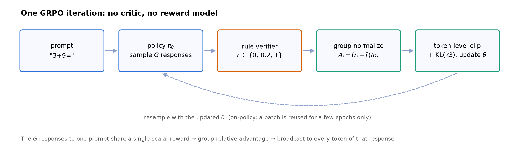
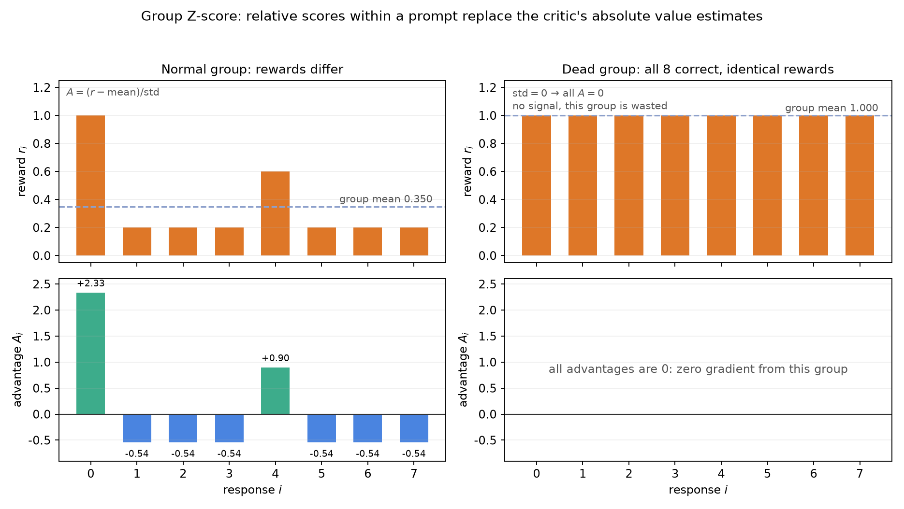

# GRPO 算法原理

**GRPO（Group Relative Policy Optimization）是 PPO 在"没有 Critic"方向上的一次减法，也是 DeepSeek-R1 那类"可验证奖励 + 大规模采样"训练路线的底座。** 它保留了 PPO 的全部骨架——重要性采样比、clip 截断、KL 约束，只换掉一样东西：**优势从哪里来**。PPO 让 Critic 估计状态价值 $`V(s)`$，再用 GAE 沿时间做加权；GRPO 让同一个 prompt 下采出的 $`G`$ 条回答互相打分，用组内均值当基线、组内标准差当尺度，得到一条回答一个优势。

这个替换之所以成立，是因为 LLM 的奖励本来就只有"一条回答一个标量"这一种粒度：规则验证器判对错、单元测试判通过、奖励模型打一个分，都落不到单步上。既然如此，"这条回答比这道题的平均水平好多少"，完全可以用同一道题的其他回答估计出来，不必再训一个和策略同规模的价值网络。省下的是显存和一轮前向，付出的是采样成本乘以 $`G`$，以及优势粒度变粗——后者是 GSPO 等后续工作要处理的问题。

本文从 PPO 的遗留问题讲起，说清 GRPO 到底砍了什么、为什么能砍；然后把组内优势拆成"基线 + 尺度"两件事，分别给出无偏性证明、偏差来源和 $`G`$ 的影响；再把 PPO 的 clip 目标逐项改写成 GRPO 的目标，说明长度归一化和 token 级比值这两处工程选择各自带来什么。KL 项单独一章，把 k1 / k2 / k3 三种估计器的偏差、方差、非负性推清楚。最后是一份不依赖 gym、不依赖任何 RL 框架的单文件实现：一个字符级 GRU 语言模型，在"一位数加法"的可验证任务上从零训练，附带数值断言、实测日志、学习曲线和四组消融。

和 [`17-ppo`](../17-ppo) 的关系：那篇已经把策略梯度、优势、重要性采样、clip 推到能逐行看懂代码的程度，本文默认读者熟悉那套符号，只在必要处回引。**如果还没读过，建议先看 PPO 的第 2、4、5、6 章**，本文第 4 章几乎全部建立在它们之上。

---

## 目录

- [1. 从 PPO 到 GRPO：砍掉 Critic](#1-从-ppo-到-grpo砍掉-critic)
- [2. 问题设定：一条回答一个分数](#2-问题设定一条回答一个分数)
- [3. 组内优势：用同题的其他回答当基线](#3-组内优势用同题的其他回答当基线)
- [4. 从 PPO 目标到 GRPO 目标](#4-从-ppo-目标到-grpo-目标)
- [5. 散度约束：KL 的三种估计器](#5-散度约束kl-的三种估计器)
- [6. 训练算法：一轮迭代里发生什么](#6-训练算法一轮迭代里发生什么)
- [7. 重点公式速查表](#7-重点公式速查表)
- [8. 代码结构与逐段说明](#8-代码结构与逐段说明)
- [9. 运行方式与实测结果](#9-运行方式与实测结果)
- [10. 常见坑与调参建议](#10-常见坑与调参建议)
- [11. 与 PPO、DAPO、Dr. GRPO、GSPO 的对照](#11-与-ppodapodr-grpogspo-的对照)
- [12. 附录：概念速查](#12-附录概念速查)

---

## 1. 从 PPO 到 GRPO：砍掉 Critic

### 1.1 PPO 里 Critic 干了两件事

回顾 PPO 的结构，价值网络 $`V_\phi`$ 身兼两职：

1. **当基线**。策略梯度里权重是 $`G_t - V(s_t)`$，把"这个局面本身值多少"扣掉，只留"这个动作额外挣了多少"（PPO 3.2）。这一步不改梯度的期望，只压方差。
2. **做自举**。GAE 把多步优势写成 TD 残差的加权和 $`\hat A_t=\sum_b(\gamma\lambda)^b\delta_{t+b}`$，其中 $`\delta_t=r_t+\gamma V(s_{t+1})-V(s_t)`$。它用 $`V`$ 替换掉"未来的真实回报"，把方差压下来（PPO 4.7）。

两件事都要求 $`V`$ 在**每一个中间状态**上给出一个准的数。

### 1.2 搬到 LLM 上，这两件事都变得昂贵且勉强

**昂贵**：Critic 通常和策略同规模（7B 对 7B），显存翻倍、每步多一次前向。RLHF 的显存瓶颈有一大半在这里。

**勉强**：LLM 的"状态"是半条回答，而奖励只在整条回答结束时才出现。于是

- $`V(s_t)`$ 要回答"已经写了这半句，最后能得几分"——这个量连人都不好标，价值头只能靠回归去猜；
- GAE 的 $`\gamma`$ 是为"时间步"设计的折扣，在 token 序列上没有物理意义（写第 3 个 token 与写第 300 个 token 并不是"早一步晚一步"的关系），实践中 LLM RL 基本取 $`\gamma=1`$；
- 奖励稀疏：中间 token 全是 0，只有末尾一个分。$`\delta_t`$ 里的 $`r_t`$ 几乎处处为 0，GAE 退化成一串 $`V`$ 的差分，误差全压在价值头上。

**根本矛盾在粒度上**：奖励是序列级的，PPO 却要求逐 token 的价值。

### 1.3 GRPO 的想法：把基线换成"同题组的平均分"

既然一道题的所有回答共享同一个起点，那"这道题的平均水平"就是一个天然基线。采 $`G`$ 条回答、打 $`G`$ 个分，均值 $`\bar r`$ 就是 $`V(x)`$ 的一次蒙特卡洛估计：

```math
V(x)=\mathbb{E}_{o\sim\pi_{\theta_{\mathrm{old}}}}\left[R(x,o)\right]\;\approx\;\bar r=\frac{1}{G}\sum_{j=1}^{G}r_j
```

于是第 $`i`$ 条回答的优势就是

```math
\hat A_i=r_i-\bar r
```

**这正是 PPO 3.2 里"减基线"的做法，只是基线从"网络估出来的 $`V(s_t)`$"换成了"同一道题其他回答的平均分"。** 基线依然只依赖 prompt（严格说依赖其余样本），与当前这条回答的动作无关，所以"减基线不改梯度期望"的证明原封不动成立（附录 12.2）。

再补一步标准化（除以组内标准差），就得到 GRPO 论文里的形式：

```math
\hat A_i=\frac{r_i-\frac{1}{G}\sum_{j=1}^{G}r_j}{\mathrm{std}\left(r_1,\dots,r_G\right)+\epsilon}
```

### 1.4 砍掉 Critic 之后，账怎么算

| | PPO | GRPO |
| --- | --- | --- |
| 网络 | Actor + Critic（同规模） | 只有 Actor |
| 每轮前向 | 采样 + 价值前向 + 更新前向 | 采样 + 更新前向 |
| 优势粒度 | 每个 token 一个 $`\hat A_t`$ | 每条回答一个 $`\hat A_i`$，广播到它的所有 token |
| 奖励要求 | 最好有逐步奖励 | 只要一条回答一个标量 |
| 采样成本 | 每 prompt 1 条 | 每 prompt $`G`$ 条 |

省下来的：一个价值网络、价值回归损失、GAE 递推。多出去的：采样量乘以 $`G`$。

对 LLM 来说这笔交易通常是划算的：采样（生成）虽然慢，但可以并行、可以离线；而 Critic 要一直挂在显存里，还要跟着策略一起更新。DeepSeekMath 用 $`G=64`$，工程实现里 8~16 更常见。

代价要说清楚：**优势的 credit assignment 变粗了**。一条回答里哪个 token 立了功、哪个 token 闯了祸，GRPO 完全不知道，它把整条回答的分数平均分给每个 token。GSPO 后来正是抓住这一点，把重要性采样和 clip 都提到序列级（见第 11 章）。

---

## 2. 问题设定：一条回答一个分数

### 2.1 一个 prompt、一组回答、一个分数

记 prompt 为 $`x`$，策略生成的第 $`i`$ 条回答为

```math
o_i=(o_{i,1},o_{i,2},\dots,o_{i,|o_i|}),\qquad o_{i,t}\sim\pi_\theta(\cdot\mid x,o_{i,<t})
```

奖励由验证器给出一个标量 $`r_i=R(x,o_i)`$。$`R`$ 可以是：

| 奖励来源 | 例子 | 特点 |
| --- | --- | --- |
| 规则验证器 | 数学题比对最终答案、代码跑单测、格式正则 | 无噪声、便宜、覆盖窄 |
| 奖励模型（RM） | 人类偏好训出来的打分器 | 覆盖宽、有噪声、可能被 hack |
| 人工 / 环境 | 真实用户反馈、游戏得分 | 最贵 |

GRPO 对这个 $`R`$ 只有一个要求：**同一条回答的所有 token 共享这一个数**。

### 2.2 和 MDP 的对应关系

| RL 概念 | 在 LLM 生成里的对应物 |
| --- | --- |
| 状态 $`s_t`$ | prompt + 已生成的前缀 $`(x,o_{<t})`$ |
| 动作 $`a_t`$ | 下一个 token $`o_t`$ |
| 策略 $`\pi_\theta(a\mid s)`$ | 语言模型在上下文下的下一个 token 分布 |
| 轨迹 / episode | 一整条回答 $`o`$ |
| 奖励 $`r`$ | 只在末尾给：$`r_T=R(x,o)`$，中间 $`r_t=0`$ |
| 折扣 $`\gamma`$ | 通常取 1（不折扣） |
| 回报 $`G_t`$ | 等于末尾那个 $`r`$，对所有 $`t`$ 相同 |

最后一行是全部差别的根源：**$`G_t`$ 对一条回答里所有 $`t`$ 都是同一个数**。PPO 要靠 Critic 把它拆成逐 token 的信号（$`G_t-V(s_t)`$），GRPO 干脆不拆，直接用组内相对值。

目标函数还是那个：

```math
J(\theta)=\mathbb{E}_{x\sim\mathcal{D},\;o\sim\pi_\theta(\cdot\mid x)}\left[R(x,o)\right]
```

### 2.3 一轮迭代的数据流



> 取一批 prompt → 每个 prompt 用当前策略采 $`G`$ 条回答 → 规则验证器逐条打分 → 组内 Z-score → token 级 clip + KL 更新 → 用新参数重新采样。整条链上没有 Critic，也没有价值回归。

---

## 3. 组内优势：用同题的其他回答当基线

### 3.1 基线的唯一硬要求：与动作无关

PPO 3.2 证过：只要 $`b`$ 只依赖状态、不依赖动作，就有

```math
\mathbb{E}_{a\sim\pi_\theta}\left[b(s)\nabla_\theta\log\pi_\theta(a\mid s)\right]=b(s)\sum_a\nabla_\theta\pi_\theta(a\mid s)=b(s)\nabla_\theta 1=0
```

所以减基线是无偏的，只改方差。这条证明在 LLM 里照样成立，只是"动作"换成了一条完整回答 $`o_i`$，"状态"换成了 prompt $`x`$。

**注意一个细节**：如果基线是 $`\bar r`$（含 $`r_i`$ 自己），它就间接依赖了当前这条回答，硬要求被破坏。严格的写法是用留一均值（leave-one-out）：

```math
b_i=\bar r_{-i}=\frac{1}{G-1}\sum_{j\neq i}r_j
```

它只用其他样本，与 $`o_i`$ 独立，无偏性成立。工程上大家通常直接用 $`\bar r`$，因为两者只差一个常数缩放（附录 12.3 给出推导）：

```math
r_i-\bar r=\frac{G-1}{G}\left(r_i-\bar r_{-i}\right)
```

方向完全一致，只是幅度小了 $`(G-1)/G`$。$`G=8`$ 时是 0.875，$`G=64`$ 时是 0.984——所以这个细节在实际训练里几乎看不出来，但写论文时值得知道。

### 3.2 组均值是状态价值的蒙特卡洛估计

对固定的 prompt，$`G`$ 条回答独立同分布地采自 $`\pi_{\theta_{\mathrm{old}}}`$，于是

```math
\mathbb{E}\left[\bar r\mid x\right]=\frac{1}{G}\sum_{j=1}^{G}\mathbb{E}\left[r_j\mid x\right]=V^{\pi_{\mathrm{old}}}(x)
```

代回去：

```math
\mathbb{E}\left[\hat A_i\mid x\right]=\mathbb{E}\left[r_i-\bar r\mid x\right]=V(x)-V(x)=0
```

**组内优势的期望是 0**，这正是"相对平均水平"的定义。而对单条样本，它估计的是

```math
r_i-\bar r\;\approx\;r_i-V(x)=A(x,o_i)
```

即"这条回答比这道题的平均水平好多少"。这与 PPO 里 $`A=Q-V`$ 的含义完全一致，只是 $`Q`$ 也被同一次采样估计了。

**估计噪声从哪来**：$`\bar r`$ 本身是 $`G`$ 个样本的均值，标准差是 $`\sigma_r/\sqrt{G}`$。$`G`$ 越小，基线越抖，优势里混进的"基线噪声"越多。这也解释了为什么 $`G=1`$ 完全不可用——此时 $`\bar r=r_i`$，优势恒为 0，一点梯度都没有。

### 3.3 为什么要再除以标准差

只减均值还不够。不同 prompt 的奖励尺度差别很大：

- 二值奖励：$`r\in\{0,1\}`$，组内标准差最大 0.5；
- 带格式分的连续奖励：$`r\in[0,1.2]`$，标准差可以到 0.4；
- 加了长度惩罚的奖励：$`r`$ 的数值范围随长度变化。

如果不做尺度归一，**同样的学习率在不同题目上意味着不同的步长**：标准差大的题，优势数值大，梯度也大；标准差小的题几乎不动。这跟 PPO 里"优势不标准化 = 学习率在乱跳"是同一件事（PPO 8.6）。

除以组内标准差就是把每个组归一成"零均值、单位标准差"的可比分差：

```math
\hat A_i=\frac{r_i-\bar r}{\sigma_r+\epsilon},\qquad \sigma_r=\mathrm{std}(r_1,\dots,r_G)
```

补两个工程细节，代码里都用到了：

- 分母的 $`\epsilon`$（本文取 `1e-4`）防止 $`\sigma_r=0`$ 时除零；
- $`\sigma_r<\epsilon`$ 时把整组优势显式置零。否则 $`0/\epsilon`$ 会留下 1e-4 量级的数值残渣，在 float32 下偶尔会变成噪声梯度。

### 3.4 一个算例

同一个 prompt 采 8 条回答，规则验证器给出：

```math
r=(1.0,\;0.6,\;0.2,\;0.2,\;0.2,\;0.2,\;0.2,\;0.2)
```

组均值 $`\bar r=0.35`$，组标准差 $`\sigma_r=0.278`$（总体标准差，$`G`$ 作分母）：

```math
\hat A=\left(+2.33,\;+0.90,\;-0.54,\;-0.54,\;-0.54,\;-0.54,\;-0.54,\;-0.54\right)
```

验一下两个性质：$`\sum_i\hat A_i=2.33+0.90-6\times0.54\approx0`$（均值为 0），$`\mathrm{std}(\hat A)=1`$。这组数据的优势有正有负，最高与最低差 4 倍以上，梯度信号明确。



> 左：一份"有区分度"的组，8 条回答的分数从 1.0 到 0.2，归一化后最好的一条拿到 +2.33，其余为负。右：8 条全对，$`\sigma_r=0`$，优势全为 0——这一组白采了。

**这个算例还说明一件事**：优势的绝对值大小并不重要，重要的是组内的**相对次序 + 相对幅度**。真正进梯度的是 $`\hat A_i\nabla\log\pi`$，$`\hat A`$ 只负责"往哪个方向、用多大力"。

### 3.5 分组大小怎么选：信号分辨率与采样成本的取舍

$`G`$ 直接决定优势的"分辨率"：

- $`G=1`$：$`\hat A_i\equiv0`$，完全没梯度；
- $`G=2`$：归一化后优势只有 $`+1`$ 和 $`-1`$ 两个取值，只有"谁更好"的信息，没有"好多少"；
- $`G=8`$：优势有 8 个不同的取值，且组均值估计的标准差是 $`\sigma_r/\sqrt{8}\approx0.35\sigma_r`$；
- $`G=64`$：均值估计的标准差降到 $`0.125\sigma_r`$，信号更干净，但采样量是 8 倍。

一个可以直接观测的证据（本仓库实测，400 轮迭代，贪心准确率）：

| $`G`$ | 贪心准确率 | 每轮采样条数 |
| --- | --- | --- |
| 4 | 54.5% | 64 |
| 8 | 74.5% ~ 81.8% | 128 |

$`G`$ 减半，准确率掉了二十多个点。原因是 $`G=4`$ 时"死组"（见 3.6）比例更高、均值估计更糙，有效梯度样本少了一半。

### 3.6 死组：GRPO 最典型的失效模式

**定义**：一个 prompt 的 $`G`$ 条回答奖励完全相同（全对或全错），则 $`\sigma_r=0`$，$`\hat A_i=0`$，这一组对参数没有任何贡献。

死组比例会随训练**上升**，两个方向都会走到：

- **全对**：模型已经掌握了这类题，组内全是 1.0；
- **全错**：这类题太难，组内全是 0（可验证奖励下，答错就是 0，没有中间分）。

我们这次训练里，死组比例从最初的 0% 一路升到后期的 80% 以上（见第 9 章的曲线）。**这不是 bug，而是 GRPO 的结构性现象**：策略越确定，组内差异越小，信号越少，训练自然减速。

三种对策，本文实现或讨论了前两种：

| 对策 | 做法 | 代价 |
| --- | --- | --- |
| 提高探索 | 升高采样温度、加大熵奖励 | 学得慢、回答质量下降 |
| 动态采样（DAPO） | 丢掉死组、补采新 prompt，保证每批有效组数 | 采样量不可控，实现更复杂 |
| 课程学习 | 按难度筛题，保证每题都有部分正确 | 需要难度估计 |

代码里 `--drop-dead-groups` 就是动态采样的最小版本：

```python
if cfg.drop_dead_groups:
    r = rewards_t.view(-1, cfg.group_size)
    keep = (r.std(dim=1, unbiased=False) > 1e-6)
    keep_seq = keep.repeat_interleave(cfg.group_size)
    prompt_seq, comp, old_logp, mask = prompt_seq[keep_seq], comp[keep_seq], old_logp[keep_seq], mask[keep_seq]
    adv = adv[keep_seq]
```

---

## 4. 从 PPO 目标到 GRPO 目标

### 4.1 起点：PPO 的截断目标

PPO 第 6 章得到的优化目标（策略部分）：

```math
J_{\mathrm{PPO}}(\theta)=\mathbb{E}_{s,a\sim\pi_{\theta_{\mathrm{old}}}}\left[\min\left(\rho_t(\theta)\hat A_t,\;\mathrm{clip}\left(\rho_t(\theta),1-\varepsilon,1+\varepsilon\right)\hat A_t\right)\right]
```

其中 $`\rho_t(\theta)=\pi_\theta(a_t\mid s_t)/\pi_{\theta_{\mathrm{old}}}(a_t\mid s_t)`$ 是重要性采样比。三个成分：

1. **$`\rho`$**：把"旧策略采的样本"折算成"新策略下的期望"（PPO 5.2）；
2. **$`\hat A`$**：这条样本相对平均水平好多少；
3. **clip + min**：比值走太远就不再加分，防止一次更新把策略带偏（PPO 6.3）。

### 4.2 第一步：把逐 token 的优势换成整条回答的优势

PPO 里每个 token 有自己的优势，来自 GAE。GRPO 没有 GAE，只有一条回答一个分，于是：

```math
\hat A_t\;\longrightarrow\;\hat A_i\qquad\text{（对同一条回答的所有 }t\text{ 取同一个值）}
```

这一步在数学上就是"把常量广播到序列的每个位置"。它的合理性来自 2.2：LLM 的 $`G_t`$ 对一条回答里所有 $`t`$ 本来就是一个数（末尾那个奖励），所以"整条共享一个优势"不是近似，而是与奖励的粒度对齐。

**代价**：一条回答内部不再有区分。写对了是因为第 3 个 token 还是第 30 个 token？GRPO 不知道。这也正是 GSPO 批评的"优化粒度与奖励粒度不匹配"的另一半（第 11 章）。

### 4.3 第二步：长度归一化

PPO 的期望是对"样本"取的，一个样本就是一个 (state, action)。LLM 里一个样本是一条不定长的序列，token 数从几十到几千不等。如果直接把所有 token 的损失加起来平均，长回答会主导梯度——它贡献的 token 多。

GRPO 的做法是**先按回答归一，再按组平均**：

```math
\frac{1}{G}\sum_{i=1}^{G}\frac{1}{|o_i|}\sum_{t=1}^{|o_i|}\left(\cdots\right)
```

内层的 $`1/|o_i|`$ 让每条回答的贡献与长度无关，外层的 $`1/G`$ 让每个 prompt 的贡献与组大小无关。

**这个归一化是有偏的，Dr. GRPO 专门指出了它。** 直观地说：一条答错的短回答，每个 token 分到的负梯度更大（分母小）；一条答对的长回答，每个 token 分到的正梯度更小。两者叠加，模型会学到"错的要写短、对的要写长"，训练中表现为回答长度持续膨胀。本文的实测曲线里，后半段确实出现了长度从 2.0 缓慢回升到 2.1 的现象（见第 9 章），量很小，因为本题答案本来就只有一个数字。

工程上的两种写法：

| 写法 | 公式 | 特点 |
| --- | --- | --- |
| 逐回答归一（本文、DeepSeekMath 实现） | $`\frac{1}{G}\sum_i\frac{1}{\vert o_i\vert}\sum_t`$ | 每条回答等权，与长度无关 |
| 逐 token 归一（DAPO） | $`\frac{1}{\sum_i\vert o_i\vert}\sum_i\sum_t`$ | 每个 token 等权，长回答权重更大 |

两者都有人用，差别就在"回答等权"还是"token 等权"。做对照实验时一定要固定其中一种，否则长度一变化，有效学习率也跟着变。

### 4.4 第三步：比值取到 token 级还是序列级

这是 GRPO 实现里最容易含糊的一处，必须分开说。

**序列级（论文式）**：整条回答的概率比

```math
\rho_i(\theta)=\frac{\pi_\theta(o_i\mid x)}{\pi_{\theta_{\mathrm{old}}}(o_i\mid x)}=\prod_{t=1}^{|o_i|}\frac{\pi_\theta(o_{i,t}\mid x,o_{i,<t})}{\pi_{\theta_{\mathrm{old}}}(o_{i,t}\mid x,o_{i,<t})}
```

一条回答一个比值，clip 作用在这个乘积上，目标为

```math
J_{\mathrm{seq}}(\theta)=\mathbb{E}\left[\frac{1}{G}\sum_{i=1}^{G}\min\left(\rho_i\hat A_i,\;\mathrm{clip}(\rho_i,1-\varepsilon,1+\varepsilon)\hat A_i\right)\right]
```

这正是 DeepSeekMath 论文式 (21) 的写法：奖励是序列级的，重要性采样也是序列级的，粒度对齐。

**token 级（主流工程实现，本文采用）**：把乘积拆开，逐 token 算比值、逐 token 截断

```math
\rho_{i,t}(\theta)=\frac{\pi_\theta(o_{i,t}\mid x,o_{i,<t})}{\pi_{\theta_{\mathrm{old}}}(o_{i,t}\mid x,o_{i,<t})}=\exp\left(\log\pi_\theta(o_{i,t}\mid x,o_{i,<t})-\log\pi_{\theta_{\mathrm{old}}}(o_{i,t}\mid x,o_{i,<t})\right)
```

```math
J_{\mathrm{tok}}(\theta)=\mathbb{E}\left[\frac{1}{G}\sum_{i=1}^{G}\frac{1}{|o_i|}\sum_{t=1}^{|o_i|}\min\left(\rho_{i,t}\hat A_i,\;\mathrm{clip}(\rho_{i,t},1-\varepsilon,1+\varepsilon)\hat A_i\right)\right]
```

两者的差别：

| | 序列级 | token 级 |
| --- | --- | --- |
| 比值个数 | 每条回答 1 个 | 每条回答 $`\vert o_i\vert`$ 个 |
| 方差 | 高（几百个比值连乘） | 低（单个比值贴近 1） |
| 截断语义 | 整条回答被判"太 off-policy"就整体不加分 | 只有偏离大的那几个 token 不加分 |
| 典型使用者 | DeepSeekMath 原文、GSPO（带长度归一） | verl / TRL / 本文 |

**为什么工程实现偏爱 token 级**：序列级比值是几百个数的连乘，$`\rho_i`$ 的数值范围能跨好几个数量级，clip 的结果要么全截要么全不截，梯度非常抖。token 级把每一小步单独校正，方差小得多，代价是"重要性采样"在理论上不再严格（每个 token 的比值对应的是不同的边际分布）。

两条路都有代价，没有一条是"正确"的。本文选 token 级，因为它在玩具规模上更稳、也更好观察；第 11 章会说 GSPO 怎么在序列级上把这件事做对。

### 4.5 完整目标与损失函数

把 4.2—4.4 合起来（以 token 级为例），得到代码里真正优化的目标：

```math
J_{\mathrm{GRPO}}(\theta)=\mathbb{E}_{x\sim\mathcal{D},\;\{o_i\}\sim\pi_{\theta_{\mathrm{old}}}}\left[\frac{1}{G}\sum_{i=1}^{G}\frac{1}{|o_i|}\sum_{t=1}^{|o_i|}\min\left(\rho_{i,t}\hat A_i,\;\mathrm{clip}(\rho_{i,t},1-\varepsilon_-,1+\varepsilon_+)\hat A_i\right)-\beta\,\frac{1}{G}\sum_{i=1}^{G}\frac{1}{|o_i|}\sum_{t=1}^{|o_i|}\hat{\mathbb{D}}_{\mathrm{KL}}^{(i,t)}\right]
```

框架里取负号转成最小化：

```math
\mathcal{L}(\theta)=-\underbrace{\frac{1}{G}\sum_i\frac{1}{|o_i|}\sum_t\min\left(\rho_{i,t}\hat A_i,\mathrm{clip}(\rho_{i,t})\hat A_i\right)}_{\text{策略项}}+\underbrace{\beta\,\frac{1}{G}\sum_i\frac{1}{|o_i|}\sum_t\hat D_{\mathrm{KL}}^{(i,t)}}_{\text{散度项}}
```

注意 clip 的上下界在本文里是分开的两个参数 $`\varepsilon_-,\varepsilon_+`$（默认都取 0.2）。DAPO 建议把上界放宽（如 0.28）、下界保持 0.2，让"低概率 token 变好"这件事不被过早截断，缓解熵塌缩（第 11 章）。

### 4.6 梯度长什么样

上面的目标可以求导。先看 clip 区间内部（$`1-\varepsilon_-<\rho<1+\varepsilon_+`$）：$`\min`$ 取的是第一项，而

```math
\nabla_\theta\rho_{i,t}=\rho_{i,t}\nabla_\theta\log\pi_\theta(o_{i,t}\mid x,o_{i,<t})
```

（同样是对数求导法则 $`\nabla\log\pi=\nabla\pi/\pi`$，与 PPO 2.1 一致）。于是

```math
\nabla_\theta J=\mathbb{E}\left[\frac{1}{G}\sum_i\frac{1}{|o_i|}\sum_t\rho_{i,t}\hat A_i\nabla_\theta\log\pi_\theta(o_{i,t}\mid x,o_{i,<t})\right]
```

**读法**：三项相乘。

- $`\nabla\log\pi`$：往"提高这个 token 概率"的方向；
- $`\hat A_i`$：方向与力度（组内相对好坏）；
- $`\rho_{i,t}`$：纠偏系数——采样时这个 token 的概率是旧策略给的，现在按新策略算期望，要按比例补上。

当 $`\rho=1`$（第一步更新）时，它与 PPO 的 on-policy 策略梯度完全一致：$`\hat A_i\nabla\log\pi`$。

**clip 区间外**：梯度为 0。按优势符号和比值方向分四种情形：

| $`\hat A_i`$ | $`\rho`$ 的位置 | 梯度 | 含义 |
| --- | --- | --- | --- |
| $`>0`$（好回答） | $`\rho\le1+\varepsilon_+`$ | $`\rho\hat A\nabla\log\pi`$ | 正常鼓励，力度随 $`\rho`$ 放大 |
| $`>0`$ | $`\rho>1+\varepsilon_+`$ | 0 | 已经抬得够高了，再抬不加分 |
| $`<0`$（坏回答） | $`\rho\ge1-\varepsilon_-`$ | $`\rho\hat A\nabla\log\pi`$ | 正常抑制 |
| $`<0`$ | $`\rho<1-\varepsilon_-`$ | 0 | 已经压得够狠了，再压不加分 |

这张表与 PPO 6.3 的表一模一样——**GRPO 没有改 clip，只改了 $`\hat A`$ 的来源**。

### 4.7 与 PPO 的公式对照

| 环节 | PPO | GRPO |
| --- | --- | --- |
| 优势 | $`\hat A_t^{\mathrm{GAE}}=\sum_b(\gamma\lambda)^b\delta_{t+b}`$ | $`\hat A_i=(r_i-\bar r)/\sigma_r`$ |
| 优势依赖 | 价值网络 $`V_\phi`$ | 同组其他回答 |
| 期望的样本 | 单步 $`(s,a)`$ | 整条回答 $`o_i`$ |
| 比值 | 单 token $`\rho_t`$ | token 级 $`\rho_{i,t}`$（或序列级） |
| 归一化 | 按 batch 标准化优势 | 组内 Z-score + $`1/\vert o_i\vert`$ |
| 约束 | clip（+ 可选 KL） | clip + KL（对 $`\pi_{\mathrm{ref}}`$） |
| 价值损失 | 有 | **没有** |
| 熵奖励 | 有 | 有（可选） |

---

## 5. 散度约束：KL 的三种估计器

### 5.1 为什么必须有参考模型

GRPO 的奖励是"验证器判对错"。一个纯优化器会立刻发现：**判对错只看最终答案，不看过程**——于是它可以学会只输出答案、学会在答案前面塞一堆无意义字符、学会中英混杂地凑格式。这就是 reward hacking。

参考模型 $`\pi_{\mathrm{ref}}`$（通常是 SFT 之后的模型，冻结不动）提供一个锚点：**策略可以变好，但不能离它太远**。KL 项就是这把尺子：

```math
\mathbb{D}_{\mathrm{KL}}\left(\pi_\theta(\cdot\mid x,o_{<t})\;\|\;\pi_{\mathrm{ref}}(\cdot\mid x,o_{<t})\right)
```

对语言模型，KL 是逐 token 的分布散度，再按 token 平均。$`\beta`$ 控制约束强度：太小会 hack，太大学不动。

### 5.2 三种估计器

KL 的真值要对整个词表求和，训练时只能采样估计。令

```math
d_t=\log\pi_{\mathrm{ref}}(o_t\mid x,o_{<t})-\log\pi_\theta(o_t\mid x,o_{<t})
```

三种常见写法：

| 名称 | 公式 | 无偏 | 恒非负 | 方差 |
| --- | --- | --- | --- | --- |
| k1 | $`-d_t=\log\pi_\theta-\log\pi_{\mathrm{ref}}`$ | ✅ | ❌（可为负） | 高 |
| k2 | $`\tfrac12 d_t^2`$ | ❌（有偏） | ✅ | 低 |
| k3 | $`e^{d_t}-d_t-1`$ | ✅ | ✅ | 低 |

本文用 k3，也是 DeepSeekMath 与多数实现的默认。

### 5.3 k3 的两条性质，逐一推

**性质一：期望等于 KL。**

```math
\begin{aligned}
\mathbb{E}_{o_t\sim\pi_\theta}\left[e^{d_t}\right]
&=\sum_{o_t}\pi_\theta(o_t\mid\cdot)\cdot\frac{\pi_{\mathrm{ref}}(o_t\mid\cdot)}{\pi_\theta(o_t\mid\cdot)}
&&\text{① 把 }e^{d}=\pi_{\mathrm{ref}}/\pi_\theta\text{ 代进去}\\
&=\sum_{o_t}\pi_{\mathrm{ref}}(o_t\mid\cdot)=1
&&\text{② 求和相消，概率归一}
\end{aligned}
```

```math
\mathbb{E}_{o_t\sim\pi_\theta}\left[d_t\right]
=\mathbb{E}\left[\log\pi_{\mathrm{ref}}-\log\pi_\theta\right]
=-\mathbb{D}_{\mathrm{KL}}\left(\pi_\theta\|\pi_{\mathrm{ref}}\right)
```

两式相加：

```math
\mathbb{E}\left[e^{d_t}-d_t-1\right]=1+\mathbb{D}_{\mathrm{KL}}-1=\mathbb{D}_{\mathrm{KL}}
```

所以 k3 是 KL 的无偏估计。**注意 ② 那一步用的是"重要性恒等式" $`\mathbb{E}_{\pi_\theta}[\pi_{\mathrm{ref}}/\pi_\theta]=1`$**，它对任意两个归一化分布都成立，这也是 k3 在所有实现里都稳定的原因。

**性质二：恒非负。** 对任意实数 $`x`$，指数函数在 0 处的切线给出

```math
e^{x}\ge 1+x\quad\Longrightarrow\quad e^{d}-d-1\ge0
```

等号只在 $`d=0`$（两个分布完全一致）时成立。这条性质很实用：**KL 估计值出现负数，一定是实现有问题**，可以直接拿去当断言（代码里第 3 条 selftest 就测这个）。

### 5.4 实现位置

逐 token 算，再按回答归一：

```python
d = ref_logp - new_logp                                  # log π_ref - log π_θ
kl = (d.exp() - d - 1.0) * m                             # k3，m 是 EOS 之后的掩码
seq_kl = kl.sum(1) / m.sum(1)                            # 按回答归一
kl_loss = cfg.kl_coef * seq_kl.mean()
```

两个容易错的地方：

- `ref_logp` 必须 `no_grad`，否则反向传播会试图更新参考模型（它已经 `requires_grad_(False)`，但少写 `no_grad` 会多建一张图，浪费显存）；
- KL 也要乘 EOS 掩码。EOS 之后的位置是补齐的，不能算进散度，否则长度不同的回答会拿到不同的 KL 惩罚。

### 5.5 可不可以不要 KL

可以，R1 系列很多配置就把 $`\beta`$ 设成 0 或极小，只靠 clip 约束。取舍：

| $`\beta`$ | 表现 | 风险 |
| --- | --- | --- |
| 0 | 学得最快，答案正确率上升最快 | 语言漂移、格式崩坏、长度失控 |
| 0.02（本文） | 稳，KL 在 1~3 之间 | 略慢 |
| 0.1+ | 非常保守 | 学不动，输出几乎不变 |

本文默认 0.02，命令行 `--kl-coef 0` 可以直接关掉对比。

---

## 6. 训练算法：一轮迭代里发生什么

把前面几章拼成流程：

```text
for iteration in 1..N:

    # ---------- 采样阶段（无梯度） ----------
    batch = sample_prompts(B)                       # 一批 prompt
    for each x in batch:
        {o_1, ..., o_G} ~ π_θ_old(·|x)               # 同一 prompt 采 G 条
        r_i = R(x, o_i)                              # 规则验证器打分
        Â_i = (r_i − mean(r)) / (std(r) + ε)         # 组内 Z-score
        if std(r) == 0 and drop_dead: 丢弃这组         # 可选：动态采样

    # ---------- 更新阶段（有梯度，可多个 epoch） ----------
    for epoch in 1..E:
        for minibatch in batch:
            ρ = exp(log π_θ − log π_θ_old)           # 逐 token 比值
            L = −mean_i[ mean_t( min(ρÂ, clip(ρ)Â) ) ] + β·mean_i[ mean_t(KL_k3) ]
            θ ← θ − η ∇L

    # ---------- 下一轮 ----------
    π_θ_old ← π_θ                                    # 旧数据作废，重新采样
```

几个设计点：

1. **采样和更新分开批**。采样时整批 128 条回答一次前向，更新时按 32 条一个 minibatch 切。这是显存与吞吐的折中。
2. **同一批数据用 $`E`$ 个 epoch**。这是 PPO 的老做法，靠 clip 保证不过度偏离。$`E`$ 越大，样本效率越高，但靠后的 epoch 数据越"旧"，比值越容易越界。本文 $`E=2`$。
3. **更新完就丢**。GRPO 是 on-policy 的：参数变了，这批数据的分布就变了，必须重采。这也是采样成本乘以 $`G`$ 之后依然可以接受的原因——它只采一次。
4. **优势是常数**。$`\hat A_i`$ 由采样阶段的奖励算出，更新阶段必须 detach（代码里它本来就来自 `torch.no_grad` 的采样，不参与求导）。

一轮的数据量：$`B=16`$ 个 prompt、$`G=8`$，即 128 条回答，每条最多 3 个 token。整轮在 4 核 CPU 上约 40 ms。

---

## 7. 重点公式速查表

| 公式 | 名称 | 含义 | 代码位置 |
| --- | --- | --- | --- |
| $`J=\mathbb{E}_{x,o\sim\pi_\theta}[R(x,o)]`$ | 训练目标 | 让高奖励回答出现的概率变大 | — |
| $`\hat A_i=\dfrac{r_i-\bar r}{\sigma_r+\epsilon}`$ | 组内优势 | 这条回答比同题平均好多少（单位标准差） | `group_advantages` |
| $`\bar r=\frac1G\sum_j r_j`$ | 组均值 | $`V(x)`$ 的蒙特卡洛估计，替代 Critic | `group_advantages` |
| $`\sigma_r=\mathrm{std}(r_1..r_G)`$ | 组内标准差 | 尺度归一，防止步长乱跳 | `group_advantages` |
| $`\rho_{i,t}=\pi_\theta/\pi_{\theta_{\mathrm{old}}}`$ | token 级比值 | 新策略把这个 token 的概率改了几倍 | `ratio` |
| $`\min(\rho\hat A,\mathrm{clip}(\rho)\hat A)`$ | 截断目标 | 比值走太远就不再加分 | `clip_objective` |
| $`\frac1G\sum_i\frac1{\vert o_i\vert}\sum_t(\cdot)`$ | 双层归一 | 回答等权、组等权 | `grpo_update` |
| $`e^{d}-d-1,\;d=\log\pi_{\mathrm{ref}}-\log\pi_\theta`$ | KL(k3) | KL 的无偏、非负、低方差估计 | `grpo_update` |
| $`\beta\,\mathbb{D}_{\mathrm{KL}}(\pi_\theta\Vert\pi_{\mathrm{ref}})`$ | 散度约束 | 防止 reward hacking 与语言漂移 | `kl_loss` |
| $`\mathcal{H}(\pi_\theta)`$ | 策略熵 | 分布越均匀熵越大，维持探索 | `ent_bonus` |
| $`c_2\,\mathcal{H}`$ | 熵奖励 | 抵消"越训越确定"的塌缩趋势 | `ent_bonus` |

---

## 8. 代码结构与逐段说明

`grpo.py` 是单文件实现，约 560 行，**不依赖 gym、不依赖任何 RL 框架**，只需 `torch`（画图另需 `matplotlib`）。

```text
grpo.py
├── Config               超参数（dataclass，逐项注释）
├── ArithmeticTask       题库 + 规则奖励（可验证任务的替身）
├── PolicyLM             字符级 GRU 语言模型（Embedding + GRU + 输出头）
├── completion_mask      EOS 掩码
├── group_advantages     组内 Z-score
├── clip_objective       截断目标（PPO/GRPO 共用，单独拆出来便于断言）
├── grpo_update          clip + KL(k3) + 熵
├── train                采样 → 打分 → 组内归一化 → 多 epoch 更新
└── selftest             7 条数值断言
```

### 8.1 为什么用一个字符级 GRU

GRPO 的算法与模型结构无关。用 7B 模型演示，成本和复现门槛都太高；用玩具模型，才能让重点落在**算法本身**上。于是这里造了一个极小的自回归语言模型：

```python
self.emb = nn.Embedding(vocab_size, emb_dim)      # 13 个 token
self.gru = nn.GRU(emb_dim, hidden_dim, batch_first=True)
self.head = nn.Linear(hidden_dim, vocab_size)
nn.init.orthogonal_(self.head.weight, gain=0.01)  # 初始策略接近均匀，先探索
```

词表是 `0-9`、`+`、`=`、`EOS` 共 13 个 token。prompt 形如 `3+9=`，回答形如 `12<EOS>`。它就是一个能逐 token 生成的语言模型，只是在语言能力上退到了加法。

**输出头用 `gain=0.01`** 是有意的：初始 logits 接近 0，分布接近均匀（熵 $`\approx\ln13=2.56`$），采样多样性足，组内优势才有区分度。如果初始化就带偏好，前几百步全是死组。

### 8.2 采样：G 条并行、记录 old_logp、EOS 掩码

```python
prompt = prompt_ids.repeat_interleave(G, 0)       # 顺序：prompt 主序、G 次序
h = self.encode_prompt(prompt)
for t in range(max_new_tokens):
    logits = self.head_logits(h)                  # 历史 token 已吃完，直接解码
    dist = Categorical(logits=logits / temperature)
    tok = dist.sample()
    logps[:, t] = dist.log_prob(tok) * alive      # 已结束的位置不再记录
    comp[:, t] = torch.where(alive.bool(), tok, EOS)
    alive = alive * (tok != EOS).float()
    _, h = self.step(comp[:, t], h)               # 用写入序列的 token 推进状态
```

三个必须同时满足的约束：

1. **`old_logp` 要和采样时同一个温度、同一个分布**。更新时用 `exp(new - old)` 算比值，两边温度不一致，比值会系统性偏离 1，clip 立刻全线触发（第 10 章第 1 条就是我们踩过的坑）。
2. **EOS 之后要掩掉**。回答长度不同，补齐的位置不能算进 loss，否则长度变成噪声。
3. **`prompt` 与 `comp` 的顺序要严格对齐**。采样时 `repeat_interleave(G)` 是"prompt 主序、G 次序"，构造 batch 时也必须是同一顺序。这一条最隐蔽：写错了不会报错，只会静默地拿 A 题的答案去配 B 题的 loss（第 10 章第 9 条）。

### 8.3 规则奖励：格式分 + 逐位匹配分

可验证任务的奖励函数长这样：

```python
body = ids[: ids.index(EOS)]                      # EOS 之前的部分
if len(body) == 0 or any(t < 0 or t > 9 for t in body):
    continue                                      # 没吐 EOS / 吐了非数字：0 分
well[i] = 1.0
s = "".join(str(t) for t in body)
ans = str(a_i + b_i)
if s == ans:
    rewards[i] = 1.0                              # 完全答对
else:
    match = sum(1 for x, y in zip(s, ans) if x == y)
    rewards[i] = 0.2 + 0.8 * match / max(len(s), len(ans))
```

设计理由：**从零训练的模型一开始根本答不对**，如果奖励只有"对/错"两档，第一轮的 128 条回答全是 0，组内 $`\sigma_r=0`$，一步都学不动。格式分让"会吐 EOS 了"先拿到一点奖励，逐位匹配分让"数字对了一半"也有信号，模型才能一步步爬上来。

这在真实场景里对应两种常见做法：

- **规则奖励 + 格式奖励**（R1 的做法）：`reward = accuracy + 0.1 * format`；
- **规则奖励 + 长度惩罚 / 重复惩罚**：抑制"凑字数"这类 hacking。

注意格式分不能给小到没意义，也不能大到盖过正确性。本文 0.2 是"格式正确但一个数字都不对"的上限，正确性最多能拿 1.0。

### 8.4 组内归一化：十行代码

```python
r = rewards.view(-1, G)
mean = r.mean(dim=1, keepdim=True)
std = r.std(dim=1, unbiased=False, keepdim=True)
adv = (r - mean) / (std + eps) if normalize_std else (r - mean)
dead = (std < 1e-6)
adv = torch.where(dead, torch.zeros_like(adv), adv)
return adv.reshape(-1), dead.float().mean().item()
```

- `view(-1, G)`：把扁平奖励按"每 G 个一组"折叠；
- `unbiased=False`：用总体标准差（$`G`$ 作分母），与论文一致；
- 死组显式置零：避免 $`0/\epsilon`$ 的数值残渣；
- 返回值里带 `dead` 比例，直接当监控指标。

### 8.5 截断目标单独拆出来

```python
def clip_objective(ratio, adv, eps_low, eps_high):
    surr1 = ratio * adv
    surr2 = torch.clamp(ratio, 1.0 - eps_low, 1.0 + eps_high) * adv
    return torch.min(surr1, surr2)
```

拆成纯函数是为了能在 `--selftest` 里直接断言梯度：在 $`\rho=1`$ 处它对 $`\rho`$ 的导数应当等于 $`\hat A`$；在越界处应当是 0。这类断言比"看 loss 曲线像不像"可靠得多。

### 8.6 更新：三个损失拼一起

```python
obj = clip_objective(ratio, a, cfg.clip_eps_low, cfg.clip_eps_high) * m
seq_obj = obj.sum(1) / m.sum(1)                   # 1/|o_i| 长度归一化

d = ref_logp - new_logp
kl = (d.exp() - d - 1.0) * m
seq_kl = kl.sum(1) / m.sum(1)

policy_loss = -seq_obj.mean()
kl_loss = cfg.kl_coef * seq_kl.mean()
ent_bonus = cfg.entropy_coef * (ent * m).sum() / m.sum()
loss = policy_loss + kl_loss - ent_bonus
```

对应 4.5 的三个项。`m.sum()` 做分母而不是 `|o_i|` 的常数，是因为 EOS 之后要排除，用掩码和更稳。

### 8.7 与 PPO 实现的 diff

| 组件 | `17-ppo/ppo.py` | `18-grpo/grpo.py` |
| --- | --- | --- |
| 网络 | `ActorCritic`（trunk + policy_head + value_head） | `PolicyLM`（emb + gru + head） |
| 采样缓存 | `RolloutBuffer`（存 value / value_next / terminal） | 直接存 `(comp, old_logp, mask)` |
| 优势 | `compute_gae` + 标准化 | `group_advantages` |
| 参考模型 | 无 | `ref_model = deepcopy(model)`，冻结 |
| 损失 | clip + value_mse + entropy | clip + KL(k3) + entropy |
| 奖励 | 环境给 | 规则验证器给 |
| 依赖 | torch + gymnasium | 只要 torch |

**删掉的东西比加上的多**：没有价值网络、没有 GAE、没有 $`\gamma/\lambda`$、没有 value loss。加上的只有一个参考模型和组内归一化。

### 8.8 数值断言

`python grpo.py --selftest` 跑 7 条，都是把公式和实现对上的硬检查：

| # | 断言 | 防的是什么 |
| --- | --- | --- |
| 1 | 组内 Z-score 与手算一致，均值为 0、标准差为 1 | 归一化写错 |
| 2 | 奖励全同 → 优势全 0，组标记为 dead | 死组处理 |
| 3 | k3 恒非负，k1 可以取负 | KL 估计器选错/写错 |
| 4 | $`\rho=1`$ 处截断目标的梯度 = $`\hat A`$（正负各测一次） | clip 的符号写反 |
| 5 | 越界后梯度为 0 | clip 没生效 |
| 6 | 规则奖励与 EOS 掩码符合定义 | 奖励/掩码写错 |
| 7 | 采样记录的 logp == teacher forcing 重算的 logp | 采样与更新口径不一致 |

第 7 条是最值钱的一条：**它把"采样分布"和"更新分布"钉死在同一个函数上**。没有它，温度不一致、状态推进错位这类 bug 会以"训练不收敛"的形式出现，极难定位。

---

## 9. 运行方式与实测结果

### 9.1 环境与依赖

```bash
pip install torch matplotlib
```

不需要 gymnasium，也不需要任何 RL 库。README 里的两张示意图可以重新生成（图中标注为英文，输出到 `assets/`，目录不存在会自动创建）：

```bash
python assets/make_figures.py
```

### 9.2 训练

```bash
# 默认：55 道一位数加法（a+b<=9），400 轮迭代，每轮 16 prompt × 8 条
python grpo.py

# 指定轮数并导出学习曲线
python grpo.py --iters 400 --plot assets/learning_curve.png

# 先跑数值断言（秒级）
python grpo.py --selftest
```

一次完整训练在 4 核 CPU 上约 **15 秒**。实测日志（本机 CPU，seed=0）：

```text
[iter   20] reward=0.281  exact= 11.7%  well= 93.8%  dead=25.0%  len=2.16  kl=1.1397  ent=1.441  clip=0.2%
[iter   40] reward=0.273  exact=  9.4%  well= 97.7%  dead=43.8%  len=2.09  kl=1.4113  ent=1.166  clip=2.5%
    -> greedy exact on 55 problems = 16.4%  (elapsed 1.8s)
[iter   60] reward=0.370  exact= 21.1%  well= 97.7%  dead=31.2%  len=2.16  kl=1.4443  ent=1.026  clip=2.0%
[iter  100] reward=0.366  exact= 16.4%  well= 98.4%  dead=25.0%  len=2.52  kl=2.3492  ent=1.150  clip=9.7%
    -> greedy exact on 55 problems = 32.7%  (elapsed 3.8s)
[iter  140] reward=0.531  exact= 38.3%  well=100.0%  dead=25.0%  len=2.16  kl=1.4986  ent=0.754  clip=5.4%
    -> greedy exact on 55 problems = 54.5%  (elapsed 5.6s)
[iter  200] reward=0.663  exact= 56.2%  well=100.0%  dead=56.2%  len=2.11  kl=1.6056  ent=0.534  clip=4.5%
    -> greedy exact on 55 problems = 67.3%  (elapsed 7.5s)
[iter  240] reward=0.812  exact= 76.6%  well=100.0%  dead=43.8%  len=2.01  kl=1.5794  ent=0.293  clip=7.4%
    -> greedy exact on 55 problems = 70.9%  (elapsed 9.4s)
[iter  300] reward=0.750  exact= 68.0%  well=100.0%  dead=50.0%  len=2.03  kl=1.6481  ent=0.331  clip=2.1%
    -> greedy exact on 55 problems = 81.8%  (elapsed 11.3s)
[iter  400] reward=0.836  exact= 79.7%  well= 99.2%  dead=81.2%  len=2.08  kl=3.1653  ent=0.163  clip=2.2%
    -> greedy exact on 55 problems = 74.5%  (elapsed 15.2s)
```

指标含义：

- `reward`：本轮所有回答的平均奖励（含探索噪声）；
- `exact`：本轮采样中答对的比例；
- `well`：格式合法（吐了 EOS、只含数字）的比例；
- `dead`：本轮里"死组"的占比；
- `len`：平均回答长度（token）；
- `kl`：与参考模型的 KL（k3 估计）；
- `clip`：比值超出截断区间的 token 占比。


### 9.3 曲线怎么读

三个阶段非常清楚：

1. **前 20 轮学格式**。`well` 从个位数冲到 94%，`exact` 还很低。这一阶段几乎全靠格式分在推动——模型先学会"吐完数字就吐 EOS"。
2. **20~300 轮学算术**。`exact` 从 10% 一路上到 80%，`len` 掉到 2.0（一个数字 + EOS，正好是最短合法回答）。贪心准确率 16% → 82%。
3. **300 轮后信号枯竭**。`ent` 从 1.44 掉到 0.16（分布几乎确定），`dead` 升到 80% 以上，`exact` 在 70%~85% 之间震荡。**这不是模型学坏了，而是组内已经没有区分度**：8 条回答几乎全对或全错，优势趋零。

第三阶段正是 3.6 讲的死组问题。把 `--drop-dead-groups` 打开，能明显缓解：

```text
[iter  400] reward=0.844  exact= 80.5%  well=100.0%  dead=93.8%  len=2.12  kl=1.5479  ent=0.141  clip=0.0%
    -> greedy exact on 55 problems = 81.8%
```

（`dead` 仍然高，因为这一列统计的是"采样到的组"，丢掉之后有效组被替换成新题，但采样出的整体分布依然在收敛。）

### 9.4 关键超参

| 参数 | 默认值 | 作用 | 调大 / 调小的后果 |
| --- | --- | --- | --- |
| `group_size` | 8 | 每个 prompt 采几条 | 调小省采样但优势更糙（`G=4` 掉到 54.5%）；调大更准但成本线性涨 |
| `temperature` | 1.0 | 采样温度 | 调高探索足、组内方差大；调低死组多、早塌缩 |
| `clip_eps_low/high` | 0.2 / 0.2 | 比值截断 | 调大更敢走、易崩；调小更保守、学得慢 |
| `kl_coef` | 0.02 | KL 约束强度 | 调大更稳、更慢；调到 0 会语言/格式漂移 |
| `entropy_coef` | 0.02 | 熵奖励 | 调大探索久、准确率上得慢；调小塌缩早、死组多 |
| `epochs` | 2 | 同一批数据复用几轮 | 调大样本效率高，但比值越界多 |
| `lr` | 5e-4 | 学习率 | 这个玩具模型上 1e-3 会抖，3e-4 偏慢 |
| `batch_prompts` | 16 | 每轮 prompt 数 | 调小梯度噪声大 |
| `drop_dead_groups` | False | 是否丢死组 | 打开后后期信号更足 |

### 9.5 消融

同样 400 轮、同样 seed，只改一处：

| 配置 | 贪心准确率 | 末尾熵 | 说明 |
| --- | --- | --- | --- |
| 默认（G=8，std 归一化，ε=0.2/0.2） | 74.5% | 0.16 | 基准 |
| 关闭 std 归一化（Dr. GRPO 风格） | 81.8% | 0.54 | 熵更高、塌缩更晚，后期反而更好 |
| clip-higher（ε=0.2/0.28） | 81.8% | 0.18 | 低概率 token 的上升空间更大 |
| 动态采样（丢死组） | 81.8% | 0.14 | 后期有效信号更多 |
| G=4 | 54.5% | 0.60 | 组太小，优势只剩 ±1 量级的信息 |

**这张表最值得看的一行是"关闭 std 归一化"**：准确率更高、熵更高、塌缩更晚。这印证了 Dr. GRPO 的批评——在这个"每题难度相近"的玩具任务上，除以标准差没有带来好处，只带来了难度偏差。换成题目难度差异很大的真实数据集，结论可能反过来，所以这是个必须先做实验、不能照抄的选择。

### 9.6 评测怎么做

```python
acc = greedy_accuracy(model, task, task.pairs, cfg)   # 贪心解码，跑全部 55 题
```

**必须用贪心（温度 → 0）评测，不能用采样。** 采样带了探索噪声，数字会虚高；贪心才是"这个策略真正会输出什么"。这一点与 PPO 里"训练回报含探索噪声，必须单独用贪心评测"完全一致（PPO 9.4）。

---

## 10. 常见坑与调参建议

1. **采样温度和更新温度不一致。** 采样用 `T=1.2`，重算 `logp` 却用 `T=1.0`，比值会系统性偏离 1，clip 全线触发、KL 虚高。要么两边同温度，要么把温度吸收进"策略的定义"。本文两边都用 `cfg.temperature`，并有一条 selftest 盯着。
2. **忘记 EOS 掩码。** 补齐位置的 logp 被算进 loss，等于给梯度掺了固定噪声；长度越长噪声越多，模型会莫名偏好短回答。
3. **prompt 与 completion 配对错位。** 采样时 `repeat_interleave(G)`，构造 batch 时忘了展开或展开顺序不一致，不报错但训练的是错的数据。本文最初就踩了这个坑，表现为"loss 在降、准确率不动"。
4. **`G=1`。** 优势恒为 0，一步都学不动。这不是"退化成 REINFORCE"，而是"退化成没有基线、也没有信号"。
5. **组内奖励全同（死组）。** 白采。训练后期这是主要瓶颈，可用动态采样、提高温度、加熵奖励缓解，或者干脆接受"已经学会了"。
6. **奖励设计单薄。** 只有 0/1 两档、模型又冷启动时，第一轮全是死组。加格式分、部分分，或先用 SFT 热启动。
7. **长度归一化的偏置。** `1/|o_i|` 让"错的写短、对的写长"有额外收益，长训练会看到长度膨胀。介意的话用 DAPO 的 token 级归一。
8. **std 归一化的难度偏置。** 简单题的 $`\sigma_r`$ 小，优势被放大；难题 $`\sigma_r`$ 大，优势被压缩。想稳一点可以关掉（本文消融里它反而更好）。
9. **忘了 detach 优势 / 参考 logp。** 优势是评分，对评分求导就不再是策略梯度；参考模型是锚点，跟着动就失去意义。
10. **只裁一侧。** 有些实现 `clip` 的上下界取同一个 $`\varepsilon`$，在低概率 token 上过早截断，熵塌缩快。DAPO 的 clip-higher 就是把上界放宽。
11. **用采样评测。** 数字好看但不可信，必须贪心。
12. **KL 为负。** k3 恒非负，出现负数说明公式或掩码写错了，直接当 bug 查。

---

## 11. 与 PPO、DAPO、Dr. GRPO、GSPO 的对照

GRPO 是一条演化线上的中间点。四个代表，各自的改动都能在上面找到位置：

| 维度 | PPO | GRPO | Dr. GRPO | DAPO | GSPO |
| --- | --- | --- | --- | --- | --- |
| Critic | 有 | 无 | 无 | 无 | 无 |
| 优势 | GAE（逐 token） | 组内 Z-score | 组内去均值（不除 std） | 组内 Z-score | 组内 Z-score |
| 比值粒度 | token | token（论文写序列级） | token | token | **序列级** |
| 长度归一 | 无 | $`1/\vert o_i\vert`$ | **去掉** | 逐 token 归一 | 序列比值内含 $`1/\vert o_i\vert`$ |
| clip | 对称 ε | 对称 ε | 对称 ε | **clip-higher** | 序列级 clip |
| 死组处理 | — | 无 | 无 | **动态采样** | — |
| 主要动机 | 稳定策略更新 | 去掉 Critic | 修长度/难度偏置 | 长 CoT 稳定训练 | 粒度对齐、MoE 稳定 |

四句话总结各自抓住的问题：

- **GRPO**：奖励是序列级的，那就用序列级的基线，不训 Critic；
- **Dr. GRPO**：GRPO 的两个归一化（长度、标准差）会引入偏置，在 R1-Zero 式训练里会推高回答长度、放大简单题；去掉它们更干净；
- **DAPO**：长链式推理下 GRPO 会熵塌缩、死组泛滥。四招——clip-higher、动态采样、token 级损失、超长惩罚；
- **GSPO**：GRPO 用 token 级比值去配序列级奖励，粒度不匹配。把比值和 clip 提到序列级（并对长度取 $`1/|o_i|`$ 次幂压缩方差），在大模型和 MoE 上更稳。

**本文实现的位置**：GRPO 的 token 级变体 + KL(k3)，可选关闭 std 归一化、可选动态采样、可选 clip-higher。四个开关都在 `Config` 里，可以逐个打开做对照——这比读论文结论更可靠。

---

## 12. 附录：概念速查

| 概念 | 一句话 | 主要出现在 |
| --- | --- | --- |
| 组内 Z-score | 同题 $`G`$ 条回答的标准化相对分 | 3.3、[12.1](#121-组内-z-score-的完整算例) |
| 减基线的无偏性 | 基线只要不含动作，期望梯度不变 | 3.1、[12.2](#122-减基线为什么不改梯度期望) |
| leave-one-out | 用其余样本算基线，严格与当前样本独立 | 3.1、[12.3](#123-leave-one-out-基线与缩放系数) |
| KL(k3) | 无偏、非负、低方差的散度估计 | 5.2、[12.4](#124-k3-为什么恒非负) |
| 重要性采样 | 用旧分布样本估新分布期望，比值是代价 | 4.4、[12.5](#125-重要性采样比的方差) |
| 温度与 logp | 采样温度必须与更新口径一致 | 8.2、[12.6](#126-温度采样与-logp-口径) |

### 12.1 组内 Z-score 的完整算例

8 条回答的奖励：

```math
r=(1.0,\;0.6,\;0.2,\;0.2,\;0.2,\;0.2,\;0.2,\;0.2)
```

**第一步，均值**：

```math
\bar r=\frac{1.0+0.6+6\times0.2}{8}=\frac{2.8}{8}=0.35
```

**第二步，方差**（总体方差，$`G`$ 作分母）：

```math
\mathbb{E}[r^2]=\frac{1^2+0.6^2+6\times0.2^2}{8}=\frac{1+0.36+0.24}{8}=0.2
```

```math
\sigma_r^2=\mathbb{E}[r^2]-\bar r^2=0.2-0.1225=0.0775\quad\Longrightarrow\quad\sigma_r=0.278
```

**第三步，优势**：

```math
\hat A_1=\frac{1.0-0.35}{0.278}=+2.33,\qquad
\hat A_2=\frac{0.6-0.35}{0.278}=+0.90,\qquad
\hat A_{3..8}=\frac{0.2-0.35}{0.278}=-0.54
```

**第四步，验两条性质**：

```math
\sum_i\hat A_i=2.33+0.90-6\times0.54=3.23-3.24\approx0
```

```math
\frac{1}{8}\sum_i\hat A_i^2=\frac{5.43+0.81+6\times0.29}{8}=\frac{7.98}{8}\approx1
```

均值为 0、方差为 1，确实是标准化的相对分。**注意这里的 0 和 1 是"组内"的，不是"全体样本"的**：每个 prompt 各自归一，互不影响。

### 12.2 减基线为什么不改梯度期望

命题：若 $`b`$ 只依赖 prompt $`x`$（或只依赖同组其他样本），则

```math
\mathbb{E}_{o\sim\pi_{\theta_{\mathrm{old}}}}\left[\left(r-b\right)\nabla_\theta\log\pi_\theta(o\mid x)\right]=\mathbb{E}\left[r\nabla_\theta\log\pi_\theta(o\mid x)\right]
```

证明只要三行（与 PPO 3.2 同构）：

```math
\begin{aligned}
\mathbb{E}\left[b\,\nabla_\theta\log\pi_\theta(o\mid x)\right]
&=\sum_{o}\pi_\theta(o\mid x)\,b\,\frac{\nabla_\theta\pi_\theta(o\mid x)}{\pi_\theta(o\mid x)}
&&\text{① 展开期望，用 }\nabla\log\pi=\nabla\pi/\pi\\
&=b\sum_{o}\nabla_\theta\pi_\theta(o\mid x)
&&\text{② }b\text{ 与 }o\text{ 无关，提出求和号}\\
&=b\,\nabla_\theta\underbrace{\sum_{o}\pi_\theta(o\mid x)}_{=\,1}=0
&&\text{③ 概率归一，常数的梯度为 0}
\end{aligned}
```

**② 那一步就是全部关键**：$`b`$ 必须与 $`o`$ 无关。如果 $`b`$ 用了 $`r_i`$ 自己（例如 $`\bar r`$ 含自身），$`b`$ 就间接依赖 $`o_i`$，这一步不成立，会引入 $`O(1/G)`$ 的偏差。这就是 3.1 里强调 leave-one-out 的原因。

### 12.3 leave-one-out 基线与缩放系数

把组均值拆成"自己 + 其他人"：

```math
\bar r=\frac{1}{G}r_i+\frac{G-1}{G}\bar r_{-i}
```

代入 $`r_i-\bar r`$：

```math
\begin{aligned}
r_i-\bar r
&=r_i-\frac{1}{G}r_i-\frac{G-1}{G}\bar r_{-i}\\
&=\frac{G-1}{G}\left(r_i-\bar r_{-i}\right)
\end{aligned}
```

**结论**：用含自身的组均值算优势，等于把 leave-one-out 优势整体缩小 $`(G-1)/G`$ 倍。方向不变，幅度略小；$`G=8`$ 时是 0.875，$`G=64`$ 时是 0.984。

这个缩放还有一个副产品：它解释了为什么 $`G=1`$ 时优势恒为 0——公式里 $`(G-1)/G=0`$，缩放系数直接归零。

### 12.4 k3 为什么恒非负

```math
e^{d}-d-1\ge0\quad\Longleftrightarrow\quad e^{d}\ge1+d
```

右边是 $`e^x`$ 在 $`x=0`$ 处的切线（$`e^0=1`$，斜率 $`e^0=1`$）。指数函数是凸函数，**凸函数总在其任意一点的切线上方**，所以不等式对所有 $`d`$ 成立，等号仅在 $`d=0`$。

这个性质带来一个实用的工程好处：KL 曲线不可能为负。**如果监控到 KL 估计为负，一定是公式、掩码或数值精度出了问题**，可以当成断言用（代码 `selftest` 第 3 条）。

顺带说一句 k2：$`\tfrac12d^2`$ 也恒非负（平方），但它不是 KL 的无偏估计，只在 $`d`$ 很小时近似等于 KL。要无偏又要非负，只有 k3。

### 12.5 重要性采样比的方差

$`\rho=\pi_\theta/\pi_{\theta_{\mathrm{old}}}`$ 的期望是 1（对新分布取期望），但它的方差可以很大。极端例子：旧策略给某 token 的概率是 0.01，新策略给 0.3，则 $`\rho=30`$。一条回答里只要有一个这样的 token，这条样本的权重就相当于 30 条。

序列级比值是这种放大效应的连乘版本，方差随长度指数增长：

```math
\mathrm{Var}\left(\prod_t\rho_t\right)\;\gg\;\mathrm{Var}\left(\rho_t\right)
```

这就是 4.4 里"工程实现偏爱 token 级"的定量理由，也是 clip 存在的意义：**把每一个超出区间的比值压回边界，等价于说"这一步的变化我不信，按边界算"**。

### 12.6 温度、采样与 logp 口径

采样时用温度 $`T`$：

```math
o_t\sim\mathrm{Categorical}\left(\mathrm{softmax}\left(\mathrm{logits}/T\right)\right)
```

此时"策略"严格说是 $`\pi_\theta^{(T)}=\mathrm{softmax}(\mathrm{logits}/T)`$，不是 $`\pi_\theta=\mathrm{softmax}(\mathrm{logits})`$。

两种自洽的写法：

| 写法 | 采样 | old_logp | new_logp | 备注 |
| --- | --- | --- | --- | --- |
| 同温度（本文） | $`T`$ | $`\log\pi^{(T)}`$ | $`\log\pi^{(T)}`$ | 比值口径一致，最稳 |
| 温度只用于采样 | $`T`$ | $`\log\pi^{(T)}`$ | $`\log\pi^{(1)}`$ | 比值系统性偏离，需要额外校正 |

第二种在工程里也常见（"采样用高温、训练用低温"），但它破坏了重要性采样的前提：old_logp 来自一个与当前策略不同的分布。要做就得老实按 $`\pi_\theta/\pi^{(T)}_{\mathrm{old}}`$ 算，而不是 $`\pi_\theta/\pi_{\mathrm{old}}`$。**这是最容易被忽略、也最难 debug 的一类偏差**：损失在降、指标不动。

本文走第一种：`cfg.temperature` 同时传给采样和 `logprobs`，并在 selftest 里断言两者一致。

---

## 参考

[DeepSeekMath: Pushing the Limits of Mathematical Reasoning in Open Language Models](https://arxiv.org/abs/2402.03300) —— GRPO 的原始论文，组内归一化与目标函数（式 21）

[DeepSeek-R1: Incentivizing Reasoning Capability in LLMs via Reinforcement Learning](https://arxiv.org/abs/2501.12948) —— 规则奖励 + 大规模 GRPO 的工程实践

[DAPO: An Open-Source LLM Reinforcement Learning System at Scale](https://arxiv.org/abs/2503.14476) —— clip-higher、动态采样、token 级损失、超长惩罚

[Understanding R1-Zero-Like Training: A Critical Perspective (Dr. GRPO)](https://arxiv.org/abs/2503.20783) —— 长度归一化与 std 归一化的偏置分析

[Group Sequence Policy Optimization (GSPO)](https://arxiv.org/abs/2507.18071) —— 序列级重要性采样与 clip

[Proximal Policy Optimization Algorithms](https://arxiv.org/abs/1707.06347) —— PPO 原始论文

[TRL 的 GRPO 实现文档](https://huggingface.co/docs/trl) —— `importance_sampling_level` 等工程选项的实际含义
