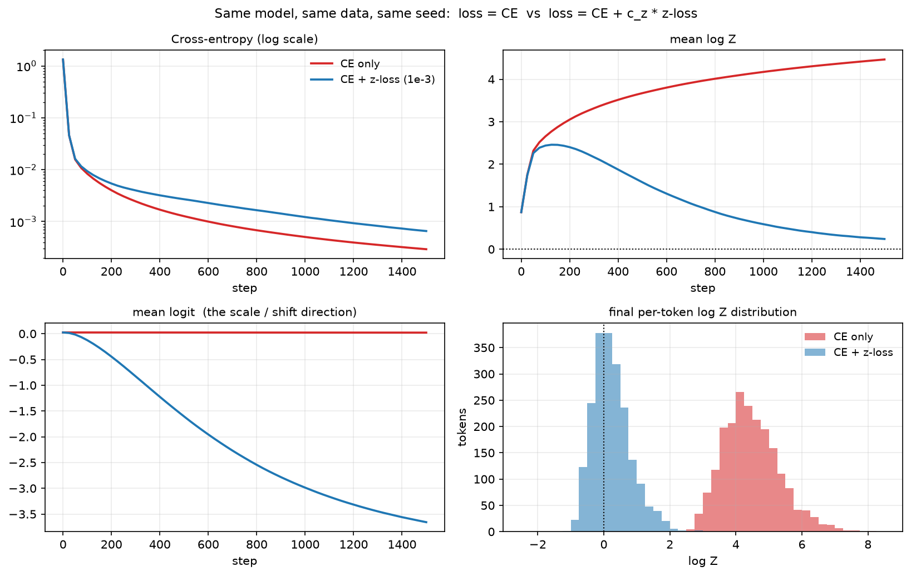

# z-loss

给 softmax 的 logits 加一个尺度约束：只惩罚配分函数 `log Z`，一行 `logsumexp` 就能实现。
作用是不让 logit 无限变大，同时不干扰概率分布本身的学习。

## 是什么

```math
L_z=\frac{c_z}{B}\sum_{b=1}^{B}\left(\log Z_b\right)^2,
\qquad
Z_b=\sum_{j=1}^{N}e^{z_{b,j}}
```

`z` 是 softmax 之前的 logits，`N` 是类数（MoE 里是专家数），`B` 是 token 数，`c_z` 一般取 `1e-3`。
实现：`z_loss.py`。

**为什么需要。** softmax 对 logits 的整体平移不敏感，交叉熵的梯度 `p - y` 满足
`Σ(p_j - y_j) = 0`，与"全体加同一个常数"这个方向严格正交。于是平移是一条**平坦方向**：
在可分数据上，预测早就定型，logits 仍会一路往上长，`log Z` 跟着涨。后果是 fp16 下
`exp(z)` 在 `z > 11.09` 溢出；bf16 下 8 位有效精度分辨不出 top-1 / top-2 的差距，router
概率饱和、梯度消失。

z-loss 就是在平移这条平坦方向上装一根弹簧，它的最优集是

```math
\log Z=0\iff\sum_{j=1}^{N}e^{z_j}=1
```

两个性质决定了它好用：

1. **只钉住 1 个自由度。** 最优集是一张 `N-1` 维流形，logits 的"形状"完全留给交叉熵，
   两者不冲突。
2. **顺带压平分布。** 梯度是 `2 log Z · p`，可拆成平移分量与 `2 log Z (p - 1/N)` 的形状
   分量；后者把概率往均匀推。所以系数不能调大，否则路由变糊。

## 怎么用

```python
def z_loss(logits, mask=None):
    if logits.dtype in (torch.bfloat16, torch.float16):
        logits = logits.float()                 # 保险丝要放在 fp32 里
    log_z = torch.logsumexp(logits, dim=-1)     # 内部 max-shift，不会溢出
    per = log_z.square()
    if mask is None:
        return per.mean()
    m = mask.reshape(-1).to(per.dtype)
    return (per.reshape(-1) * m).sum() / m.sum().clamp_min(1.0)

loss = ce + 1e-3 * z_loss(router_logits, mask=attention_mask)   # MoE 路
```

四个坑：

- 必须传 **softmax 之前的 logits**。传概率进去等于对 $`\log\sum_j p_j=\log 1=0`$ 求平方，恒为 0。
- 在 **fp32** 里算，bf16 算它等于把保险丝放在火上。
- MoE 要传 **mask**，padding token 也会被路由，会稀释分母。
- 系数从 **1e-3** 起（ST-MoE 默认值），别超过 `1e-2`。

## 效果

- **它让 `log Z` 停下来。** 没有 z-loss 时 `log Z` 随训练单调上涨（平移是平坦方向，没人管）；
  加上之后被钉在 0 附近，越偏拉得越狠（梯度大小 `∝ |log Z|`），等于一个自适应的软约束。
- **不动主任务的最优解。** 最优集是整张 `N-1` 维流形，任意形状的 logits 都能找到对应的平移
  让它落在最优集上，所以交叉熵的解不受影响。
- **代价是压平。** 形状分量会把分布推向均匀，`c_z` 太大时路由分化变差、专家利用度下降。
- **数值上直观可查。** 跑 `python3 z_loss.py`：

```text
[梯度校验] True                 # 解析梯度与 autograd 一致
[平移] softmax 差值 2.8e-17 | logZ 差值 2.0    # softmax 无视平移，logZ 平移多少涨多少
[极小值] z = -log(8) 时的 z-loss: 0.0          # Σe^z = 1 时惩罚为 0
[精度] bf16 logits -> torch.float32 11503.125 | 朴素 log(exp(z).sum()): inf
```

最后一行是它存在的最直接理由：同样的 logits，`logsumexp` 算得出来，`log(exp(z).sum())` 已经溢出。
（`|z|` 到 10 上下时，bf16 已经分不清 top-1 与 top-2 的差距；z-loss 把尺度压住，等于把这个分辨率
还给 router。）

### 实测对照

`z_loss.py` 的 `compare()`（`python3 z_loss.py` 会先跑自检再跑这一节）：同一模型、同一数据、
同一 seed，管线只用官方的 `nn.Linear` + `F.cross_entropy` + `AdamW`，唯一差别是
`loss += 1e-3 * z_loss(logits)`，跑 1500 步。

| 设置 | CE | 平均 `log Z` | 平均 logit | max logit | 准确率 |
| --- | --- | --- | --- | --- | --- |
| 只算 CE | 2.9e-4 | 4.465 | 0.02 | 8.20 | 100% |
| CE + z-loss | 6.6e-4 | 0.240 | -3.66 | 2.90 | 100% |



四张图分别是：CE（两条几乎重合，都在 1e-4 量级）、平均 `log Z`（唯一大幅分叉的地方，
4.47 对 0.24）、平均 logit（z-loss 把整体平移压到负值，CE 那条一直停在 0 附近）、以及终态
per-token `log Z` 的分布（无 z-loss 堆在 4.5，有 z-loss 堆在 0）。结论：准确率和 CE 量级都不变，
**差别全落在尺度上**——`max logit` 从 8.2 降到 2.9（fp16 的上溢阈值是 11.09），代价是
部分 token 的 logit 被推到更深的负值，负侧下溢成 0，不影响结果。
