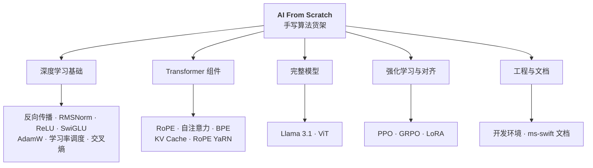

<p align="center">
  <h1 align="center">AI From Scratch</h1>
  <p align="center">
    <b>手写 AI 核心算法 · 每个文件夹一个独立算法单元</b>
    <br/>
    <i>原理讲清楚，代码能跑通，数值对得上。</i>
  </p>
</p>

<p align="center">
  <a href="https://www.python.org/"></a>
  <a href="https://pytorch.org/"></a>
  <a href="./LICENSE"></a>
  <a href="https://github.com/donglinAI/ai-from-scratch/stargazers"></a>
  <a href="https://github.com/donglinAI/ai-from-scratch/network/members"></a>
</p>

---

## 这是什么

这是一个**手写 AI 核心算法的独立单元合集**。每个文件夹对应一个算法或模型，自成一个完整的、可独立取用的单元：

```
<模块目录>/
├── README.md     # 算法原理：公式推导、直觉解释、对照验证
└── *.py          # 实现代码：单文件、少封装、可直接运行
```

它**不是一门按顺序学习的课程**，而是一个可以随手翻开的**算法货架**——你想看 RoPE 就看 RoPE，想看 PPO 就看 PPO，每个单元都不依赖其他单元，读哪个、跑哪个都行。

每个模块都围绕同一套标准来写，回答三件事：

1. **公式怎么变成代码**——保留关键计算步骤、张量形状和梯度传播过程；
2. **组件怎么协同工作**——从最小算子走到能跑的完整链路；
3. **结果怎么验证正确**——内置断言、参考实现对照、数值检查和可视化实验。

代码尽量保持**单文件、少封装、可运行**，适合逐行阅读、二次修改和借鉴到自己项目里。如果能帮到同样在啃这些算法的你，就是它最大的价值。

## 架构总览



## 算法目录

> 状态说明：✅ 已实现 · 🚧 筹备中

### 深度学习基础

| 模块 | 一句话说明 |
|:---|:---|
| [01 · 反向传播与自动微分](./01-backpropagation-from-scratch) ✅ | 纯 Python 手写标量计算图、拓扑排序与反向传播，用 MLP 求解 XOR，附 PyTorch 对照 |
| [04 · RMSNorm](./04-rms-norm) ✅ | RMSNorm / LayerNorm、PreNorm / PostNorm 对比实验，以及解析梯度推导 |
| [05 · ReLU](./05-relu) ✅ | 自定义 `autograd.Function` 前向与反向、激活曲线、死亡神经元实验 |
| [06 · SwiGLU](./06-swiglu) ✅ | 门控前馈网络、SiLU 性质、激活与梯度曲线，与 Llama MLP 数值对照 |
| [07 · AdamW](./07-adamw) ✅ | 一阶矩、二阶矩、偏差修正与解耦权重衰减，与 `torch.optim.AdamW` 对照 |
| [08 · 学习率调度](./08-lr-scheduler) ✅ | Linear Warmup、Cosine Decay、多参数组与调度器状态保存 / 恢复 |
| [09 · 交叉熵与 Focal Loss](./09-cross-entropy-loss) ✅ | 类别权重、`ignore_index`、Label Smoothing、Focal Loss，以及信息论可视化 |

### Transformer 组件

| 模块 | 一句话说明 |
|:---|:---|
| [02 · 旋转位置编码 RoPE](./02-rotary-position-embedding) ✅ | 标准 RoPE、Llama 3.1 频率缩放、频率曲线可视化与中文推导笔记 |
| [03 · 自注意力机制](./03-self-attention) ✅ | MHA / GQA、因果掩码、缩放点积注意力，与 Hugging Face 数值对照 |
| [13 · BPE 分词器](./13-bpe) ✅ | 字节级 BPE 训练、编码、解码、词表保存与加载 |
| [14 · KV Cache](./14-kv-cache) ✅ | 静态缓存、Prefill / Decode、因果掩码，以及增量解码与全量重算一致性检查 |
| [19 · RoPE YaRN 缩放](./19-rope-yarn) ✅ | Llama-3.1 三段式 RoPE 缩放（8K → 128K），完整数学推导 + 最小可运行实现 |

### 完整模型

| 模块 | 一句话说明 |
|:---|:---|
| [10 · Llama 3.1 推理](./10-llama-from-scratch) ✅ | GQA、RoPE Scaling、RMSNorm、SwiGLU、KV Cache、Safetensors 权重加载与文本生成 |
| [11 · Vision Transformer](./11-vit-from-scratch) ✅ | Patch Embedding、CLS Token、位置编码、Pre-LN Transformer Block 与分类头 |

### 强化学习与对齐

| 模块 | 一句话说明 |
|:---|:---|
| [17 · PPO](./17-ppo) ✅ | 从策略梯度到 GAE、重要性采样、Clip 截断的完整推导，CartPole 单文件从零训练到满分 |
| [15 · LoRA](./15-lora) 🚧 | 低秩适配微调（参数高效微调），筹备中 |
| [18 · GRPO](./18-grpo) 🚧 | 分组相对策略优化，筹备中 |

### 工程与文档

| 模块 | 一句话说明 |
|:---|:---|
| [12 · 开发环境](./12-environment) ✅ | AutoDL 初始化脚本，以及 Git / GitHub 配置说明 |
| [16 · ms-swift 文档](./16-ms-swift-doc) ✅ | ms-swift 框架的完整文档与最佳实践 |

## 快速开始

### 1. 克隆仓库

```bash
git clone https://github.com/donglinAI/ai-from-scratch.git
cd ai-from-scratch
```

### 2. 准备环境

建议使用 **Python 3.10 或更高版本**。基础模块主要依赖 PyTorch，可视化脚本额外使用 NumPy 和 Matplotlib。

```bash
python -m venv .venv
source .venv/bin/activate
python -m pip install --upgrade pip
pip install torch numpy matplotlib
```

如需 GPU，请根据 CUDA 版本选择对应的 [PyTorch 安装命令](https://pytorch.org/get-started/locally/)。Llama 推理及部分参考实现对照还需要：

```bash
pip install transformers safetensors modelscope
```

PPO 模块额外依赖：

```bash
pip install gymnasium
```

### 3. 运行某个模块

大多数脚本可以直接执行；包含本地导入的脚本，建议先进入对应目录再运行。

```bash
# 反向传播：纯 Python 手写自动微分，求解 XOR
cd 01-backpropagation-from-scratch
python xor_python.py

# RoPE：标准实现与 Llama 3.1 频率缩放
cd ../02-rotary-position-embedding
python rope.py

# PPO：CartPole 从零训练
cd ../17-ppo
python ppo.py
```

## Llama 3.1：从权重加载到文本生成

[llama31_inference.py](./10-llama-from-scratch/llama31_inference.py) 将完整推理链路集中在一个文件中：

```text
配置解析 → RoPE / GQA / RMSNorm / SwiGLU → Decoder Layer
        → Safetensors 分片权重加载 → Prefill → KV Cache 增量解码 → 采样输出
```

用 Tiny 配置做数值自检（无需下载真实权重）：

```bash
cd 10-llama-from-scratch
python llama31_inference.py --check
```

真实模型推理：

```bash
python llama31_inference.py \
  --prompt "用一句话解释 RoPE 是什么。" \
  --device cuda \
  --max-new-tokens 128 \
  --stats
```

默认从 ModelScope 获取 `LLM-Research/Meta-Llama-3.1-8B-Instruct`，也可通过 `--model` 指定本地权重目录。真实 8B 模型对磁盘、内存或显存要求较高，模型下载与使用还需遵守对应模型许可。

## 配套讲解视频

每个模块都尽量配套「理论篇 + 代码篇」讲解，理论篇侧重公式与直觉，代码篇侧重实现细节与调试过程。

| 模块 | 理论讲解 | 代码讲解 |
|:---|:---|:---|
| Backpropagation | 筹备中 | 筹备中 |
| RoPE | [旋转位置编码：理论篇](https://www.xiaohongshu.com/explore/6ad1ba3a00000000150052f8?xsec_token=ABQLRD8o_3HJsGCDwgRpJa1bf-p-8FKj3DAtyvIdiEeIw=&xsec_source=pc_user) | [旋转位置编码：代码篇](https://www.xiaohongshu.com/explore/6ad31eb3000000001a0211d2?xsec_token=ABKTNiA1JoS16skb7UebVOv_Rkrq_uTDf72VRh1ho_Ej4=&xsec_source=pc_user) |
| Self-Attention | [自注意力机制：理论篇](https://www.xiaohongshu.com/explore/6ad70acf000000002f03237d?xsec_token=ABj7eZjkQn7TJR4pfqLdYHEmtDECd8NPpmPz8YVDwI5cs=&xsec_source=pc_user) | [自注意力机制：代码篇](https://www.xiaohongshu.com/explore/6ad89540000000002c03b9e5?xsec_token=ABLnasY4rP1yhaEgpoGOe3pPNWXa2oSV_5fbys4lX9pGo=&xsec_source=pc_user) |
| RMSNorm | [均方根层归一化：理论篇](https://www.xiaohongshu.com/explore/6ae176b400000000340245ec?xsec_token=ABEUFAX6mC_j6-TeXgzNjC4bMFgzzrJJIDSGeHB6JS3mo=&xsec_source=pc_user) | [均方根层归一化：代码篇](https://www.xiaohongshu.com/explore/6af3d658000000002b010a94?xsec_token=ABls6L9vohmIqvtO3HjjVjAVn0065pAzCq-sFRUrZ95G0=&xsec_source=pc_user) |
| ReLU | [ReLU 激活函数：理论篇](https://www.xiaohongshu.com/explore/6ae5cd66000000001200b47b?xsec_token=ABZDUmuy1o3zs5tBuIW9VNi-2yYAlEoQTd2zymzTPHmpU=&xsec_source=pc_user) | 筹备中 |
| SwiGLU | [SwiGLU 激活函数：理论篇](https://www.xiaohongshu.com/explore/6ae730070000000006021a0b?xsec_token=YBHEE_PYJMEN8q-eGa1fBAl3RL1S1MyRByzo4coXDd14w=&xsec_source=pc_creatormng) | 筹备中 |
| AdamW | [AdamW 优化器：理论篇](https://www.xiaohongshu.com/explore/6ae81e580000000019002e2c?xsec_token=YBodqmf6y_frpJyAv4SP0qiiCCW5_hd38xbPaCI5fA4Qs=&xsec_source=pc_creatormng) | 筹备中 |

## 后续规划

以下方向尚未在当前仓库中实现，欢迎通过 Issue 一起讨论优先级：

- **计算机视觉**：CNN、ResNet、目标检测、图像分割与视觉预训练；
- **多模态**：CLIP、跨模态注意力、图文检索、视觉语言模型与多模态对齐；
- **图像生成与 Diffusion**：Autoencoder、VAE、GAN、U-Net、DDPM、DDIM、Latent Diffusion 与 Stable Diffusion 最小复现；
- **训练与对齐**：分布式训练、混合精度、梯度累积、Checkpoint、RLHF、DPO 与奖励模型；
- **推理与算子**：连续批处理、PagedAttention、量化、CUDA / Triton 算子。

## 参与贡献

欢迎提交 Issue 或 Pull Request，尤其欢迎：

- 修复公式、代码、注释或视频中的错误；
- 补充边界条件、数值测试和最小复现示例；
- 在保持可读性的前提下改进实现；
- 完善中文笔记、图示与模块讲解。

提交代码时，建议同时说明运行环境、验证方式和预期结果，避免引入仅能运行但难以阅读的黑盒封装。

## License

本项目基于 [MIT License](./LICENSE) 开源。第三方模型、权重和依赖库遵循其各自的许可协议。

## 致谢

感谢 [PyTorch](https://pytorch.org/)、[Hugging Face Transformers](https://github.com/huggingface/transformers) 与 [ModelScope](https://github.com/modelscope/modelscope) 等开源项目提供的参考实现和工具支持。

如果这个项目帮你把某个抽象概念真正写成了代码，欢迎 Star、交流或提出改进建议。
